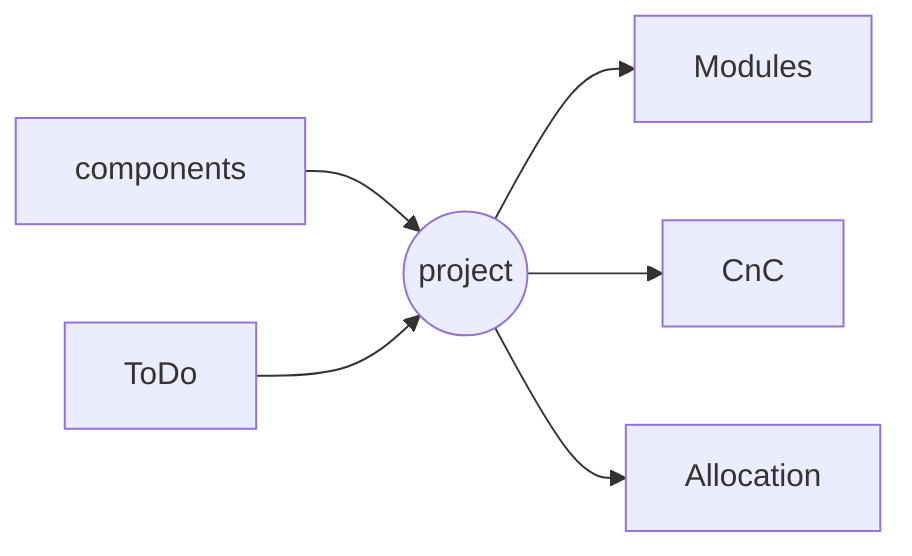

# The condenced guide to writing Software Architecture Documentation

## Introduction

### Purpose

Condenced description of a way to approch the creation/writing of the Sotfware Architecture Documentation.

#### The purpose of documenting the architecture

The goal of documenting an architecture is to write it down so that others can successfully use it, maintain it, and build a system from(Cle02,p20)

### References

- Bas03: Software Architecture in Practice, Second Edition, ISBN: 0-321-15495-9
- Cle02: Documenting Software Architectures: Views and Beyond, ISBN: 0-201-70372-6
- Cle11: Documenting Software Architectures - Views and Beyond - Second Edition, ISBN 978-0-321-55268-6
- [Examples and templates](https://wiki.sei.cmu.edu/confluence/display/SAD)
- Sun06 Read Me First!: _A Style Guide for the Computer Industry, Second Edition_ By Sun Technical Publications ISBN: 0-13-142899-3 Publisher: Prentice Hall

### Vocabulary

- Component - refers to entities like e.g. a service that handles connections from users. Or a message broker.

### Overview

The "Software Architecture Documentation" concept is used for documenting large project.

In this document 'Component' refers to entities like e.g. a service that handles connections from users. Or a message broker.

In a small project with few components you may be able to have single part/chapter for each component. In the component part all aspects of the component will be explained.
Having a single part for a component still poses the challenge of where to document how two components communicate with each other:

- Explain the interaction in one part and refer to that explanation in the other part.
- Explain the interaction in both parts.

When you have a large project with a high number of components it becomes challenging to find the specific information you are looking for due to the sheer amount of information you have to go through.

#### Software Architecture Documentation view packet concept

With "Software Architecture Documentation" you split the document into view packets.

A view packet will contain information about an aspect of a component or collection of components.

e.g The description of the EdgeConnector Component would be split into the following view packets

- What EdgeConnector consists of
- What Edgeconnector requires to work, e.g. WebSocket library.
- What other components the Edgeconnector communicate with.
- How the EdgeConnector is deployed.
- How the EdgeConnector is installed.
- What team is responsible for EdgeConnector.

A view packet is the smallest cohesive bundle of documentation that you would give to a stakeholder, such as a development team or a subcontractor(Cle03, p139).

The aspect have three major types:

- Modules - the system as units of implementation
- Component and Connectors(CnC) - the system as units of runtime execution
- Allocation - the mapping from software elements to environmental structures

Each of the major type have their own list of styles, to provide a more targeted way to describe an apsect.

Each of of the types have the following styles:

- Module
  - Aspect - describe particular modules called aspects that are responsible for crosscutting concerns(Cle11,p65) TODO what is this?
  - Data model - how the relations among data entities(Cle11,p65) TODO What is this?
  - Decomposition - presents the functionality of a system understanable modules that grows ever more detailed as you dive deeper.
  - Generalization - TODO: When modules have a generalization relationship, the parent module is a more general version of the child modules. (The parent module owns the commonalities, and the variations are manifested in the children.) (Cle11, 82)
  - Layered - used to describe the allowed-to-use relation in a restricted fashion between groups of modules called layers(Cle11,p65)
  - Uses - Show what a module requires to operate correctly.
- Component and Connectors(CnC)
  - client-server - components interact by requesting services of other components. The essence of this style is that communication is typically paired and initiated by the client(,99).
  - Multi-tier - TODO
  - Peer-to-peer - components directly interact as peers by exchanging services.
  - Pipe-and-filter - A filter transforms data that it receives through one or more pipes and transmits the result through one or more pipes.
  - Publish-subscribe - components interact via announced events.
  - Service-Oriented Architecture - a collection of distributed components that provide and/or consume services.
  - Shared-data - The data has multiple accessors and at least one shared-data store for retaining persistent data(,94)
- Allocation
  - Deployment - In the deployment style it is shown which logical groups components are assigned to(Cle11, p191)
  - Install - shows how major modules and components and installed(Cle11, p200).
  - Other allocations -
  - Testing - Show what major testing is done to significant modules.
  - Work assignment - Show which signinicant modules belong to what groups. (Cle11, p190).

#### Relation between the "4+1 view" and DocArch

(Bas03, p41)

- Logical = Module view
- Process = component-and-connector
- Developement = Allocation
- Physical = allocation

#### Stakeholders and the Architecture Documentation view packets the stakeholders might find most useful

(Bas03, p205)

Source: (Cle11,p326)

| Stakeholder          | M-Decomp | M-Uses | M-Layer | M-Gen | C&C | A-Depl | A-Imp | A-inst | A-work |
| -------------------- | -------- | ------ | ------- | ----- | --- | ------ | ----- | ------ | ------ |
| Analyst              | d        | d      | d       | s     | s   | d      |       | s      | .      |
| Architect            | d        | d      | d       | d     | d   | d      | s     | d      | s      |
| Customer             |          |        |         |       |     | o      |       |        | .      |
| Dev team             | d        | d      | d       | d     | d   | s      | s     | d      | .      |
| End user             |          |        |         |       | s   | s      |       | o      | .      |
| Infrastructure supp  | s        | s      |         |       | s   | d      | d     | o      | .      |
| Maintainer           | d        | d      | d       | d     | d   | s      | s     |        | .      |
| New stakeholder      | x        | x      | x       | x     | x   | x      | x     | x      | x      |
| Prod line app bld    | d        | d      | o       | s     | s   | s      | s     | s      | .      |
| Projet Manager       | s        | s      | s       |       |     | d      |       |        | d      |
| Test and Integration | d        | d      | d       | d     | s   | s      | s     | d      | .      |

- d: detailed information
- s: some details
- o: overview information
- x: anything
- .: ignore, for formating rule purposes.

See also Choosing the Views(Cle11, p315).

## Process architecture documentation

- Initially put all the relevant data into the viewpacket, then later you might want to go into more details by creating a child view packet and then move the detail information into the child view.
  - This is probably guided by when the information becomes too dense in the current packet.

- Create the document from the template.
- Start with the Module Decomposition module and describe the whole product in there.
- From there go where it makes sense to you
  - Usually for me, I do Module use for the next view packet,
  - The more module decomposition, possibly start on the CnC.

### Documentation principles

- Rule 1: Write Documentation from the Reader’s Point of View(Cle11, p36)
  - Introduce only one new subject per paragraphs/line?
  - Introduce the information right before the reader needs it?
  - Find out who your readers are, what they know, and what they expect of the document(Cle11, p37).
  - Avoid unnecessary insider jargon(Cle11, p37).
  - Avoid overuse of acronyms. Resist using an acronym when the spelled-out phrase is short or it appears only a few times(Cle11, p37).
- Rule 2: Avoid Unnecessary Repetition(Cle11, p37)
  - However, at times the cost to the reader of not repeating information in the other places where it’s needed is high. Readers don’t like to flip pages or click hyperlinks unnecessarily(Cle11, p38).
- Rule 3: Avoid Ambiguity(Cle11, p40)
  - Ambiguity occurs when documentation can be interpreted in more than one way and at least one of those ways is incorrect(Cle11, p40).
    - It is far better to be explicit and wrong than to be vague.
      - —Frederick Brooks, Jr. (1995, p. 259)
  - A well-defined notation with precise semantics goes a long way toward eliminating whole classes of linguistic ambiguity from a document(Cle11, p40).
- Rule 3a: Explain Your Notation(Cle11, p40)
  - The ubiquitous box-and-line diagrams that people always draw on whiteboards are one of the greatest sources of ambiguity in architecture documentation(Cle11, p40).
  - Make it as easy as possible for your reader to determine the meaning of the notation(Cle11, p41).
- Rule 4: Use a Standard Organization(Cle11, p43)
  - Establish a standard, planned organization scheme, make your documents adhere to it, and ensure that readers know about it(Cle11, p43).
  - Organize documentation for ease of reference. Software documentation may be read from cover to cover at most once, probably never(Cle11, p43).
  - Don’t leave any section blank; mark as "TBD" what you don’t yet know or "NA" what you know is not applicable(Cle11, p44).
- Rule 5: Record Rationale(Cle11, p44)
  - For the most important decisions, you should record why you made them the way you did(Cle11, p44).
  - You should also record the important or most likely alternatives you rejected and state why(Cle11, p44).
    - Later, when those decisions come under scrutiny or pressure to change, you will find yourself revisiting the same arguments and wondering why you didn’t take another path.
    - Recording your rationale will save you enormous time in the long run, although it requires discipline to record your rationale in the heat of the moment(Cle11, p44).
- Rule 6: Keep Documentation Current but Not Too Current(Cle11, p44)
- Rule 7: Review Documentation for Fitness of Purpose(Cle11, p45)

### Write clearly and simply

- Short, uncomplicated sentences
  - Use simple declarative and imperative sentence structures.
  - Use active voice
  - present tense
  - concrete, meaningful words.
  - Use terms consistently.
- Keep paragraphs short:
  - Limit each paragraph to one idea.
  - Make the topic sentence the first sentence in each paragraph.
  - Emphasize main points.
  - Keep paragraphs from three to five sentences long.
  - Limit paragraphs to 75 words or fewer.
  - TODO include StandardParagraph description
- Condense text; Write concisely and eliminate unnecessary material: you need to know not only what readers need, but what they do not need
  - Do not include unnecessary definitions and explanations, or information that is too technical for readers' needs.
  - Eliminate "nice to know" or overly detailed information.
  - Avoid flowery language, such as "great" and "amazing," buzzwords, and unsupported claims.
  - Eliminate introductory text that repeats the content in the headings.
  - Avoid writing introductions to figures or tables that repeat the figure or table caption.
  - Omit redundant figure callouts.
    - or other screen features that already have a self explanatory name. E.g. Delete, Copy etc.
  - Do not duplicate instructions on how to use a graphical user interface (GUI).
  - Do not make text so short that it seems "dumbed down," choppy, abrupt, confusing, or incomplete.
    - You do not want to sacrifice content, readability, quality, tone, or flow.
  - if topics can be read in any order, you might need to link to or repeat some information to provide sufficient context for readers.
    - Use links to make text seem shorter
    - Replace text with tables, charts, and figures, when possible.
- Write meaningful headings and subheadings: Write as a short, precise abstracts of their associated content
  - Headings are often displayed out of context in a search results list or bookmark menu.
  - To construct scannable headings, follow the guidelines in "Headings"
  - Avoid starting headings with articles or with a technical term that begins with a lowercase letter(Sun06, ch2).
  - Do not repeat the exact text of higher-level headings in subheadings, or the text of chapter titles in section headings.
  - Include some text before the initial first-level heading in a chapter.
  - Some documentation groups add qualifiers to headings and subheadings to identify the type of information that is contained in a section, such as overviews, tasks, and reference material.
    - If you use qualifiers, do so consistently within the documentation set.
    - Booting a System (Overview)
    - Shutting Down a System (Tasks)
- Use bulleted lists: Bulleted lists are ideal for online documents because they emphasize information in a concise format that encourages scanning.
  - Use bulleted lists to break up long paragraphs.
  - Use more lists online than you would on a typical printed page.
  - Avoid having more than nine items in a list.
  - Use concise phrases.
    - Concise phrases are easier to scan than complete sentences.
  - Write the first sentence as a concise summary if a list item consists of two or more sentences.
- Use jump lists: A jump list provides a clickable list of topics that helps readers scan and navigate in an online document.
  - The contents within a chapter or section
  - All procedures, including those that are part of a long, complex task
  - A list of related topics that are typically cross-referenced in print documents
  - When you create a jump list, consider; briefly explaining the content of each list item so that readers can decide which links to traverse
    - Emphasize key words and phrases in bold.

## View packet template

The sections of a view packet are:

- Primary presentation
  - Shows the elements and the relationship among those that populate the view(Bas03, p206)
  - Both graphical and textual
- Context diagram
  - Shows how the component depicted in this view packet relates to its environment(Bas03, p208).
- Element catalog
  - Details at least those elements and relations depicted in the primary presentation, and perhaps others that are not i the primary presentation(Bas03, p207).
- Element catalog - Elements and their properties
  - names each element in the view packet and lists the properties of that element.
- Element catalog - Relations and their properties
  - the specific relation type(s) that are depicts among the elements in this view.
- Element catalog - Element interfaces section
  - An interface is a boundary across which elements interact or communicate with each other.
- Element catalog - Element behavior
  - Some elements have complex interactions with their environment, which will be descriped here.
- Variability guide
  - What can be cusotmized to allow this element to be used in a different way than how it works in this description(cel11,23)
- Architecture background
  - explain to someone why the design is as it is and to provide a convincing agument that it is sound(Bas03, p208)
- Architecture background - Design rationale
  - The architect explains why the design decisions reflected in the view packet were made and gives a list of rejected alternatives and why they were rejected.
- Architecture background - Result of Analysis
  - The architect should document the results of analyses that have been conducted, such as the results of performance or security analysis or a list of what would have to change in the face of a particular kind of system modification.
- Architecture background - Assumptions
  - The architect should document any assumptions he or she made when crafting the design. Assumptions are usually about either environment or need.
- Glossary of terms
  - Words used in the view, with a brief description of each(Bas03, p208).
- Other information
  - Content will vary according to the standard practices of your organization (Bas03, p208).
- Related view packets
  - (Bas03, p207).
  - Parent
    - Higher level viewpacket where this component is referenced.
  - Siblings
    - Other view packets describing the same component.
  - Children
    - More detailed viewpackets of the component.
