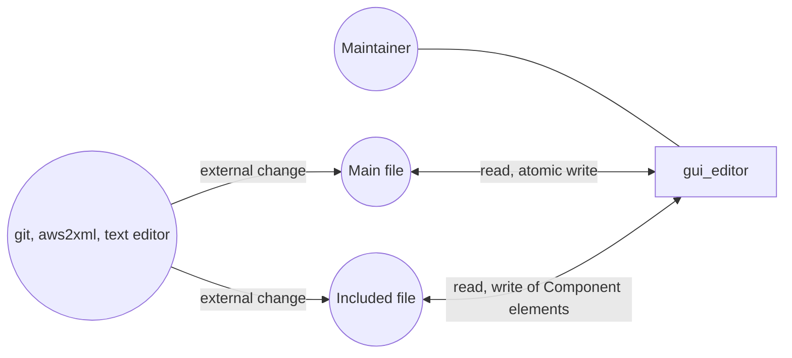
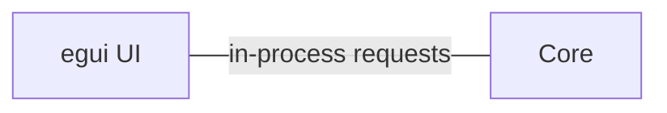

# GUI Editor Design

## Introduction

### Purpose

Design decisions for `gui_editor`, each with options, pros, cons, and a suggested choice.
Readers are the product owner, the architect, the planner, and the developers.

### Vocabulary

- Baseline: Content of a file as the editor last loaded or saved the file.
- Core: Project model, XML reader, XML writer, and in-memory SQLite database.
- External change: Change to a file on disk by any program other than the editor, for example `git pull`, `aws2xml`, or a text editor.
- INC-1: First increment after the MVP in `PLAN.md`.
- Included file: SAD XML file named by an `<Include>` element of the including project file.
- Main file: Project file the user selects; the file that holds the `<Include>` elements.
- SAD: Software Architecture Documentation.

### References

- Requirements: [REQUIREMENTS.md](REQUIREMENTS.md)
- Plan and task T-51: [PLAN.md](PLAN.md)
- Story cards: [USER_STORIES.md](USER_STORIES.md)
- SAD DTD: [software_architecture_documentation.dtd](../../sad_xml_sql/tests/software_architecture_documentation.dtd)

### Reading this document

Three organizational levels:

- Introduction (top)
  - Purpose, Vocabulary, References.
  - Overview: components and context that the decisions refer to.
- Component sections (bulk)
  - One section per component that owns a decision.
  - Each decision has a status, the problem, an example, the options, a comparison, and a suggested choice.
- Decision status values
  - Proposed, awaiting product owner review: the architect suggests a choice; nothing is decided.
  - Decided: the product owner chose; the requirements carry the choice.

### Overview

#### Primary components decomposition

| Name | Description | Reference |
| --- | --- | --- |
| Core | Reads, checks, holds, and writes SAD XML projects. | [Component: Core](#component-core) |
| egui UI | Edit and view windows, dialogs, and warnings. | [REQUIREMENTS.md](REQUIREMENTS.md#architecture-and-interface-overview) |

#### Overview context diagram



| Entity | Type | Description | Reference |
| --- | --- | --- | --- |
| git, aws2xml, text editor | Adjacent | Change project files outside the editor. | [REQUIREMENTS.md](REQUIREMENTS.md#feature-interaction) |
| gui_editor | The Work | Edits SAD XML projects. | [REQUIREMENTS.md](REQUIREMENTS.md) |
| Included file | Adjacent | SAD XML file named by an `<Include>` element. | GEDT-FR-00042 to GEDT-FR-00045 |
| Main file | Adjacent | SAD XML file the user selects. | GEDT-FR-00001, GEDT-FR-00004 |
| Maintainer | Adjacent | Edits and saves the project. | GEDT-STORY-00002, GEDT-STORY-00026 |

#### Primary components interconnection



| Entity | Type | Description | Reference |
| --- | --- | --- | --- |
| Core | Component | Detects external changes and writes files. | [Component: Core](#component-core) |
| egui UI | Component | Shows the save prompt and warnings. | GEDT-FR-00009, GEDT-FR-00045 |
| In-process requests | Connector | Rust function requests and error values. | GEDT-FR-00046 |

## Component: Core

The core loads the main file and its included files, holds the session, and writes each changed file on save.

### External change of an included file

Decision for open question 13 of [REQUIREMENTS.md](REQUIREMENTS.md#open-questions).

#### Status

Decided on 2026-11-25: option a, prompt for each changed included file.

- Product owner answer, quoted: "provide a prompt of file changed on disk with an option to overwrite".
- No requirement changes; GEDT-FR-00009 already covers every file.

#### Problem

A save writes the Component elements of an included file, GEDT-FR-00043, from task T-51 in INC-1 onward, under GEDT-STORY-00026.
The save keeps every other element of that file as on disk, GEDT-FR-00044.
Another program can change the included file between load and save.
The decision states what the save does with such a file.

Related requirements:

- GEDT-AR-00035: write only inside the directory of the main file, checked at write time.
- GEDT-FR-00009: ask before overwriting a file that changed on disk since the last load or save, also on autosave.
- GEDT-FR-00043: write to an included file only the Component elements loaded from that file.
- GEDT-FR-00044: keep the other elements of an included file unchanged.
- GEDT-FR-00045: warn about skipped edits on Save and exit.

The main file already follows GEDT-FR-00009: the editor asks, and on confirm the session version replaces the whole main file.

#### Example scenario

The scenario below runs through every option.

- The user opens `system.xml`, which includes `payments.xml` from the same directory.
- `payments.xml` holds component 3.0.0.5 "Ledger" and component 3.0.0.7 "Gateway".
- The user renames 3.0.0.5 to "Ledger service".
- In a terminal, the user runs `git pull`, which brings a teammate's change to `payments.xml`:
  - New Summary text on 3.0.0.7 "Gateway".
  - New component 3.0.0.9 "Fraud check".
  - New Team element.
- The user selects Save.

#### Option a: prompt for each changed included file

The GEDT-FR-00009 prompt covers each included file, one prompt per changed file.
On confirm, the save writes the session Component elements and copies every other element from the file as on disk at write time.
On decline, the save leaves the included file as on disk, and the edits stay unsaved in the session.

What the user sees:

```text
payments.xml changed on disk since you opened it.
Save your component edits into payments.xml?
Components changed or added outside the editor in this file are replaced by the editor version.
Teams, viewpackets, relations, and behaviors stay as they are on disk.
[Overwrite components]  [Keep file on disk]
```

Result in the example:

- Overwrite components: 3.0.0.5 is "Ledger service"; 3.0.0.7 has the old Summary; 3.0.0.9 is gone; the new Team stays.
- Keep file on disk: `payments.xml` keeps the teammate's change; the rename stays unsaved; the prompt returns on the next save, including the autosave 60 seconds later.

Pros:

- Same rule and same dialog as the main file, so the user learns one behaviour.
- GEDT-FR-00009 already says "a file", so option a needs no requirement change.
- The user decides; no edit and no external change is lost without a prompt.
- Overwrite loses less than for the main file, because the save keeps every non-Component element from disk.
- Lowest cost: reuses the change detection and dialog of the main file.

Cons:

- Overwrite drops external changes to Component elements, including components added outside the editor, such as 3.0.0.9.
- One prompt per changed file per save; after a decline, autosave asks again every 60 seconds until the user confirms or reopens the project.
- A user who clicks Overwrite by habit loses the teammate's component changes.

#### Option b: skip the changed included file without a prompt

The save writes the main file and every unchanged included file, and leaves a changed included file as on disk.
The user sees nothing.

Result in the example: `system.xml` is saved; `payments.xml` keeps the teammate's change; the rename is never saved.

Pros:

- No external change is ever lost.
- No prompt, no user effort.
- Low cost.

Cons:

- The user believes the rename is saved; the rename is lost at exit without notice.
- Breaks the GEDT-FR-00045 intent that no edit is lost silently.
- Differs from the main file, which prompts.
- Needs an amended GEDT-FR-00009.

#### Option c: the save fails

Before writing any file, the save checks every file; one changed included file fails the whole save with an error, GEDT-FR-00046 to GEDT-FR-00048.

What the user sees:

```text
Save failed: payments.xml changed on disk since you opened it.
No file was written. Your edits are still in the editor.
```

Result in the example: neither file is written; the project stays modified; autosave fails with the same error every 60 seconds.

Pros:

- No file changes without the user knowing; fails closed.
- Low cost; reuses the save error path.

Cons:

- No way out inside the editor: the user must revert `payments.xml` outside the editor, which drops the teammate's change, or close the editor and lose the edits.
- Blocks the save of the main file too, though the main file did not change.
- Differs from the main file, which prompts.
- Needs an amended GEDT-FR-00009.

#### Option d: skip the changed included file and warn

Like option b, but the save shows a non-modal warning, like GEDT-FR-00045.

What the user sees:

```text
Not saved: payments.xml changed on disk since you opened it.
Unsaved edits: 3.0.0.5 Ledger service.
Reopen the project to load the new file; your edits to this file are then lost.
```

Result in the example: `system.xml` is saved; `payments.xml` keeps the teammate's change; the rename stays unsaved, and the warning repeats on each Save and exit.

Pros:

- No external change is lost.
- The user knows which edits are not saved.
- Reuses the GEDT-FR-00045 warning.

Cons:

- The only way to keep the rename is to reopen the project and repeat the edit by hand.
- Differs from the main file, which prompts.
- Needs an amended GEDT-FR-00009.

#### Option e: merge by component, prompt on conflict

The core keeps the baseline Component elements of each included file.
At save, the core compares each component in three versions: baseline, session, and disk now.

- Changed only in the session: the save writes the session version.
- Changed only on disk, or added on disk: the save keeps the disk version and loads the disk version into the session.
- Changed in both: the editor asks the user for that component.

Result in the example: no prompt; 3.0.0.5 is "Ledger service"; 3.0.0.7 has the teammate's Summary; 3.0.0.9 stays; the new Team stays.

What the user sees only on a conflict, for example when the teammate also renamed 3.0.0.5 to "General ledger":

```text
Component 3.0.0.5 changed in the editor and in payments.xml.
Editor: Ledger service
On disk: General ledger
[Keep editor version]  [Keep disk version]
```

Pros:

- Lowest data loss: only true conflicts need a choice.
- Fewest prompts.

Cons:

- Highest cost: baseline snapshot, three-way compare, session reload, conflict dialog, and many test fixtures.
- Writes components that the session did not load, so GEDT-FR-00043 needs an amendment.
- Differs from the main file, which has no merge.
- More code that writes files, so more room for a merge defect that writes wrong data.

#### Comparison

| Criterion | a: prompt | b: skip silently | c: fail | d: skip and warn | e: merge |
| --- | --- | --- | --- | --- | --- |
| Consistency with the main file | Same | Different | Different | Different | Different |
| Data loss risk | Medium: on Overwrite, external Component changes | High: user edits lost silently | Medium: user must drop one side | Medium: user edits need manual redo | Low: conflicts only |
| Implementation and test cost | Low | Low | Low | Low to medium | High |
| Requirement change | None | GEDT-FR-00009 | GEDT-FR-00009 | GEDT-FR-00009 | GEDT-FR-00009, GEDT-FR-00043 |
| Security | Writes only after confirm and the GEDT-AR-00035 check | No write to the changed file | No write at all; fails closed | No write to the changed file | Most write logic; a merge defect writes wrong data |
| User effort | One click per changed file per save | None, until the loss shows | High: resolve outside the editor | Medium: redo edits after reopen | Low; one click per conflict |

#### Behaviour shared by all options

- Change detection compares a SHA-256 of the file bytes at the baseline with the bytes on disk just before the write.
  - A modification time compare misses two writes within the clock resolution.
- Every option that writes an included file repeats the GEDT-AR-00035 path check at write time.
- The save reads the changed file with the hardened reader, GEDT-AR-00010 to GEDT-AR-00013 and GEDT-AR-00031.
  - When the changed file fails parsing or the DTD rules, the save of that file fails with the GEDT-FR-00046 error and keeps the file.
- An external change between the final check and the rename is still lost; the window is the same as for the main file.
- No option writes Team elements to an included file, GEDT-FR-00043.

#### Suggested choice

Option a, prompt for each changed included file.
GEDT-FR-00009 already covers every file, so option a is the literal reading of the approved requirement and needs no change.
The user sees the same dialog and the same rule as for the main file, and nothing is lost without a prompt.
Option a costs the least in T-51, which is already size L.
The accepted cost is that Overwrite drops components changed or added outside the editor; the dialog text says so.
If included files often change during a session, for example through a team `git pull` workflow, option e is the upgrade path in a later increment.

#### Follow-up after the product owner decision

- The product owner chose option a on 2026-11-25.
- The architect closed open question 13 in [REQUIREMENTS.md](REQUIREMENTS.md#open-questions); no requirement changes.
- T-51 implements option a under GEDT-STORY-00026.
