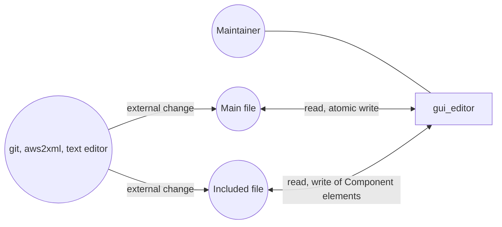
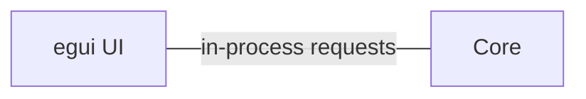

# GUI Editor Design

## Introduction

### Purpose

Design and implementation decisions for `gui_editor` and its build, each with the options considered, the chosen option, and the reason.
Readers are the product owner, the architect, the planner, and the developers.

### Vocabulary

- Baseline: Content of a file as the editor last loaded or saved the file.
- Core: Project model, XML reader, XML writer, and in-memory project store.
- External change: Change to a file on disk by any program other than the editor, for example `git pull`, `aws2xml`, or a text editor.
- INC-1: First increment after the MVP in `PLAN.md`.
- Included file: SAD XML file named by an `<Include>` element of the including project file.
- Main file: Project file the user selects; the file that holds the `<Include>` elements.
- SAD: Software Architecture Documentation.
- Tool image: Build image of GEDT-AR-00034, defined in `gui_editor/container/Containerfile`.

### References

- Requirements: [REQUIREMENTS.md](REQUIREMENTS.md)
- Plan and tasks: [PLAN.md](PLAN.md)
- Story cards: [USER_STORIES.md](USER_STORIES.md)
- SAD DTD: [software_architecture_documentation.dtd](../../sad_xml_sql/tests/software_architecture_documentation.dtd)
- Tool image definition: [Containerfile](../container/Containerfile)

### Reading this document

Three organizational levels:

- Introduction (top)
  - Purpose - one sentence on the system and the decisions recorded.
  - Vocabulary - glossary of uncommon terms.
  - References - requirement documents, plan, external standards.
  - Overview - scope, components, decision drivers, and a decision log table.
- Decision sections (bulk)
  - One section per decision, same pattern:
    - Status: Proposed, Accepted, Deprecated, or Superseded, with the date and the decision owner.
    - Context: the problem and the forces that shape it.
    - Drivers: requirements and quality attributes the decision must satisfy.
    - Options: each alternative with pros and cons.
    - Decision: the chosen option.
    - Rationale: why the chosen option beats the alternatives, or a plain statement that no reason was recorded.
    - Consequences: positive, negative, and follow-up work.
- A requirement in [REQUIREMENTS.md](REQUIREMENTS.md) states the need; this document holds the products, tools, files, and commands that meet the need.

### Overview

#### Design scope

The decisions cover the core of `gui_editor`, the save behaviour for included files, and the tool image and checks of the build.
The web app architecture is not decided and is outside this document.
No ICD exists yet; the components and context below stand in for one.

#### Primary components decomposition

| Name | Description | Reference |
| --- | --- | --- |
| Core | Reads, checks, holds, and writes SAD XML projects. | [DD-001](#dd-001-external-change-of-an-included-file) to [DD-010](#dd-010-no-editor-encryption) |
| egui UI | Edit and view windows, dialogs, and warnings. | [REQUIREMENTS.md](REQUIREMENTS.md#architecture-and-interface-overview) |
| Tool image | Runs the build, the tests, and the checks of the checked crates. | [DD-011](#dd-011-tool-image-base-variant) to [DD-016](#dd-016-advisory-database-location) |

#### Overview context diagram



| Entity | Type | Description | Reference |
| --- | --- | --- | --- |
| git, aws2xml, text editor | Adjacent | Change project files outside the editor. | [REQUIREMENTS.md](REQUIREMENTS.md#feature-interaction) |
| gui_editor | The Work | Edits SAD XML projects. | [REQUIREMENTS.md](REQUIREMENTS.md) |
| Included file | Adjacent | SAD XML file named by an `<Include>` element. | GEDT-FR-00042 to GEDT-FR-00045 |
| Main file | Adjacent | SAD XML file the user selects. | GEDT-FR-00001, GEDT-FR-00004 |
| Maintainer | Adjacent | Edits and saves the project. | GEDT-STORY-00002, GEDT-STORY-00026 |

#### Primary components interconnection



| Entity | Type | Description | Reference |
| --- | --- | --- | --- |
| Core | Component | Detects external changes and writes files. | [DD-001](#dd-001-external-change-of-an-included-file) |
| egui UI | Component | Shows the save prompt and warnings. | GEDT-FR-00009, GEDT-FR-00045 |
| In-process requests | Connector | Rust function requests and error values. | GEDT-FR-00046 |

#### Decision drivers

| ID | Driver | Source |
| --- | --- | --- |
| GEDT-AR-00001 | SAD XML files are the only persistent store. | [Storage](REQUIREMENTS.md#storage) |
| GEDT-AR-00007 | Interrupted save leaves old or new content. | [Storage](REQUIREMENTS.md#storage) |
| GEDT-AR-00009 | Project data stays in project files. | [Storage](REQUIREMENTS.md#storage) |
| GEDT-AR-00012 | Malformed input gives an error value, no panic. | [Security](REQUIREMENTS.md#security) |
| GEDT-AR-00016 | Query values are bound parameters. | [Security](REQUIREMENTS.md#security) |
| GEDT-AR-00025 | Locked dependencies, advisory and policy checks. | [Security](REQUIREMENTS.md#security) |
| GEDT-AR-00029 | UI frame under 100 ms during load and save. | [Performance](REQUIREMENTS.md#performance) |
| GEDT-AR-00030 | `sad2md` and `tui_editor` tests keep passing. | [Storage](REQUIREMENTS.md#storage) |
| GEDT-AR-00034 | Pinned official Rust base, pinned tools, shellcheck. | [Platforms](REQUIREMENTS.md#platforms) |
| GEDT-AR-00037 | Zero lint warnings. | [Platforms](REQUIREMENTS.md#platforms) |
| GEDT-AR-00038 | Standard Rust formatting. | [Platforms](REQUIREMENTS.md#platforms) |
| GEDT-AR-00039 | No unexempted duplicate crate versions. | [Build and supply chain](REQUIREMENTS.md#build-and-supply-chain) |
| GEDT-AR-00043 | Container writes only to three host paths. | [Build and supply chain](REQUIREMENTS.md#build-and-supply-chain) |
| GEDT-AR-00046 | Advisory data fetched fresh in each run. | [Build and supply chain](REQUIREMENTS.md#build-and-supply-chain) |
| GEDT-AR-00050 | x86_64 Linux is the only host platform. | [Platforms](REQUIREMENTS.md#platforms) |
| GEDT-AR-00055 | Zero shellcheck findings in checked crate scripts. | [Platforms](REQUIREMENTS.md#platforms) |
| GEDT-FR-00005 | Save without edits keeps DTD content. | [Storage](REQUIREMENTS.md#storage) |
| GEDT-FR-00009 | Ask before overwriting a file changed on disk. | [Storage](REQUIREMENTS.md#storage) |
| GEDT-FR-00018 | Offer only view values that `sad2md` processes. | [Viewpackets](REQUIREMENTS.md#viewpackets) |
| GEDT-FR-00037 | Cross-project reference is the component address. | [Multiple projects](REQUIREMENTS.md#multiple-projects) |
| GEDT-FR-00042 | Included file: load Component and Team only. | [Storage](REQUIREMENTS.md#storage) |
| GEDT-FR-00043 | Included file: write Component elements only. | [Storage](REQUIREMENTS.md#storage) |

#### Decision log

| ID | Title | Status | Date | Reference |
| --- | --- | --- | --- | --- |
| DD-001 | External change of an included file | Accepted | 2026-11-25 | [DD-001](#dd-001-external-change-of-an-included-file) |
| DD-002 | In-memory SQLite through sad_xml_sql | Accepted | Not recorded | [DD-002](#dd-002-in-memory-sqlite-through-sad_xml_sql) |
| DD-003 | Hardened shared library | Accepted | Not recorded | [DD-003](#dd-003-hardened-shared-library) |
| DD-004 | Cross-project references by address | Accepted | Not recorded | [DD-004](#dd-004-cross-project-references-by-address) |
| DD-005 | Atomic save | Accepted | Not recorded | [DD-005](#dd-005-atomic-save) |
| DD-006 | DTD rule check in Rust | Accepted | Not recorded | [DD-006](#dd-006-dtd-rule-check-in-rust) |
| DD-007 | Accepted save losses | Accepted | Not recorded | [DD-007](#dd-007-accepted-save-losses) |
| DD-008 | Editor-only reader option for included files | Accepted | Not recorded | [DD-008](#dd-008-editor-only-reader-option-for-included-files) |
| DD-009 | Component-only write-back for included files | Accepted | Not recorded | [DD-009](#dd-009-component-only-write-back-for-included-files) |
| DD-010 | No editor encryption | Accepted | Not recorded | [DD-010](#dd-010-no-editor-encryption) |
| DD-011 | Tool image base variant | Decided | 2026-11-27 | [DD-011](#dd-011-tool-image-base-variant) |
| DD-012 | Supply-chain check tools | Accepted | 2026-11-25 | [DD-012](#dd-012-supply-chain-check-tools) |
| DD-013 | Lint and format tools | Accepted | 2026-11-25 | [DD-013](#dd-013-lint-and-format-tools) |
| DD-014 | Shellcheck source | Accepted | 2026-11-27 | [DD-014](#dd-014-shellcheck-source) |
| DD-015 | Writable host paths | Accepted | 2026-11-25 | [DD-015](#dd-015-writable-host-paths) |
| DD-016 | Advisory database location | Accepted | 2026-11-25 | [DD-016](#dd-016-advisory-database-location) |
| DD-017 | Load and save off the UI thread | Accepted | Not recorded | [DD-017](#dd-017-load-and-save-off-the-ui-thread) |
| DD-018 | Source of ViewType and ViewStyle values | Accepted | Not recorded | [DD-018](#dd-018-source-of-viewtype-and-viewstyle-values) |

## DD-001: External change of an included file

### DD-001 Status

Accepted on 2026-11-25 by the product owner: option a, prompt for each changed included file.

- Decision for open question 13 of [REQUIREMENTS.md](REQUIREMENTS.md#open-questions).
- Product owner answer, quoted: "provide a prompt of file changed on disk with an option to overwrite".
- No requirement changes; GEDT-FR-00009 already covers every file.

### DD-001 Context

A save writes the Component elements of an included file, GEDT-FR-00043, from task T-51 in INC-1 onward, under GEDT-STORY-00026.
The save keeps every other element of that file as on disk, GEDT-FR-00044.
Another program can change the included file between load and save.
The decision states what the save does with such a file.
The main file already follows GEDT-FR-00009: the editor asks, and on confirm the session version replaces the whole main file.

#### Example scenario

The scenario below runs through every option.

- The user opens `system.xml`, which includes `payments.xml` from the same directory.
- `payments.xml` holds component 3.0.0.5 "Ledger" and component 3.0.0.7 "Gateway".
- The user renames 3.0.0.5 to "Ledger service".
- In a terminal, the user runs `git pull`, which brings a teammate's change to `payments.xml`:
  - New Summary text on 3.0.0.7 "Gateway".
  - New component 3.0.0.9 "Fraud check".
  - New Team element.
- The user selects Save.

### DD-001 Drivers

- GEDT-AR-00035: write only inside the directory of the main file, checked at write time.
- GEDT-FR-00009: ask before overwriting a file that changed on disk since the last load or save, also on autosave.
- GEDT-FR-00043: write to an included file only the Component elements loaded from that file.
- GEDT-FR-00044: keep the other elements of an included file unchanged.
- GEDT-FR-00045: warn about skipped edits on Save and exit.

### DD-001 Options

#### Option a: prompt for each changed included file

The GEDT-FR-00009 prompt covers each included file, one prompt per changed file.
On confirm, the save writes the session Component elements and copies every other element from the file as on disk at write time.
On decline, the save leaves the included file as on disk, and the edits stay unsaved in the session.

What the user sees:

```text
payments.xml changed on disk since you opened it.
Save your component edits into payments.xml?
Components changed or added outside the editor in this file are replaced by the editor version.
Teams, viewpackets, relations, and behaviors stay as they are on disk.
[Overwrite components]  [Keep file on disk]
```

Result in the example:

- Overwrite components: 3.0.0.5 is "Ledger service"; 3.0.0.7 has the old Summary; 3.0.0.9 is gone; the new Team stays.
- Keep file on disk: `payments.xml` keeps the teammate's change; the rename stays unsaved; the prompt returns on the next save, including the autosave 60 seconds later.

Pros:

- Same rule and same dialog as the main file, so the user learns one behaviour.
- GEDT-FR-00009 already says "a file", so option a needs no requirement change.
- The user decides; no edit and no external change is lost without a prompt.
- Overwrite loses less than for the main file, because the save keeps every non-Component element from disk.
- Lowest cost: reuses the change detection and dialog of the main file.

Cons:

- Overwrite drops external changes to Component elements, including components added outside the editor, such as 3.0.0.9.
- One prompt per changed file per save; after a decline, autosave asks again every 60 seconds until the user confirms or reopens the project.
- A user who clicks Overwrite by habit loses the teammate's component changes.

#### Option b: skip the changed included file without a prompt

The save writes the main file and every unchanged included file, and leaves a changed included file as on disk.
The user sees nothing.

Result in the example: `system.xml` is saved; `payments.xml` keeps the teammate's change; the rename is never saved.

Pros:

- No external change is ever lost.
- No prompt, no user effort.
- Low cost.

Cons:

- The user believes the rename is saved; the rename is lost at exit without notice.
- Breaks the GEDT-FR-00045 intent that no edit is lost silently.
- Differs from the main file, which prompts.
- Needs an amended GEDT-FR-00009.

#### Option c: the save fails

Before writing any file, the save checks every file; one changed included file fails the whole save with an error, GEDT-FR-00046 to GEDT-FR-00048.

What the user sees:

```text
Save failed: payments.xml changed on disk since you opened it.
No file was written. Your edits are still in the editor.
```

Result in the example: neither file is written; the project stays modified; autosave fails with the same error every 60 seconds.

Pros:

- No file changes without the user knowing; fails closed.
- Low cost; reuses the save error path.

Cons:

- No way out inside the editor: the user must revert `payments.xml` outside the editor, which drops the teammate's change, or close the editor and lose the edits.
- Blocks the save of the main file too, though the main file did not change.
- Differs from the main file, which prompts.
- Needs an amended GEDT-FR-00009.

#### Option d: skip the changed included file and warn

Like option b, but the save shows a non-modal warning, like GEDT-FR-00045.

What the user sees:

```text
Not saved: payments.xml changed on disk since you opened it.
Unsaved edits: 3.0.0.5 Ledger service.
Reopen the project to load the new file; your edits to this file are then lost.
```

Result in the example: `system.xml` is saved; `payments.xml` keeps the teammate's change; the rename stays unsaved, and the warning repeats on each Save and exit.

Pros:

- No external change is lost.
- The user knows which edits are not saved.
- Reuses the GEDT-FR-00045 warning.

Cons:

- The only way to keep the rename is to reopen the project and repeat the edit by hand.
- Differs from the main file, which prompts.
- Needs an amended GEDT-FR-00009.

#### Option e: merge by component, prompt on conflict

The core keeps the baseline Component elements of each included file.
At save, the core compares each component in three versions: baseline, session, and disk now.

- Changed only in the session: the save writes the session version.
- Changed only on disk, or added on disk: the save keeps the disk version and loads the disk version into the session.
- Changed in both: the editor asks the user for that component.

Result in the example: no prompt; 3.0.0.5 is "Ledger service"; 3.0.0.7 has the teammate's Summary; 3.0.0.9 stays; the new Team stays.

What the user sees only on a conflict, for example when the teammate also renamed 3.0.0.5 to "General ledger":

```text
Component 3.0.0.5 changed in the editor and in payments.xml.
Editor: Ledger service
On disk: General ledger
[Keep editor version]  [Keep disk version]
```

Pros:

- Lowest data loss: only true conflicts need a choice.
- Fewest prompts.

Cons:

- Highest cost: baseline snapshot, three-way compare, session reload, conflict dialog, and many test fixtures.
- Writes components that the session did not load, so GEDT-FR-00043 needs an amendment.
- Differs from the main file, which has no merge.
- More code that writes files, so more room for a merge defect that writes wrong data.

#### Comparison

| Criterion | a: prompt | b: skip silently | c: fail | d: skip and warn | e: merge |
| --- | --- | --- | --- | --- | --- |
| Consistency with the main file | Same | Different | Different | Different | Different |
| Data loss risk | Medium: on Overwrite, external Component changes | High: user edits lost silently | Medium: user must drop one side | Medium: user edits need manual redo | Low: conflicts only |
| Implementation and test cost | Low | Low | Low | Low to medium | High |
| Requirement change | None | GEDT-FR-00009 | GEDT-FR-00009 | GEDT-FR-00009 | GEDT-FR-00009, GEDT-FR-00043 |
| Security | Writes only after confirm and the GEDT-AR-00035 check | No write to the changed file | No write at all; fails closed | No write to the changed file | Most write logic; a merge defect writes wrong data |
| User effort | One click per changed file per save | None, until the loss shows | High: resolve outside the editor | Medium: redo edits after reopen | Low; one click per conflict |

### DD-001 Decision

Prompt for each changed included file, option a.

Behaviour shared by all options:

- Change detection compares a SHA-256 of the file bytes at the baseline with the bytes on disk just before the write.
  - A modification time compare misses two writes within the clock resolution.
- Every option that writes an included file repeats the GEDT-AR-00035 path check at write time.
- The save reads the changed file with the hardened reader, GEDT-AR-00010 to GEDT-AR-00013 and GEDT-AR-00031.
  - When the changed file fails parsing or the DTD rules, the save of that file fails with the GEDT-FR-00046 error and keeps the file.
- An external change between the final check and the rename is still lost; the window is the same as for the main file.
- No option writes Team elements to an included file, GEDT-FR-00043.

### DD-001 Rationale

- GEDT-FR-00009 already covers every file, so option a is the literal reading of the approved requirement and needs no change.
- The user sees the same dialog and the same rule as for the main file, and nothing is lost without a prompt.
- Option a costs the least in T-51, which is already size L.

### DD-001 Consequences

- Overwrite drops components changed or added outside the editor; the dialog text says so.
- If included files often change during a session, for example through a team `git pull` workflow, option e is the upgrade path in a later increment.
- The architect closed open question 13 in [REQUIREMENTS.md](REQUIREMENTS.md#open-questions); no requirement changes.
- T-51 implements option a under GEDT-STORY-00026.

## DD-002: In-memory SQLite through sad_xml_sql

### DD-002 Status

Accepted by the architect; date not recorded.
The decision confirms the business-analyst assumption from the voice of the developer, quoted: "Project data is currently held in memory in a mem based sqlite DB, for ease of search and update."
No separate product owner answer on this decision is recorded.

### DD-002 Context

The core needs a session model of every loaded project that serves search, filters, and edits.

### DD-002 Drivers

- GEDT-AR-00001, GEDT-AR-00009, GEDT-AR-00016, GEDT-AR-00028.

### DD-002 Options

| Option | Pros | Cons |
| --- | --- | --- |
| In-memory SQLite through `sad_xml_sql` | Same schema as `sad2md` and `tui_editor`; SQL serves search and filters. | SQL queries need bound parameters, GEDT-AR-00016. |
| On-disk SQLite | Survives a crash. | Second source of truth; extra copy of sensitive data. |
| Plain Rust structs | No SQL layer. | Duplicates the model and search of `sad_xml_sql`. |

### DD-002 Decision

Hold loaded projects in an in-memory SQLite database through the `sad_xml_sql` library.

### DD-002 Rationale

`sad2md` and `tui_editor` already use the same schema, and SQLite serves search and filters.

### DD-002 Consequences

- Every query passes file and user values as bound parameters, GEDT-AR-00016.

## DD-003: Hardened shared library

### DD-003 Status

Accepted by the architect; date not recorded.
No separate product owner answer on this decision is recorded.

### DD-003 Context

`sad_xml_sql` panics on malformed input, loses data on save, and writes elements out of DTD order.
`sad2md` and `tui_editor` use the same library.

### DD-003 Drivers

- GEDT-AR-00012, GEDT-AR-00030, GEDT-FR-00005, GEDT-FR-00046.

### DD-003 Options

| Option | Pros | Cons |
| --- | --- | --- |
| Extend `sad_xml_sql` in place | One parser to secure and test; `sad2md` and `tui_editor` gain the fixes. | Changes can break `sad2md` or `tui_editor`. |
| Fork the code into `gui_editor` | No risk to the other tools. | The copies drift; the `sad2md` parser stays unsafe. |

### DD-003 Decision

Extend `sad_xml_sql` in place for error values, lossless round trip, and DTD order.

### DD-003 Rationale

One parser to secure and test, used by every tool in the repository.

### DD-003 Consequences

- GEDT-FR-00046 applies to `tui_editor` through the shared core.
- GEDT-AR-00030 keeps the `sad2md` and `tui_editor` suites passing after each change.

## DD-004: Cross-project references by address

### DD-004 Status

Accepted by the architect; date not recorded.
No separate product owner answer on this decision is recorded.

### DD-004 Context

A viewpacket or relation in one project can reference a component of another loaded project, GEDT-STORY-00017.

### DD-004 Drivers

- GEDT-FR-00011, GEDT-FR-00036, GEDT-FR-00037, GEDT-FR-00038.

### DD-004 Options

| Option | Pros | Cons |
| --- | --- | --- |
| Component address with the FileId first | The DTD and `sad_xml_sql` already use the form; no DTD change. | FileIds must stay unique across loaded projects. |
| Name-based reference | Readable. | A rename breaks the link. |
| New project attribute on references | Explicit project. | Changes the DTD and breaks `sad2md`. |

### DD-004 Decision

A reference is the component address, with the owning project FileId as first part; FileIds stay unique across loaded projects.

### DD-004 Rationale

The DTD and `sad_xml_sql` already use this address form, so no DTD change is needed.

### DD-004 Consequences

- Open question 1 in [REQUIREMENTS.md](REQUIREMENTS.md#open-questions) depends on the address scheme.

## DD-005: Atomic save

### DD-005 Status

Accepted by the architect; date not recorded.
No separate product owner answer on this decision is recorded.

### DD-005 Context

A crash or kill during save must not leave a truncated project file.

### DD-005 Drivers

- GEDT-AR-00007, GEDT-AR-00008, GEDT-AR-00009.

### DD-005 Options

| Option | Pros | Cons |
| --- | --- | --- |
| Backup copy then overwrite | Simple restore. | Corruption window; extra copy of the data. |
| In-place write | Simplest. | A crash leaves a truncated file. |
| Temporary file, flush, rename, flush directory | Rename is atomic on Linux file systems. | Temporary file in the project directory. |

### DD-005 Decision

Write a temporary file in the project directory, flush the file, rename the file over the project file, then flush the directory.

### DD-005 Rationale

Rename is atomic on Linux file systems, and the temporary file stays on the same device.

### DD-005 Consequences

- The temporary file takes permission mode bits no wider than the project file, GEDT-AR-00009.

## DD-006: DTD rule check in Rust

### DD-006 Status

Accepted by the architect; date not recorded.
No separate product owner answer on this decision is recorded.

### DD-006 Context

The editor checks the DTD rules before each save, and the tests need an independent validator.

### DD-006 Drivers

- GEDT-AR-00010, GEDT-AR-00011, GEDT-FR-00006, Compatibility quality attribute.

### DD-006 Options

| Option | Pros | Cons |
| --- | --- | --- |
| libxml2 at runtime | Full DTD validation. | C dependency with a history of entity and memory bugs. |
| Rust check in the core, `xmllint` in CI | No C XML library at runtime; independent check in tests. | Two rule implementations. |

### DD-006 Decision

The core checks the DTD rules in Rust; CI runs `xmllint --noout --nonet --valid` on every saved fixture as the independent SAD DTD validator.

### DD-006 Rationale

No C XML library runs in the editor, and `xmllint` gives an independent check in tests.

### DD-006 Consequences

- `--nonet` keeps the validator from fetching any external resource.

## DD-007: Accepted save losses

### DD-007 Status

Accepted by the product owner in the answer to open question 8; date not recorded.

### DD-007 Context

The `sad_xml_sql` reader drops the items in [Known save limitations](REQUIREMENTS.md#known-save-limitations) on load.

### DD-007 Drivers

- GEDT-FR-00001, GEDT-FR-00005.

### DD-007 Options

| Option | Pros | Cons |
| --- | --- | --- |
| Accept the losses for the first release | First release on time. | The GEDT-STORY-00002 save criterion is not fully met. |
| Fix the DTD-defined items first | No loss. | Reader, writer, and schema changes for each item; delays the first release. |

### DD-007 Decision

Accept the losses in [Known save limitations](REQUIREMENTS.md#known-save-limitations) for the first release.

### DD-007 Rationale

The fix needs reader, writer, and schema changes in `sad_xml_sql` for each dropped item.

### DD-007 Consequences

- The GEDT-STORY-00002 save criterion is knowingly not fully met.

## DD-008: Editor-only reader option for included files

### DD-008 Status

Accepted by the product owner in the answer to open question 5; date not recorded.

### DD-008 Context

The editor loads only Component and Team elements from an included file, GEDT-FR-00042, and `sad2md` output must not change.

### DD-008 Drivers

- GEDT-AR-00030, GEDT-FR-00042.

### DD-008 Options

| Option | Pros | Cons |
| --- | --- | --- |
| Editor-only option on the shared reader | Default read and `sad2md` output unchanged. | Two read paths to test. |
| Restrict the default shared reader | One read path. | Removes the external viewpacket links in `sad2md` output. |

### DD-008 Decision

Add an option to the shared `sad_xml_sql` reader that loads only Component and Team elements from an included file.
The option skips the viewpackets, relations, behaviors, and nested Include elements of an included file, and only the editor sets the option.

### DD-008 Rationale

The default read stays unchanged, so `sad2md` output and golden tests stay unchanged.

### DD-008 Consequences

- Two read paths to test.

## DD-009: Component-only write-back for included files

### DD-009 Status

Accepted by the product owner in the answer to open question 9; date not recorded.

### DD-009 Context

The `sad_xml_sql` model does not hold Team `Member`.

### DD-009 Drivers

- GEDT-FR-00043, GEDT-FR-00044, GEDT-FR-00045.

### DD-009 Options

| Option | Pros | Cons |
| --- | --- | --- |
| Read and write Team `Member` first | Team edits saved. | Reader, writer, and schema changes. |
| Write Component elements only | No data loss in included files. | Team edits of included files are never saved. |
| Write Team elements without `Member` | Team edits saved. | Extends the accepted loss to included files. |

### DD-009 Decision

A save writes only Component elements to an included file; Team elements stay unchanged.

### DD-009 Rationale

A Team write-back loses `Member` data that the user did not edit.

### DD-009 Consequences

- GEDT-FR-00045 warns the user about the unsaved Team edits.

## DD-010: No editor encryption

### DD-010 Status

Accepted by the architect; date not recorded.
No separate product owner answer on this decision is recorded.

### DD-010 Context

Project files can hold sensitive infrastructure details.

### DD-010 Drivers

- GEDT-AR-00001, GEDT-AR-00009, GEDT-AR-00015.

### DD-010 Options

| Option | Pros | Cons |
| --- | --- | --- |
| File encryption in the editor | Protects copies of the file. | Breaks `sad2md`, git diffs, and the XML constraint. |
| OS disk encryption | No format change. | Depends on the workstation set-up. |

### DD-010 Decision

The editor adds no encryption; data at rest relies on OS disk encryption.

### DD-010 Rationale

Data stays on the local machine, GEDT-AR-00009 and GEDT-AR-00015.

### DD-010 Consequences

- None beyond the drivers.

## DD-011: Tool image base variant

### DD-011 Status

Decided on 2026-11-27 by the product owner: "Please record the design decission behind going with trixie and not alpine".

- The developer first chose Debian trixie during T-02 and T-54 without a recorded reason.

### DD-011 Context

GEDT-AR-00034 requires a base built from the Docker Official Image for Rust, pinned by version tag and digest.
The official Rust image comes in several variants that differ in the operating system, the C library, and the installed packages.
The variant also sets the package archive that [DD-014](#dd-014-shellcheck-source) takes shellcheck from.

Current choice, in `gui_editor/container/Containerfile` and `gui_editor/container/tool_image.sh`:

- `docker.io/library/rust:1.100.0-trixie@sha256:223cc32ddca8f3ee90c436dbc94b6b5f052ea7f9653c5201e9612f08ad7d21b8`.
- Rust toolchain version 1.100.0; no reason for this version is recorded.

### DD-011 Drivers

- GEDT-AR-00034, GEDT-AR-00039, GEDT-AR-00041, GEDT-AR-00049, GEDT-AR-00050, GEDT-AR-00055.

### DD-011 Options

| Option | Pros | Cons |
| --- | --- | --- |
| Alpine, musl libc | Smallest image and fewest packages; Alpine package archive is signature-checked. | Build target changes from `x86_64-unknown-linux-gnu` to a musl target, so the checked dependency graph of GEDT-AR-00039 and GEDT-AR-00041 changes; the GUI crates load the host windowing and graphics libraries at run time, which a musl binary cannot load reliably from a glibc host; the host binary needs rework; shellcheck availability in the Alpine archive not checked. |
| Debian trixie, full variant (chosen) | glibc, matching the checked target and the glibc-based Fedora host of GEDT-AR-00004; shellcheck in the Debian archive; works today. | Largest image and most packages of the three, so the largest attack surface; the host binary needs a host glibc at least as new as the glibc of the base release. |
| Debian trixie, slim variant | glibc, same checked target; same Debian archive for shellcheck; smaller image with fewer packages. | Packages that the full variant holds and the build may need must be added, and each addition must fit GEDT-AR-00034; not tested with the GUI crates. |

### DD-011 Decision

Debian trixie, full variant.

### DD-011 Rationale

- glibc, which the GUI crates of `gui_editor` and the host binary use; Alpine uses musl.
- The checked build target `x86_64-unknown-linux-gnu` of GEDT-AR-00039 and GEDT-AR-00041 stays the same.
- shellcheck comes from the signature-checked archive of the base itself, see [DD-014](#dd-014-shellcheck-source).
- Alpine rejected: musl changes the checked target and needs rework of the GUI crates and the host binary.
- Slim rejected: packages the build needs must be added one by one, and the variant is untested with the GUI crates.

### DD-011 Consequences

- No change to the current base reference.
- A new Debian release or a new Rust version needs a new base reference and digest, and a new tool image tag.

## DD-012: Supply-chain check tools

### DD-012 Status

Accepted on 2026-11-25; the product owner approved the T-01 definition of done, quoted in [NOTES.md](NOTES.md): "cargo audit and cargo deny run, and the build fails on any finding not explicitly ignored."

### DD-012 Context

GEDT-AR-00025 needs a locked dependency resolve, an advisory check, and a policy check; GEDT-AR-00039 and GEDT-AR-00041 need the duplicate and licence checks.

### DD-012 Drivers

- GEDT-AR-00025, GEDT-AR-00034, GEDT-AR-00039, GEDT-AR-00041, GEDT-AR-00046.

### DD-012 Options

| Option | Pros | Cons |
| --- | --- | --- |
| `cargo-audit` and `cargo-deny`, installed in the tool image (chosen) | Version-pinned once per image; named in the approved T-01 definition of done. | Two tools whose advisory checks overlap. |
| Install the tools at each run | No tool image. | Network fetch and build of the tools in every run; rejected in the `PLAN.md` row "Build container tool image, T-02 follow-up". |

### DD-012 Decision

- Resolve dependencies from the committed `Cargo.lock` with `--locked`.
- Install `cargo-audit` 0.23.0 and `cargo-deny` 0.22.0 in the tool image with `cargo install --locked --version`.
- Run both tools by the absolute paths `/usr/local/cargo/bin/cargo-audit` and `/usr/local/cargo/bin/cargo-deny`, so no cargo `[alias]` replaces them.
- Keep the deny policy in `gui_editor/deny.toml` and `gui_editor/deny-gui_editor.toml`, and the audit exceptions in `gui_editor/.cargo/audit.toml`.

### DD-012 Rationale

- The tool names come from the T-01 definition of done that the product owner approved.
- The image install replaces a per-run install, `PLAN.md` row "Build container tool image, T-02 follow-up".
- No reason is recorded for the versions 0.23.0 and 0.22.0, or for running both tools despite the overlap.

### DD-012 Consequences

- A tool upgrade changes the Containerfile and the tool image tag.

## DD-013: Lint and format tools

### DD-013 Status

Accepted on 2026-11-25, `PLAN.md` row "rustfmt in CI, T-02 follow-up".

### DD-013 Context

GEDT-AR-00037 and GEDT-AR-00038 name the official Rust linter and formatter of the GEDT-AR-00034 toolchain; those are `clippy` and `rustfmt`.

### DD-013 Drivers

- GEDT-AR-00034, GEDT-AR-00037, GEDT-AR-00038.

### DD-013 Options

| Option | Pros | Cons |
| --- | --- | --- |
| `rustup component add` on the base toolchain (chosen) | Version follows the pinned base; no second pin. | Version changes with every base change. |
| Separate pinned toolchain for the tools | Tool version independent of the base. | Second toolchain in the image. |

### DD-013 Decision

Add `clippy` and `rustfmt` with `rustup component add`, so both follow the toolchain of the pinned base, rustc 1.100.0.

### DD-013 Rationale

The `PLAN.md` row records "as for clippy" for rustfmt; no reason is recorded for the clippy choice or against a separate toolchain.

### DD-013 Consequences

- `gui_editor/container/tool_image.sh` checks the reported clippy and rustfmt versions against the expected lines.

## DD-014: Shellcheck source

### DD-014 Status

Accepted on 2026-11-27 by the product owner, answers to open questions 28 and 29 in [REQUIREMENTS.md](REQUIREMENTS.md#open-questions).

### DD-014 Context

GEDT-AR-00055 runs shellcheck in the tool image.
Shellcheck is not a cargo crate, so `cargo install --locked` does not apply, and the GEDT-AR-00025 checks do not cover the tool.

### DD-014 Drivers

- GEDT-AR-00034, GEDT-AR-00043, GEDT-AR-00055.

### DD-014 Options

| Option | Pros | Cons |
| --- | --- | --- |
| Debian package, exact version pin | Same version in every build. | Build breaks when that version leaves the archive; chosen in open question 28, then replaced by the answer to open question 29. |
| Debian package, no version pin (chosen) | Security updates reach the next image build; trust rests on the archive keys the base already trusts. | Version can differ between two builds with the same tag. |

The other options offered in open question 28 are not recorded in REQUIREMENTS.md or PLAN.md.

### DD-014 Decision

Install the `shellcheck` package from the Debian trixie archive of the base with `apt-get install --yes --no-install-recommends shellcheck`, with no version pin and with the archive signature check on, then remove the apt lists.
The gate runs `/usr/bin/shellcheck --norc` over all checked scripts in one run.

### DD-014 Rationale

- Open question 28, quoted: "a: pinned Debian pkg", option text "apt installs one exact trixie version, signature-checked by the archive the base already uses."
- Open question 29, quoted: "Why the pick pin it when it is part of the debian std packages, just use the fucking version the debian release provides..."
- `--norc`: product owner answer "a: keep --norc", `PLAN.md` row "T-60 norc option, developer question".

### DD-014 Consequences

- The archive depends on the base variant of [DD-011](#dd-011-tool-image-base-variant).
- A newer shellcheck can report new findings on unchanged scripts, see [Risks](REQUIREMENTS.md#risks).
- The tool version check has no shellcheck version to compare; accepted by product owner answer "b: reduce".

## DD-015: Writable host paths

### DD-015 Status

Accepted on 2026-11-25 by the product owner, T-54 question 1, "1a", with the follow-up "Folder + change tests".

### DD-015 Context

Code in the build container could rewrite host scripts, security defect D-T54-04, High.

### DD-015 Drivers

- GEDT-AR-00043.

### DD-015 Options

| Option | Pros | Cons |
| --- | --- | --- |
| Three writable paths, everything else read-only (chosen) | Container cannot rewrite host scripts. | Tests that wrote into the crate root move. |

The other options of T-54 question 1 are not recorded in REQUIREMENTS.md or PLAN.md.

### DD-015 Decision

- Build output directory: `target/`.
- Dependency cache directory: `.cargo-home`.
- Test output directory: `<crate>/test-output`, git-ignored.
- `build.sh`, `tool_image.sh run`, and CI mount every other path read-only.

### DD-015 Rationale

Security defect D-T54-04, High, `PLAN.md` row "Writable paths, T-54 follow-up".

### DD-015 Consequences

- The writable `.cargo-home/registry/src` allows cache poisoning, accepted for the MVP, see [Risks](REQUIREMENTS.md#risks).

## DD-016: Advisory database location

### DD-016 Status

Accepted on 2026-11-25 by the product owner, T-54 R-T54-01, "B: fresh DB per run".

### DD-016 Context

Advisory databases in the writable `.cargo-home` could be edited by a test and read by a later check, finding R-T54-01.

### DD-016 Drivers

- GEDT-AR-00025, GEDT-AR-00046.

### DD-016 Options

| Option | Pros | Cons |
| --- | --- | --- |
| Databases in the writable `.cargo-home` | No fetch per run. | A test can edit the data of a later check. |
| Fresh databases in the container `/tmp` (chosen) | Each run reads data no earlier run touched. | Network fetch in each run. |

### DD-016 Decision

Fetch both databases in each run into `/tmp/advisory-dbs` in the container, named by `ADVISORY_DB_DIR`; `cargo-audit` reads `--db "$ADVISORY_DB_DIR/cargo-audit"`, and `cargo-deny` reads `advisories.db-path = "$ADVISORY_DB_DIR/cargo-deny"`.

### DD-016 Rationale

Finding R-T54-01, `PLAN.md` row "Advisory databases, T-54 follow-up".

### DD-016 Consequences

- `cargo-deny` fails closed when `ADVISORY_DB_DIR` is unset, empty, or relative.

## DD-017: Load and save off the UI thread

### DD-017 Status

Accepted by the architect; date not recorded.
The choice stood in the former wording of GEDT-AR-00029 and moved here when GEDT-AR-00029 was reduced to the need.

### DD-017 Context

GEDT-AR-00029 keeps each UI frame under 100 ms during a load or a save.

### DD-017 Drivers

- GEDT-AR-00027, GEDT-AR-00029.

### DD-017 Options

| Option | Pros | Cons |
| --- | --- | --- |
| Load and save on the UI thread | Simplest. | A 2,000-component load blocks frames. |
| Load and save outside the UI thread (chosen) | Frames continue during load and save. | Session state needs a hand-over between threads. |

### DD-017 Decision

Run load and save outside the UI thread.

### DD-017 Rationale

No reason beyond the 100 ms frame target is recorded, and no measurement of the UI thread option exists.

### DD-017 Consequences

- None beyond the drivers.

## DD-018: Source of ViewType and ViewStyle values

### DD-018 Status

Accepted by the architect; date not recorded.
The choice stood in the former wording of GEDT-FR-00018 and moved here when GEDT-FR-00018 was reduced to the need.

### DD-018 Context

The SAD DTD declares ViewType and ViewStyle as CDATA, so the DTD gives no value list.

### DD-018 Drivers

- GEDT-FR-00018.

### DD-018 Options

| Option | Pros | Cons |
| --- | --- | --- |
| List in the editor | No dependency on `sad_xml_sql`. | Drifts from the values `sad2md` processes. |
| `sad_xml_sql::create_styles` (chosen) | Same list that `sad2md` processes. | None recorded. |

### DD-018 Decision

Offer the values that `sad_xml_sql::create_styles` lists.

### DD-018 Rationale

`sad_xml_sql::create_styles` is the list that `sad2md` processes.

### DD-018 Consequences

- None beyond the drivers.
