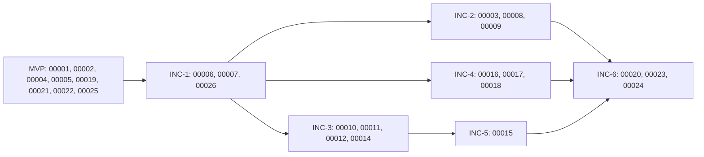
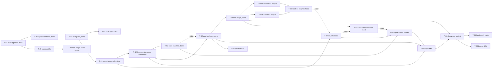
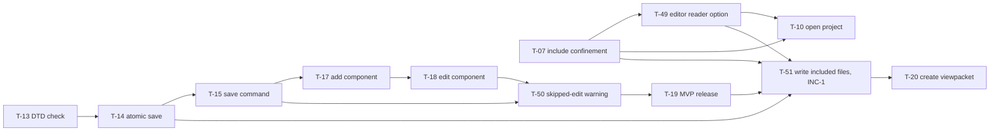

# GUI Editor Delivery Plan

## Introduction

### Purpose

Delivery order for `gui_editor`: the MVP, the increments after the MVP, and the tasks of each story.
Readers are the product owner and the developers of `gui_editor`.

### Vocabulary

- CI gate: The `cargo audit`, `cargo deny`, `cargo clippy`, and `cargo test` checks that CI runs for each crate.
- Included file: SAD XML file named by an `<Include>` element of the including project file.
- Increment: Releasable set of stories that builds only on earlier increments.
- MVP: Minimal viable product, the first release.
- Size: Relative effort of a task, S, M, or L, without calendar dates.
- Skipped edit: Edit to a Component or Team element loaded from an included file, which no save writes to that file.
- Spike: Time-boxed experiment that reduces a risk before the real work.
- Task: Unit of work small enough for one change set.
- Walking skeleton: Thin end-to-end path through all MVP components, built before any one is deepened.

### References

- Design decisions: [DESIGN.md](DESIGN.md)
- Requirements: [REQUIREMENTS.md](REQUIREMENTS.md)
- Story cards: [USER_STORIES.md](USER_STORIES.md)

### Overview

- **[Goal](#goal):** what the plan delivers.
- **[Product owner decision](#product-owner-decision):** approved scope and order.
- **[Existing work](#existing-work):** state of the code and CI before the next task.
- **[MVP](#mvp):** first release scope and exit criteria.
- **[Increments](#increments):** releases after the MVP.
- **[Task list](#task-list):** tasks with size, definition of done, and delivery order.
- **[Dependency graph](#dependency-graph):** order between increments and between the first tasks.
- **[Deferred](#deferred):** stories and tasks outside the plan.
- **[Backlog](#backlog):** review nits, each attached to the task that touches the same code.
- **[Risks](#risks):** risks and mitigations.
- **[Security findings](#security-findings):** issues found in existing code.
- **[Open questions](#open-questions):** adopted defaults and pending questions.

## Goal

Maintainers update one or more SADs through a native Linux egui editor, without hand-editing XML, and every saved file validates and works with `sad2md`.

## Product Owner Decision

The product owner approved the plan on 2026-11-23.
After T-01, the product owner made the follow-up decisions in the rows marked "T-01 follow-up".
The product owner approved the task order of the T-01 follow-up on 2026-11-23.
After T-40, the product owner decided questions 11 to 13 and approved the revised order in [Delivery Order](#delivery-order) on 2026-11-24.
The decision on question 8 was provisional until the architect added GEDT-AR-00037 and GEDT-AR-00038 on 2026-11-25.
After T-41, the product owner made the decisions in the rows marked "T-41 follow-up" on 2026-11-24.
After commit `5fbeeb3`, the product owner made the decisions in the rows marked "5fbeeb3 follow-up" on 2026-11-24.
After T-52, the product owner made the decisions in the rows marked "T-52 follow-up" on 2026-11-24.
During T-02, the product owner made the decisions in the rows marked "T-02 follow-up" on 2026-11-25.
On 2026-11-25, the product owner also answered open question 21 and made the Containerfile classification decision in a row marked "T-54 follow-up".
After the T-54 implementation, the product owner made the CI cache, test placement, and tool image tag decisions in the rows marked "T-54 follow-up" on 2026-11-25.
During T-54 testing, the product owner made the writable paths, cargo config check, test output folder, cache poisoning, and loop limit decisions in the rows marked "T-54 follow-up" on 2026-11-25.
After T-54 testing and review, the product owner made the advisory database, accepted risk, `tui_editor` save path, and loop round decisions in the rows marked "T-54 follow-up" on 2026-11-25.
On 2026-11-25, the product owner also answered open questions 8, 22, and 24 and decided the committed-language guardrail, which adds task T-55.
An earlier plan revision recorded "go with user" as a decision on open question 23, but that reading came from the orchestrator, not from the product owner, so the row "Build user, question 23" is withdrawn.
On 2026-11-25, the product owner also answered plan open questions 10 and 19 and requirements open questions 13 and 16, in the rows marked "2026-11-25 answers".
On 2026-11-25, the product owner also answered plan open questions 25 and 27, in the rows marked "2026-11-25 answers".
On 2026-11-25, the product owner answered open question 26 with "Q26a", in the row "Duplicate `syn` versions in `tui_editor`, question 26".
On aligning the plan with that answer, the product owner said "how about you remove line 96 and 97 and suddenly life becomes simpler?", so the two decision rows that allowed `skip` entries outside `gui_editor` and the row that kept them unchanged are removed, and by product owner answer "delete the shit" on 2026-11-25, the row "Skip wording in T-02 and T-43, T-52 follow-up" is removed.
On 2026-11-25, the product owner requested a Linux-only platform requirement, recorded in the row "Linux-only platform, 2026-11-25 request".
On 2026-11-25, the product owner requested rootless build containers as the top priority, recorded in the row "Rootless containers, 2026-11-25 request", which answers open question 23 and adds tasks T-56 to T-58 before T-47.
The split into T-56 to T-58 and open questions 28 to 30 wait for the product owner.

| Question | Decision |
| --- | --- |
| Accepted risks O-1 and O-2, T-54 follow-up | Decided on 2026-11-25: accepted and documented in `gui_editor/README.md`; O-1, the git config check trusts the caller's `PATH` and shell functions; O-2, a host-side `cargo test` follows symlinks that a container planted in `<crate>/test-output`. |
| Accepted save losses, requirements open question 8 | Accepted for the first release and recorded in REQUIREMENTS.md; no task. |
| Advisories in `aws2xml`, T-41 follow-up | Record risk only; no task; the 16 advisories stay unassigned, see [Security Findings](#security-findings). |
| Advisory databases, T-54 follow-up | Decided on 2026-11-25 for R-T54-01: the cargo-audit and cargo-deny advisory databases both live in the ephemeral `/tmp` of the container and are fetched fresh on each run; cargo-deny reads `advisories.db-path = "$ADVISORY_DB_DIR/cargo-deny"`, set identically in `gui_editor/deny.toml` and `gui_editor/deny-gui_editor.toml` and allowed in `DENY_ALLOWED_KEYS`; cargo-deny fails closed when `ADVISORY_DB_DIR` is unset, empty, or relative. |
| Advisory fix, T-01 follow-up | Upgrade dependencies in task T-41; add no advisory exceptions. |
| `aws2xml` lint scope, requirements open question 16, 2026-11-25 answers | Decided on 2026-11-25, product owner answer "no leave aws2xml out, it is still a proof-of-concept": GEDT-AR-00037 and GEDT-AR-00038 cover the four crates only; T-44 proceeds unchanged. |
| `aws2xml` version guard, T-52 follow-up | Added to T-52 scope on 2026-11-24: the `sad_xml_sql` path dependency in `aws2xml/Cargo.toml` gets `version = "0.7.3"`; `gui_editor/tests/test_build_pipeline_config.rs` guards `aws2xml` through the separate list `VERSION_GUARDED_NON_CI_CRATES`, not `CI_CRATES`, because CI does not build `aws2xml`. |
| Bans check baseline, 5fbeeb3 follow-up | Add task T-52, size S, before T-02, to bring the `cargo deny check` bans state back to the baseline before `5fbeeb3`; T-52 takes the `sad2md` wildcard from T-43. |
| Bans check deviation, T-52 follow-up | T-52 closes with a recorded deviation: `cargo deny check bans` for `sad2md` and `sad_xml_sql` moves to task T-53, because the remaining `hashbrown` duplicate comes from `simple-xml-builder` 1.1.0, the newest release. |
| Build container tool image, T-02 follow-up | Decided on 2026-11-25: add task T-54, size M, right after T-02 and before T-47; T-54 builds a tool image FROM the pinned `docker.io/library/rust:1.100.0-trixie` digest with cargo-audit 0.23.0, cargo-deny 0.22.0, rustfmt, and clippy, used by `gui_editor/build.sh`, CI, and the agents instead of installing the tools on each run; not a dev shell, and the GUI does not run in a container; T-54 starts without another approval once T-02 is done; T-44 uses the tool image; CI builds the image on each run with the layer cache and pushes no image, as proposed by the planner and confirmed by the product owner on 2026-11-25; `cargo build` and `cargo test` also run in the tool image, as decided in the row "Tool image requirement, question 21"; revised on 2026-11-25 by the rows "CI cache, T-54 follow-up", "Test placement, T-54 follow-up", "Tool image tag, T-54 follow-up", "Writable paths, T-54 follow-up", "Cargo config check, T-54 follow-up", and "Test output folder, T-54 follow-up". |
| Build user, question 23 | Withdrawn on 2026-11-25: the answer "go with user" was the orchestrator's interpretation, not a product owner decision; open question 23 is closed by the row "Rootless containers, 2026-11-25 request". |
| Cache poisoning, T-54 follow-up | Decided on 2026-11-25: `.cargo-home/registry/src` stays writable, so a container can poison cached crate sources for later builds, and the poisoned sources pass audit and deny; tester severity Medium, reproduced; accepted for the MVP and documented; an unassigned backlog item fetches dependencies in a separate step, mounts `registry` read-only, and builds with `--offline`. |
| Cargo config check, T-54 follow-up | Decided on 2026-11-25, T-54 question 2, option A: `tool_image.sh run <dir>` accepts any top-level directory but refuses an untracked `<dir>/.cargo/config.toml` or `<dir>/.cargo/config`, and always refuses `<repo>/.cargo/config.toml`; the check fails closed without git; the git state does not come from the caller's environment, as security defect D-T54-06 requires; open question 22 is closed, see the row "Tracked cargo config files, question 22". |
| CI cache, T-54 follow-up | Decided on 2026-11-25: no layer cache for now; each CI job builds the tool image without a cache and pushes nothing, with no new action; a CI cache through the GitHub first-party `actions/cache`, pinned by SHA, storing a `docker save` tarball keyed by the tag and followed by the same content check, is an unassigned backlog item for when CI build time matters. |
| CI gate, T-02 follow-up | Decided on 2026-11-25 during T-02 testing: "`gui_editor` CI gate green" in T-02 means the `gui-editor-build` job and the `gui_editor` test job; the `sad2md`, `sad_xml_sql`, and `tui_editor` jobs stay red on the known `hashbrown` and `syn` duplicates until T-53 and T-43. |
| Clippy gate, T-01 follow-up | Add `cargo clippy -D warnings` to CI in task T-44. |
| Clippy requirement, question 8 | Closed on 2026-11-25: the architect added GEDT-AR-00037, zero lint warnings, and GEDT-AR-00038, standard formatting; T-44 stays under GEDT-STORY-00019 and traces to GEDT-AR-00037 and GEDT-AR-00038 instead of GEDT-AR-00030. |
| Committed-language guardrail | Decided on 2026-11-25, product owner answer: "the important part is that only Rust and Bash is what is committed as part of the committed product"; the architect widened GEDT-AR-00032 and GEDT-AR-00033 to every committed file of the repository, verified by an automated repository check; task T-55, size S, in the MVP under GEDT-STORY-00019, runs right after T-47 and adds that check. |
| Containerfile classification, T-54 follow-up | Decided on 2026-11-25: a `Containerfile` counts as a configuration format for GEDT-AR-00032 and GEDT-AR-00033, so T-54 treats `gui_editor/container/Containerfile` under both requirements. |
| Containerfile `RUN` sentence, question 24 | Closed on 2026-11-25: the product owner removed the sentence on the `RUN` lines of a `Containerfile` from REQUIREMENTS.md on purpose; no architect request. |
| Deferred list | GEDT-STORY-00013 stays deferred; T-48 is not scheduled, see [Deferred](#deferred). |
| Delivery order, 5fbeeb3 follow-up | T-52, T-02, T-47, T-43, T-44, T-45, T-46, T-03, then the rest unchanged; T-43 keeps its dependencies T-02, T-42, and T-47. |
| Delivery order, T-01 follow-up | Approved as is: T-39, T-40, T-41, T-42, T-02, T-43, T-44, T-45, T-46, then T-03 onward. |
| Delivery order, T-52 follow-up | Add task T-53, size M, after T-47 and before T-43, to replace `simple-xml-builder` in `sad_xml_sql`; T-53 depends on T-47 and T-52; T-43 also depends on T-53. |
| Delivery order, revision after T-40 | Approved on 2026-11-24, with T-51 moved to INC-1 and T-48 removed, see [Delivery Order](#delivery-order). |
| DTD validation | Structural DTD checks in the Rust core now; the product owner approves `xmllint` as a CI-only tool when T-13 starts. |
| Duplicate `syn` versions in `tui_editor`, question 26 | Decided on 2026-11-25, product owner answer "Q26a": T-43 removes the `syn` 2 and `syn` 3 duplicate in `tui_editor` by upgrade or pin only, with no `skip` entry; the shared `deny.toml` keeps an empty `bans.skip` (AR-00039, AR-00040). |
| Duplicate versions, T-02 follow-up | Revises open question 20 for `gui_editor` only. `gui_editor/deny-gui_editor.toml` is the `gui_editor` cargo-deny policy file, whose `bans.skip` holds the Linux duplicates that no upgrade removes with eframe 0.37, through winit 0.30 and calloop 0.13: `rustix` 0.38, `linux-raw-sys` 0.4, `thiserror` 1, `thiserror-impl` 1, and `syn` 2, each with a reason and "remove in T-43"; the shared `gui_editor/deny.toml` for `sad2md`, `sad_xml_sql`, and `tui_editor` keeps an empty `bans.skip`, and upgrades only still applies there; a test keeps both files identical apart from `bans.skip` and `licenses.exceptions`; `graph.targets` as in the row "Graph targets, T-02 follow-up"; `flate2` locked to 1.1.9, which removes the `miniz_oxide` duplicate and also `zlib-rs` 0.6.9. |
| eframe version and features, T-02 follow-up | eframe 0.37.0 with `default-features = false` and the features `glow`, `wayland`, `x11`, and `default_fonts`. |
| File dialog crate, T-02 follow-up | `rfd` 0.18 with only the `xdg-portal` feature, approved as a new crate. |
| File dialog fallback to `zenity`, T-02 follow-up | Accepted for T-02 and documented in `gui_editor/README.md`: when the xdg portal fails, the `xdg-portal` backend of `rfd` runs `zenity` from `PATH` as a direct process, with no shell and no network. |
| Font licences, T-02 follow-up | OFL-1.1 and Ubuntu-font-1.0 allowed only for `epaint_default_fonts`, through one `licenses.exceptions` entry in `gui_editor/deny-gui_editor.toml` only, because cargo-deny 0.22 reports an unused exception as an error for the other crates; neither licence joins the global allow list; both policy files stay identical apart from `bans.skip` and `licenses.exceptions`; the `exceptions` key added to the allowed-keys test. |
| Graph targets, T-02 follow-up | `graph.targets = ["x86_64-unknown-linux-gnu"]` in both `gui_editor/deny.toml` and `gui_editor/deny-gui_editor.toml`; the setting also clears the `windows-sys` duplicate in `tui_editor`, so T-43 no longer covers `windows-sys`. |
| `gui_editor` version, T-02 follow-up | `gui_editor` version set to 0.2.0, as GEDT-AR-00036 requires, because `gui_editor` does not exist on master. |
| Hashbrown ownership, T-52 follow-up | T-53 owns the `hashbrown` duplicate entirely; T-43 and T-52 no longer cover `hashbrown`; after T-53, no crate in `CI_CRATES` has more than one `hashbrown` version, and any `hashbrown` duplicate left in `tui_editor` is removed through upgrades in T-53, never a skip. |
| Included-file external change, requirements open question 13, 2026-11-25 answers | Decided on 2026-11-25, product owner answer "provide a prompt of file changed on disk with an option to overwrite", option a in [DESIGN.md](DESIGN.md#external-change-of-an-included-file): T-51 shows the GEDT-FR-00009 prompt for each included file changed on disk, with an option to overwrite; no requirement changes. |
| Included-file writes, question 12 | T-51, size L, is the first task of INC-1, not part of the MVP; until T-51 lands, the T-50 warning tells users that edits to included-file items are skipped. |
| Increment order | INC-1 to INC-6 as listed. |
| ISC licence, T-02 follow-up | ISC allowed globally in `deny.toml`, because every eframe Linux build needs ISC through `libloading`, used by glutin, x11rb, and wayland-sys. |
| Licence allow list, T-01 follow-up | Add Zlib and Unicode-3.0 to the `deny.toml` allow list in task T-42. |
| Linux-only platform, 2026-11-25 request | Decided on 2026-11-25, product owner request "If there is no AR please create an AR stating that linux is the only support platform for build and running the apps": the architect added GEDT-AR-00049, x86_64 Linux as the only supported build platform, and GEDT-AR-00050, x86_64 Linux as the only supported host platform for `gui_editor`, `sad2md`, and `tui_editor`; both trace to GEDT-STORY-00019 in the MVP; T-19 adds the x86_64 Linux statements to `gui_editor/README.md`, `sad2md/README.md`, and `tui_editor/README.md`, because T-19 already updates `gui_editor/README.md` for the release, and checks that the tool image and every CI runner are x86_64 Linux; no new task; requirements open question 19 answered with "q19a" on 2026-11-25, and the architect amended GEDT-AR-00049 and GEDT-AR-00050 to name x86_64 Linux; requirements open question 20 answered with "q20 fucking forget about aws2xml until it is specifically requested" on 2026-11-25, so `aws2xml` stays out of GEDT-AR-00049 and GEDT-AR-00050. |
| Loop limit, T-54 follow-up | Decided on 2026-11-25: T-54 reached the 3-round developer and tester limit; the product owner approved one extra round, round 4, for D-T54-06 and the test output folder. |
| Loop rounds, T-54 follow-up | Decided on 2026-11-25: the T-54 developer and tester loop ran 3 rounds plus 1 approved extra round, then one fix pass for R-T54-01, approved by the product owner. |
| MVP scope | Components only; the MVP writes no included file; viewpackets, diagrams, and included-file writes follow in INC-1. |
| Next action | Start T-01, build pipeline; T-01 is done. |
| Old artifact `sad_xml_sql/dump_test_output.xml` | No task; git ignores the file. |
| Partial T-02 changes, question 6 | T-02 restarts clean; the partial T-02 changes leave the working tree before the T-01 commit. |
| Position of T-02, question 7 | T-02 stays after T-42. |
| Regression tests, T-01 follow-up | Task T-39 adds `sad2md` and `tui_editor` tests before any change to `sad_xml_sql`. |
| Repository-root `.cargo-home/` ignore, question 25, 2026-11-25 answers | Decided on 2026-11-25, product owner answer "q25 update the .gitignore", option A: T-46 only adds `.cargo-home/` to the repository-root `.gitignore` and confirms that `git status` shows no `.cargo-home/` after a build; T-46 changes no script. |
| Repository-root findings, question 9 | Add task T-46, size S, after T-45, to fix the three repository-root findings; narrowed on 2026-11-25 by the rows "Repository-root scripts, question 10, 2026-11-25 answers" and "Repository-root `.cargo-home/` ignore, question 25, 2026-11-25 answers". |
| Repository-root scripts, question 10, 2026-11-25 answers | Decided on 2026-11-25, product owner answer "leave the root scripts alone": T-46 no longer changes the root `build.sh` or `build_in_docker.sh`; the remaining T-46 scope is decided in the row "Repository-root `.cargo-home/` ignore, question 25, 2026-11-25 answers". |
| Rootless containers, 2026-11-25 request | Decided on 2026-11-25, product owner request "Please create an AR that the docker containers have to run rootless and the create a plan for how to implement it and make that the top priority": the architect added GEDT-AR-00051, Critical, under GEDT-STORY-00019 in the MVP: each build run starts a container only on a container engine that the build run has verified as rootless, rootless docker or rootless podman, locally and in CI, including the tool image build and the CI gitleaks scan; the request answers open question 23, so the fake-engine-only coverage is replaced by a real rootless engine locally and in CI; tasks T-56, local rootless engine, T-57, CI rootless engine, and T-58, rootless engine check, run first in [Delivery Order](#delivery-order), ahead of T-47; the engine choices wait for open questions 28 and 29; the repository-root `build.sh` and `build_in_docker.sh` stay out until requirements open question 21 is answered. |
| Round-trip scope, question 11 | Shrink both tasks: T-03 becomes a short check of the save gaps left after T-40, and T-12 covers only what T-40 did not. |
| rustfmt in CI, T-02 follow-up | Decided on 2026-11-25 during T-02 testing: T-44 is extended so CI runs `cargo fmt --check` as well as clippy for all four crates; the pinned image adds rustfmt through `rustup component add rustfmt`, as for clippy; backlog item D-03 goes to T-44. |
| Save failure in `tui_editor`, requirements open question 10 | Task T-47 under GEDT-STORY-00002 fixes the silent save failure and keeps the `tui_out.xml` target. |
| Save target of `tui_editor`, question 13 | Keep `tui_out.xml`; T-48 is not scheduled, see [Deferred](#deferred). |
| Skipped-edit warning form, requirements open question 12 | Non-modal warning on a direct Save; on exit, a modal warning that lets the user cancel the exit; T-50 implements this form. |
| Story split, question 19, 2026-11-25 answers | Decided on 2026-11-25, product owner answer "go with the default": the architect created GEDT-STORY-00026, included-file write, with GEDT-AR-00035, GEDT-FR-00009, GEDT-FR-00043, and GEDT-FR-00044; T-51 traces to GEDT-STORY-00026 in INC-1, and GEDT-STORY-00002 stays wholly in the MVP. |
| Story trace of GEDT-AR-00035, question 27, 2026-11-25 answers | Decided on 2026-11-25, product owner answer "q27a.", option a: GEDT-AR-00035 stays on GEDT-STORY-00021 and GEDT-STORY-00026; the plan records GEDT-AR-00035 as delivered in INC-1 by T-51. |
| Test output folder, T-54 follow-up | Decided on 2026-11-25: the 7 tests in `sad_xml_sql` and `tui_editor` that wrote into their crate root write under `<crate>/test-output` instead, a git-ignored folder mounted writable. |
| Test placement, T-54 follow-up | Decided on 2026-11-25: `build.sh` runs `cargo build` only; `cargo test` runs in the tool image through `gui_editor/container/tool_image.sh run` in CI and for agents, because the config tests read sibling directories outside the `build.sh` mount. |
| Tool image requirement, question 21 | Option A, answered on 2026-11-25: GEDT-AR-00034 now allows an image built from the Docker Official Image `docker.io/library/rust`, pinned by version tag and `sha256` digest, that adds only the version-pinned tools `cargo-audit`, `cargo-deny`, `clippy`, and `rustfmt`; `cargo build` and `cargo test` run in the T-54 tool image. |
| Tool image tag, T-54 follow-up | Decided on 2026-11-25: the tag is `localhost/gui_editor-tools:<sha256 over the Containerfile content and the checked base image reference>`, so another pinned `RUST_IMAGE` builds a new tag; the fail-closed label and tool-version check still runs on every use. |
| Tracked cargo config files, question 22 | Decided on 2026-11-25, option C: no extra check on tracked cargo config files; a change to a tracked `.cargo/config.toml` or `.cargo/config` shows in `git status` and goes through review. |
| `tui_editor` save path, T-54 follow-up | Decided on 2026-11-25: `WorkState.save_path` is a test-only seam that defaults to `tui_out.xml`, so tests write under `tui_editor/test-output`; production behaviour is unchanged. |
| Writable paths, T-54 follow-up | Decided on 2026-11-25, T-54 question 1, option A: code under test writes only to `target/`, `.cargo-home`, and one git-ignored test output folder per crate, `<crate>/test-output`; `build.sh`, `tool_image.sh run`, and CI mount everything else read-only; reason: security defect D-T54-04, High, where code in the container could rewrite host scripts. |

## Existing Work

- T-01 is done and committed as `dd719d1`.
  - `gui_editor/build.sh` uses a pinned image and `--locked`, and runs `cargo audit` and `cargo deny` before `cargo build`.
  - CI gates every crate in the test matrix with audit and deny before `cargo test`, using `gui_editor/deny.toml` and `gui_editor/.cargo/audit.toml`.
- T-39 is done, reviewed, approved, and committed.
  - `sad2md` and `tui_editor` now have regression tests, so GEDT-AR-00030 protects both tools.
- T-40 is done, reviewed, approved with nits N1 to N6, and committed.
  - T-40 fixes the root cause of the `context_model` UNIQUE failure in `sad_xml_sql`.
  - T-40 also fixes the save round trip: DOCTYPE, `Version`, addresses, DTD order, no drift, DiagramKey, ViewPacket TeamId, and Include elements.
  - T-40 writes only items from the main file to the main file, and never writes included files.
  - T-03 and T-12 shrink to the gaps that T-40 left, as decided on question 11.
  - The review nits are in [Backlog](#backlog).
- T-41 is done and committed.
  - T-41 upgrades `ratatui` to 0.30.2 and replaces `tui-textarea` with `ratatui-textarea` 0.9.4.
  - T-41 removes RUSTSEC-2026-0459 from `aws2xml` as a side effect.
  - T-41 removes the `crossterm`, `rustix`, `linux-raw-sys`, `unicode-width`, and `windows_*` duplicates as a side effect.
  - T-41 adds a `syn` 2 and `syn` 3 duplicate in `tui_editor`, through `thiserror` 2 in `kasuari` and `ratatui-core`; T-43 resolves the duplicate.
  - `aws2xml` keeps 16 known advisories that predate T-41, see [Security Findings](#security-findings).
- T-42 is done and committed as `d44c2ff`.
  - The review nits R-02 to R-04 are in [Backlog](#backlog).
- Commit `5fbeeb3`, "Update sqlite to 0.41", broke the bans baseline of `cargo deny check`.
  - `5fbeeb3` adds the `bans.skip` entries `hashbrown@0.12.3`, `syn@2.0.104`, and `windows-sys@0.59.0` to `gui_editor/deny.toml`, which all four crates share through `--config`.
  - With cargo-deny 0.22.0 and `--deny warnings`, `tui_editor` passes, `gui_editor` reports `unmatched-skip` for all three entries, and `sad_xml_sql` and `sad2md` report `unmatched-skip` for `syn` and `windows-sys`.
  - The `gui_editor` test `test_ar_00025_ac4_deny_bans_deny_multiple_versions_and_wildcards` fails with "bans.skip is not empty" at `gui_editor/tests/test_build_pipeline_config.rs:621`.
  - `sad2md` fails with `error[wildcard]`, because the `sad_xml_sql` path dependency in `sad2md/Cargo.toml` has no `version`; `tui_editor` already has `version = "0.7.3"`.
  - T-52 restores the baseline for `gui_editor`; T-53 removes the `hashbrown` duplicate left in `sad2md` and `sad_xml_sql`.
- T-52 is done and committed by the product owner: tested, reviewed in two rounds, and approved with nits.
  - `bans.skip` in `gui_editor/deny.toml` is empty, and the `sad_xml_sql` path dependency in `sad2md/Cargo.toml` has `version = "0.7.3"`.
  - The `sad_xml_sql` path dependency in `aws2xml/Cargo.toml` also has `version = "0.7.3"`, guarded by `VERSION_GUARDED_NON_CI_CRATES` in `gui_editor/tests/test_build_pipeline_config.rs`.
  - The review and test nits are in [Backlog](#backlog).
  - `gui_editor` passes the full `cargo deny` check, no crate reports `unmatched-skip` or `wildcard`, and all test suites pass.
  - `sad2md` and `sad_xml_sql` still fail `cargo deny check bans` on `hashbrown` 0.12.3, through `indexmap` 1.9.3 and `simple-xml-builder` 1.1.0, and `hashbrown` 0.17.2, through `hashlink` 0.12.2 and `rusqlite` 0.41.1.
  - `simple-xml-builder` 1.1.0 is the newest release, and a `rusqlite` downgrade brings back RUSTSEC-2026-0459, so T-53 replaces `simple-xml-builder`.
- Git status shows no partial T-02 change in `gui_editor`; T-02 restarts clean from the T-01 commit.
- T-02 is done and committed, after the manual Wayland and X11 window check by the product owner passed.
  - T-02 is implemented under the T-02 follow-up decisions of 2026-11-25, tested in two tester rounds, reviewed, and approved with nits.
  - The backlog items R-02 to R-05 are done in T-02.
  - The T-02 tester found D-01 and D-02, both fixed and closed in the second tester round.
    - D-01: the zenity line in `gui_editor/README.md` did not say that `zenity` runs from `PATH`.
    - D-02: comment lines broke mid-phrase, against the comment rule.
  - The T-02 tester also found D-03, a rustfmt finding, moved to T-44, see [Backlog](#backlog).
  - The T-02 review nits T02-N-01 to T02-N-04 are in [Backlog](#backlog).
  - The `gui_editor` CI gate of T-02 means the `gui-editor-build` job and the `gui_editor` test job, as decided in the row "CI gate, T-02 follow-up".
- T-54 is done: tested, reviewed in two review rounds, and approved with nits; the product owner commit is pending.
  - The developer and tester loop ran 3 rounds plus 1 approved extra round, then one fix pass for R-T54-01, see the rows "Loop limit, T-54 follow-up" and "Loop rounds, T-54 follow-up".
  - Security defects D-T54-01 to D-T54-06 and review finding R-T54-01 are fixed and verified.
  - Round 4 delivered D-T54-06, the git-environment-independent cargo config check, and the move of 7 `sad_xml_sql` and `tui_editor` tests to `<crate>/test-output`.
  - Both advisory databases live in the ephemeral `/tmp` of the container and are fetched fresh on each run, see the row "Advisory databases, T-54 follow-up".
  - `tui_editor` `WorkState.save_path` is a test-only seam with the default `tui_out.xml`, see the row "`tui_editor` save path, T-54 follow-up".
  - Accepted risks O-1 and O-2 are documented in `gui_editor/README.md`, see [Risks](#risks).
  - The second review round nits R2-T54-01 to R2-T54-04 are in [Backlog](#backlog).
  - New `gui_editor/container/tool_image.sh` is a Bash library and CLI with `build` and `run <dir> <cmd…>`.
  - The CI `test` job no longer uses `container:` and runs each step through `tool_image.sh`.
  - Code under test writes only to `target/`, `.cargo-home`, and `<crate>/test-output`; `build.sh`, `tool_image.sh run`, and CI mount everything else read-only.
  - `.cargo-home/registry/src` stays writable, an accepted cache poisoning risk, see [Risks](#risks).
  - Rootless podman and rootless docker are covered by a fake engine only; GEDT-AR-00051 replaces that coverage with real rootless engines through T-56 to T-58.
  - On the development machine, the account cannot run docker as root, and `docker info --format '{{json .SecurityOptions}}'` prints `["name=seccomp,profile=builtin","name=cgroupns"]`, as the product owner reported on 2026-11-25.
    - The Docker daemon runs as root, rootful, and the account reaches the daemon without being root, so local runs exercise only the rootful docker path with `--user`.
    - Unknown: whether podman is installed, whether the account has `/etc/subuid` and `/etc/subgid` entries, and whether a one-time root step is needed for a rootless engine; T-56 checks these.
- GEDT-AR-00051 gaps in the T-54 code, found by the architect on 2026-11-25:
  - `select_user_args` in `gui_editor/container/tool_image.sh`, around lines 74 to 96, gives rootful docker `--user uid:gid` and falls back to `--user` when the rootless detection fails; `gui_editor/build.sh` sources that function.
  - Podman gets `--userns=keep-id` without a rootless check, so rootful podman runs containers.
  - The CI jobs in `.github/workflows/ci.yml` set `CONTAINER_ENGINE: docker` against the rootful daemon of the `ubuntu-24.04` runner, and the gitleaks step, around line 37, runs `docker run` directly, outside `tool_image.sh`.
  - `gui_editor/README.md` documents build output ownership under rootful docker with `--user`.
  - Tests in `gui_editor/tests/pipeline/test_build_pipeline.sh` expect `--user` on rootful docker and as the fallback.
- CI stays red until T-53 and T-43 land, because `cargo deny check bans` fails for `sad2md`, `sad_xml_sql`, and `tui_editor`.
- The uncommitted change to `aws2xml/Cargo.lock` predates T-01 and belongs to no planned task.
- Save findings in shared and `tui_editor` code:
  - `tui_editor/src/work.rs` line 314 discards the `Result` of `dump_db_to_xml`; F7 saves to `work_state.save_path`, default `tui_out.xml`.
  - `dump_db_to_xml` writes in place with `File::create`, which is not atomic, against GEDT-AR-00007.
  - `dump_db_to_xml` prints debug lines with `println!`, which garble the `tui_editor` screen.
- `sad_xml_sql` loads and saves through in-memory SQLite, with the defects listed in [REQUIREMENTS.md](REQUIREMENTS.md#risks).
- No existing code fully covers any story.

## MVP

The MVP is a native Linux app that opens a project file safely, adds and edits components, and saves the file atomically so that the file validates and `sad2md` accepts the file.
The build, test, and release pipeline is part of the MVP.

| Story | Priority | Requirements |
| --- | --- | --- |
| GEDT-STORY-00001 | Critical | GEDT-AR-00001, 00012, 00013, 00027, GEDT-FR-00001, 00002, 00003, 00042 |
| GEDT-STORY-00002 | Critical | GEDT-AR-00001, 00002, 00030, GEDT-FR-00004, 00005, 00006, 00009, 00045 to 00048 |
| GEDT-STORY-00004 | Critical | GEDT-FR-00010, 00011, 00012, 00013 |
| GEDT-STORY-00005 | Critical | GEDT-FR-00013, 00014, 00015, 00016, 00045 |
| GEDT-STORY-00019 | Critical | GEDT-AR-00003, 00004, 00032, 00033, 00034, 00037 to 00051, and GEDT-AR-00025, see open question 5 |
| GEDT-STORY-00021 | Critical | GEDT-AR-00010 to 00016, 00029, 00031; GEDT-AR-00035 is delivered in INC-1 by T-51 under GEDT-STORY-00026, as decided on open question 27 |
| GEDT-STORY-00022 | Critical | GEDT-AR-00007, 00008, 00009, GEDT-FR-00006 |
| GEDT-STORY-00025 | Critical | GEDT-AR-00009, 00015, 00023, 00024 |

### MVP Security

The only interface of the native app is the local project file and its included files.

- Input validation: the project file and its included files are untrusted input, see GEDT-STORY-00021.
- Write confinement: the MVP writes no included file, so the MVP exposes no included-file write surface.
  T-51 in INC-1 adds the write together with the write-time check of GEDT-AR-00035.
- Secrets: the app needs no credentials, and CI runs a secret scan.
- Authentication and authorization: not needed for a single-user local app.
  OS file permissions protect the project files, as the out-of-scope decision states.
- Supply chain: shipped crates get no advisory exceptions; T-41 fixes known advisories through upgrades.
- Build containers: every build run starts containers only on a verified rootless engine, locally and in CI, GEDT-AR-00051, delivered first by T-56 to T-58.

### MVP Exit Criteria

- Open, then save, of every fixture gives equal canonical XML, apart from the [Known save limitations](REQUIREMENTS.md#known-save-limitations), passes `xmllint --noout --nonet --valid` in CI, and passes `sad2md`.
- No save writes an included file; every edit to a Component or Team element of an included file is a skipped edit, and the hash of each included file stays unchanged.
- Each explicit Save or exit with a skipped edit shows the warning of GEDT-FR-00045, which tells the user that edits to included-file items are skipped.
- Read-only directory and full-disk fixtures show an error naming the file and cause, keep the file, and keep the project marked modified.
- 1,000 kills during save leave zero corrupted files.
- The network namespace test sees zero outbound connections.
- All security fixtures pass, including include traversal and symlink fixtures on load, and 1 hour of reader fuzzing causes no crash.
- The `sad2md` and `tui_editor` test suites pass.
- The CI gate passes for `gui_editor`, `sad2md`, `sad_xml_sql`, and `tui_editor`.
- The app works on Fedora, on Wayland and on X11.
- No build run, local or in CI, starts a container on a rootful engine or on an engine whose mode the run cannot read (GEDT-AR-00051).
- `gui_editor/README.md`, `sad2md/README.md`, and `tui_editor/README.md` name x86_64 Linux as the only supported platform, and the tool image and every CI runner are x86_64 Linux (GEDT-AR-00049, GEDT-AR-00050).

## Increments

### INC-1 Included Files, Viewpackets, and Diagrams

| Story | Priority | Requirements |
| --- | --- | --- |
| GEDT-STORY-00006 | Critical | GEDT-FR-00011, 00017, 00018, 00019 |
| GEDT-STORY-00007 | Critical | GEDT-FR-00011, 00020, 00021, 00022 |
| GEDT-STORY-00026 | Critical | GEDT-AR-00035, GEDT-FR-00009, 00043, 00044; T-51 |

- Value: edits to included components reach their files, and maintainers edit all SAD content, not only components.
- Requirements: GEDT-AR-00035, GEDT-FR-00017 to 00022, 00043, 00044; the MVP covers GEDT-FR-00009 and GEDT-FR-00011.
- Depends on: MVP.
- First task: T-51, write included files.
- Security: T-51 ships the write-time path check of GEDT-AR-00035 with the included-file write.
- Exit: an edit to an included component is written only to that included file, and all other elements of that file stay unchanged.
  Traversal and symlink-swap fixtures at write time are rejected with the file kept.
  An included file changed on disk since the last load or save gets the GEDT-FR-00009 prompt with an option to overwrite.
  The T-50 warning lists only Team edits of included files.
  Viewpackets and diagrams of all six styles are editable, and saved files pass the MVP checks.
- Also holds spike T-23 on multiple windows under Wayland, to test that risk early.

### INC-2 Editing Comfort

- Value: autosave, fast component search, and replicas shown as separate components.
- Stories: GEDT-STORY-00003, GEDT-STORY-00008, GEDT-STORY-00009.
- Requirements: GEDT-AR-00028, GEDT-FR-00007, 00008, 00023, 00024; the MVP covers GEDT-FR-00047 and 00048.
- Depends on: INC-1.
- Exit: autosave within 60 seconds, with a prompt before overwriting a file changed on disk.
  Autosave skips skipped edits without a warning.
  Search updates within 100 ms and matches `'`, `%`, and `_` literally.

### INC-3 Reading the Architecture

- Value: readers explore the architecture without the risk of changing the project.
- Stories: GEDT-STORY-00010, GEDT-STORY-00011, GEDT-STORY-00012, GEDT-STORY-00014.
- Requirements: GEDT-FR-00025 to 00029, 00031.
- Depends on: INC-1.
- Exit: the core rejects every change request in view mode, and filters and panes leave the modified flag unchanged.

### INC-4 Multiple Projects

- Value: maintainers work across several SADs and reference components between projects.
- Stories: GEDT-STORY-00016, GEDT-STORY-00017, GEDT-STORY-00018.
- Requirements: GEDT-FR-00034 to 00040.
- Depends on: MVP and INC-1.
- Exit: each project is saved only to its own file, and a reference to a project that is not loaded stays in the file after save.

### INC-5 Linked Windows

- Value: windows on several screens follow the same selection.
- Story: GEDT-STORY-00015.
- Requirements: GEDT-FR-00032, 00033.
- Depends on: INC-3.
- Exit: a selection reaches every window within 1 second, on Wayland and on X11.

### INC-6 Local Web App

- Value: maintainers edit in a browser on the local machine.
- Stories: GEDT-STORY-00020, GEDT-STORY-00023, GEDT-STORY-00024.
- Requirements: GEDT-AR-00005, 00017 to 00021, GEDT-FR-00041.
- Depends on: INC-1 to INC-5, because GEDT-FR-00041 requires every native function.
- Security: GEDT-STORY-00023 and GEDT-STORY-00024 ship with the web surface they protect.
- Exit: the Host, Origin, token, and Content-Security-Policy tests pass, and the shared UI suite passes in Firefox and Chromium.

## Task List

Requirement IDs in the definition of done are short forms, for example AR-00025 for GEDT-AR-00025.
Table rows are sorted by task ID; [Delivery Order](#delivery-order) gives the order of work.
Task T-48 is not scheduled and is listed in [Deferred](#deferred).

| ID | Task | Story | Inc | Depends on | Size | Definition of done |
| --- | --- | --- | --- | --- | --- | --- |
| T-01 | Build pipeline | 00019 | MVP | none | M | Done, committed as `dd719d1`. `build.sh` builds `gui_editor`, not `amber-dos`; image pinned by version and digest; `cargo build --locked`; `cargo audit` and `cargo deny` fail on unignored findings; secret scan; CI runs the `gui_editor`, `sad_xml_sql`, `sad2md`, and `tui_editor` tests; `.cargo-home/` ignored in `gui_editor` and `aws2xml` (AR-00024, AR-00025, AR-00030) |
| T-02 | egui walking skeleton | 00019 | MVP | T-01, T-42 | M | Done and committed; the manual Wayland and X11 window check by the product owner passed. Tested in two tester rounds, D-01 and D-02 closed, D-03 moved to T-44; reviewed and approved with nits T02-N-01 to T02-N-04, see [Backlog](#backlog). Restarted clean from the T-01 commit; eframe window starts on Fedora Wayland and X11, with an open-file dialog and an empty component list; new licences of egui dependencies, such as OFL-1.1, approved by the product owner and added to `deny.toml` with the allow-list test; windowing duplicates removed, or skipped for windows targets with a reason, see open question 20; backlog items R-02 to R-05 done; `gui_editor` CI gate green, meaning the `gui-editor-build` job and the `gui_editor` test job, while the `sad2md`, `sad_xml_sql`, and `tui_editor` jobs stay red until T-53 and T-43; the decisions in the rows marked "T-02 follow-up" apply (AR-00003, AR-00004, AR-00025, AR-00039, AR-00040, AR-00041, AR-00042) |
| T-03 | Check of save gaps after T-40 | 00002 | MVP | T-01, T-40 | S | Short check, no fixes: open and save of every fixture compared with the source; each element that `sad_xml_sql` still drops or reorders, apart from the Known save limitations, listed and assigned to T-12 or proposed as a Known save limitation; elements fixed by T-40 not re-checked beyond the existing T-40 tests |
| T-04 | Hardened XML reader | 00021 | MVP | T-44 | M | External entity and entity expansion fixtures rejected; no external DTD loaded; file over 64 MiB or nesting over 32 levels rejected (AR-00010, AR-00011, AR-00031) |
| T-05 | Errors instead of crashes | 00021 | MVP | T-04 | M | No `expect`, panic, or exit on input paths, including `update_component_by_id`; legacy tests expect error values; 1 hour of fuzzing without crash (AR-00012) |
| T-06 | Field validation | 00021 | MVP | T-05 | S | Bad address, non-integer SortOrder, and FileId outside 1 to 255 rejected; `convert_from_address_to_id` fixed (AR-00013) |
| T-07 | Include confinement | 00021 | MVP | T-05 | S | Path traversal and symlink fixtures rejected; Include `url` never fetched; the path check is a reusable core function for T-51 (AR-00014, AR-00015) |
| T-08 | Bound SQL parameters | 00021 | MVP | T-44 | S | CI static check finds no SQL built by string formatting (AR-00016) |
| T-09 | Load and save off the UI thread | 00021 | MVP | T-02 | S | Each UI frame under 100 ms during load (AR-00029) |
| T-10 | Open project | 00001 | MVP | T-06, T-07, T-09, T-49 | M | All elements of the selected file loaded; only Component and Team elements of included files loaded, through the T-49 option; error names path, line, column, and rule; file hash and mtime unchanged; backlog item T02-N-04 decided (FR-00001 to FR-00003, FR-00042, AR-00001) |
| T-11 | Load benchmark | 00001 | MVP | T-10 | S | 2,000 components, 500 viewpackets, and 5,000 relations load within 2 seconds, checked in CI (AR-00027) |
| T-12 | Remaining writer fixes | 00002 | MVP | T-03 | M | Only the gaps that T-03 assigns are fixed, without rework of the T-40 fixes; canonical XML compare test for every fixture after open and save, apart from the Known save limitations; backlog items N1, N3, and N5 done; re-size to S if T-03 finds no gap (FR-00005, AR-00002, AR-00030) |
| T-13 | Pre-save DTD check | 00002 | MVP | T-12 | M | Core checks the DTD structure rules in Rust; a rule failure keeps the existing file and names the failing element; `xmllint` runs in CI only, and the product owner approves `xmllint` as a CI-only tool when T-13 starts; the CI `xmllint` step covers required counts such as `ViewPacket+`, `Component+`, and `ComponentId+`, backlog item N6 (FR-00006) |
| T-14 | Atomic save | 00022 | MVP | T-13 | M | Atomic save in the shared `sad_xml_sql` save path, replacing the in-place `File::create` of `dump_db_to_xml`, so the editor and `tui_editor` use one path; temporary file in the project directory with mode no wider than the project file; flush, rename, directory flush; mode bits kept; every failure returned as an error naming the file and cause; 1,000-kill test passes (AR-00007 to AR-00009, FR-00046) |
| T-15 | Save command and external-change check | 00002 | MVP | T-14 | M | Saves to the source file; asks before overwriting a file changed on disk; a failed save shows the error naming file and cause, keeps the file, and keeps the project marked modified, tested with read-only directory and full-disk fixtures (FR-00004, FR-00009, FR-00046 to FR-00048) |
| T-16 | Data stays local | 00025 | MVP | T-10 | S | Network namespace test sees zero connections; logs hold only paths, addresses, and error kinds (AR-00015, AR-00023, AR-00024) |
| T-17 | Add component | 00004 | MVP | T-15 | M | Unique address with FileId first; case-insensitive name order; duplicate name rejected; `template_sad.xml` updated (FR-00010 to FR-00013) |
| T-18 | Edit component | 00005 | MVP | T-17 | M | Every DTD child editable; address unchanged; rename shown in every view (FR-00013 to FR-00016) |
| T-19 | MVP release | 00019 | MVP | T-11, T-16, T-18, T-50 | S | Wayland and X11 demonstration; `sad2md` accepts a saved file; no included file written; `gui_editor/README.md` updated, including the Known save limitations and the skipped edits to included-file items until INC-1; `gui_editor/README.md` names x86_64 Linux as the only supported build platform and as the only supported host platform for running `gui_editor`; `sad2md/README.md` and `tui_editor/README.md` name x86_64 Linux as the only supported platform; the tool image of AR-00034 and every CI runner checked to be x86_64 Linux (AR-00049, AR-00050) |
| T-20 | Create viewpacket | 00006 | INC-1 | T-19 | M | Primary component must exist; types and styles from `create_styles`; unique address (FR-00011, FR-00017, FR-00018) |
| T-21 | Edit viewpacket | 00006 | INC-1 | T-20 | M | Every DTD child and attribute editable except the address (FR-00019) |
| T-22 | Diagram editor | 00007 | INC-1 | T-21 | L | Six styles; relation endpoints checked; removal from a diagram keeps the component (FR-00020 to FR-00022) |
| T-23 | Spike: multiple windows on Wayland | 00015 | INC-1 | T-02 | S | Time-boxed prototype of two egui windows; result recorded |
| T-24 | Autosave | 00003 | INC-2 | T-22 | M | Save within 60 seconds; no write without changes; skipped edits skipped without a warning and not counted as unsaved changes; prompt before overwrite; a failed autosave shows the error and keeps the project marked modified (FR-00007 to FR-00009, FR-00045, FR-00047, FR-00048, AR-00007, AR-00029) |
| T-25 | Component search | 00008 | INC-2 | T-22 | S | Case-insensitive; `LIKE` with `ESCAPE` so special characters match literally; under 100 ms for 2,000 components (FR-00024, AR-00016, AR-00028) |
| T-26 | Replica nodes | 00009 | INC-2 | T-22 | S | ETCD1 to ETCD3 fixture shows 3 nodes, each with its own relations (FR-00023) |
| T-27 | View mode | 00011 | INC-3 | T-22 | M | Core rejects changes in view mode; selection kept on mode switch (FR-00026 to FR-00028) |
| T-28 | Component overview | 00012 | INC-3 | T-27 | S | Lists only viewpackets with the component as primary (FR-00029) |
| T-29 | Panes | 00014 | INC-3 | T-27 | M | Two or more panes, each with its own view and selection (FR-00026, FR-00031) |
| T-30 | Client-server filter | 00010 | INC-3 | T-27 | S | Name filter shows matches and their direct relations; project data unchanged (FR-00025, FR-00026) |
| T-31 | Multi-project session | 00016 | INC-4 | T-22 | M | Two or more files loaded; FileIds unique; each project saved only to its own file (FR-00034, FR-00035) |
| T-32 | Cross-project references | 00017 | INC-4 | T-31 | M | Reference stored as address; unresolved references marked and kept on save (FR-00036 to FR-00038) |
| T-33 | Multi-project view | 00018 | INC-4 | T-32 | S | Each component shows the Title of the owning project (FR-00039, FR-00040) |
| T-34 | Linked windows | 00015 | INC-5 | T-23, T-29 | M | Selection reaches every window within 1 second (FR-00032, FR-00033) |
| T-35 | Web architecture decision | 00020 | INC-6 | T-34 | M | Decision record approved by the product owner |
| T-36 | Local server protection | 00023 | INC-6 | T-35 | M | Loopback only; wrong Host gets 421; foreign Origin gets 403; 128-bit per-launch token required (AR-00017 to AR-00020) |
| T-37 | Text-only rendering and CSP | 00024 | INC-6 | T-35 | S | `<script>` fixture shown as text; CSP allows scripts from the server origin only (AR-00021) |
| T-38 | Web feature parity | 00020 | INC-6 | T-36, T-37 | L | Shared UI suite passes in Firefox and Chromium (AR-00005, FR-00041) |
| T-39 | Regression tests for `sad2md` and `tui_editor` | 00002 | MVP | T-01 | M | Done, reviewed, approved, and committed. Fixed `tui_editor/Cargo.lock` with `sad_xml_sql` 0.7.3 committed; `sad2md` golden-output tests over the fixtures; `tui_editor` tests for load, edit, and save through `sad_xml_sql`, without a terminal; both suites run with `--locked` in CI and pass (AR-00030) |
| T-40 | Fix failing `sad_xml_sql` test | 00002 | MVP | T-39 | S | Done, reviewed, approved with nits N1 to N6, see [Backlog](#backlog), and committed. `db_update::tests::test_insert_into_context_model_ignore_duplicates_ignores_duplicate` passes without a panic at `src/db_update.rs:212`; root cause fixed in code, or test correction justified in the change set; `sad2md` and `tui_editor` suites pass (AR-00030). The change set also holds the save round-trip fix, so T-03 and T-12 cover only the remaining gaps |
| T-41 | Security upgrade of shipped crates | 00019 | MVP | T-40 | L | Done and committed; `ratatui` upgraded to 0.30.2 and `tui-textarea` replaced with `ratatui-textarea` 0.9.4. `rusqlite` 0.41 with `libsqlite3-sys` 0.39 or later in `sad_xml_sql`, `sad2md`, and `tui_editor`, fixing RUSTSEC-2026-0459; `tui_editor` upgrades fix RUSTSEC-2026-0009, RUSTSEC-2025-0055, RUSTSEC-2024-0436, RUSTSEC-2026-0253, RUSTSEC-2026-0002, and RUSTSEC-2026-0486; no new advisory ignore entries; `cargo audit` passes for all four crates; all test suites pass (AR-00025, AR-00030) |
| T-42 | Licences | 00019 | MVP | T-41 | S | Done, committed as `d44c2ff`; review nits R-02 to R-04 in [Backlog](#backlog). `license = "Apache-2.0"` in `sad2md`, `sad_xml_sql`, and `tui_editor`; Zlib and Unicode-3.0 in the `deny.toml` allow list; `deny.toml` key allow-list test in `gui_editor/tests/test_build_pipeline_config.rs` updated and passing; `cargo deny check licenses` passes for all four crates (AR-00025, AR-00041) |
| T-43 | Duplicate versions | 00019 | MVP | T-02, T-42, T-47, T-53 | M | Starts from the T-52 bans baseline; path dependency versions are out of scope, because T-52 fixes the `sad2md` wildcard and `tui_editor` already has `version = "0.7.3"`; the `tui_editor` duplicates left after T-41 removed through upgrades, because T-41 already removed the `crossterm`, `rustix`, `linux-raw-sys`, `unicode-width`, and `windows_*` duplicates; the `syn` 2 and `syn` 3 duplicate in `tui_editor`, added by T-41 through `thiserror` 2 in `kasuari` and `ratatui-core`, removed by upgrade or pin only, as decided on open question 26; `multiple-versions = "deny"` kept; `cargo deny check` passes for all four crates; all test suites pass; the `gui_editor` skip entries of the T-02 follow-up decision on duplicate versions, `rustix` 0.38, `linux-raw-sys` 0.4, `thiserror` 1, `thiserror-impl` 1, and `syn` 2, removed through upgrades once eframe moves past winit 0.30, so the `gui_editor` policy file ends with an empty `bans.skip`, which retires the AR-00040 exemptions (AR-00025, AR-00030, AR-00039) |
| T-44 | Clippy and rustfmt gate | 00019 | MVP | T-43, T-54 | M | The T-54 tool image provides clippy and rustfmt, added there through `rustup component add clippy` and `rustup component add rustfmt`, so T-44 installs neither tool; CI runs `cargo fmt --check` and `cargo clippy --locked --all-targets -- -D warnings` in the T-54 tool image for all four crates; formatting fixed with `cargo fmt`, including backlog items D-03 and T02-N-03 and the existing `cargo fmt --check` diffs in `gui_editor/tests/test_build_pipeline_config.rs` and `tui_editor`; comment nits R2-T54-01 to R2-T54-04 fixed; clippy warnings fixed, not allowed in bulk, including the backlog item on `collapsible_if` in `package_values`; all test suites pass; CI fully green (AR-00037, AR-00038) |
| T-45 | Requirement IDs in advisory script | 00019 | MVP | T-01 | S | Backlog nit F-15: the three comments in `gui_editor/check_advisory_ignores.sh` cite GEDT-AR-00025 instead of `DEF-04` and `DEF-06` (AR-00025) |
| T-46 | Repository-root `.cargo-home/` ignore | 00019 | MVP | T-45 | S | Scope by product owner answer "q25 update the .gitignore" on open question 25, option A. The repository-root `.gitignore` gets the entry `.cargo-home/`; `git status` shows no `.cargo-home/` entry after a build; no script changes, so the root `build.sh` and `build_in_docker.sh` stay unchanged, by product owner answer "leave the root scripts alone" (AR-00024, nearest requirement, because an unignored `.cargo-home/` can hold `credentials.toml`) |
| T-47 | Save failures reported in core and `tui_editor` | 00002 | MVP | T-41 | S | `dump_db_to_xml` returns an error value naming the output file and the cause; the `println!` debug lines in `dump_db_to_xml` removed, so the `tui_editor` screen stays clean; `tui_editor/src/work.rs` line 314 handles the `Result` and shows the error on screen; since T-54, F7 saves to `work_state.save_path`, default `tui_out.xml`, and the ignored `Result` of `dump_db_to_xml` remains T-47 scope; the save target stays `tui_out.xml`; edits stay in the session after a failure; read-only directory and full-disk fixtures in the `sad_xml_sql` and `tui_editor` tests, without a terminal; backlog items N2 and N4 done; all test suites pass (FR-00046, FR-00047 and FR-00048 applied to `tui_editor`, AR-00030) |
| T-49 | Editor-only reader option for included files | 00001 | MVP | T-07 | M | `sad_xml_sql` reader option loads only Component and Team elements from included files and follows no Include of an included file; only `gui_editor` sets the option; the default read is unchanged, and the T-39 `sad2md` golden tests pass without change; tests cover both read paths (FR-00042, AR-00030) |
| T-50 | Skipped-edit warning | 00005 | MVP | T-15, T-18 | M | Core records each edit to a Component or Team element of an included file as a skipped edit; skipped edits leave the modified flag unchanged; a direct Save shows a non-modal warning naming the address and source file of each skipped edit; exit shows a modal warning that lets the user cancel the exit, as decided on requirements open question 12; until T-51 lands, the warning states that edits to included-file items are skipped; the warning repeats on each Save or exit, also when no file is written; tests for direct Save and exit; also traces to GEDT-STORY-00002 (FR-00008, FR-00045) |
| T-51 | Write included files | 00026 | INC-1 | T-07, T-14, T-15, T-19, T-49, T-50 | L | First task of INC-1. External change, as decided on requirements open question 13, option a in [DESIGN.md](DESIGN.md#external-change-of-an-included-file): before a save writes an included file changed on disk since the last load or save, the GEDT-FR-00009 prompt names that file and offers to overwrite. An included file is written only when the path resolved at write time is inside the directory of the including project file, and the write goes through the checked directory handle; traversal and symlink-swap fixtures rejected with the file kept (AR-00035); only the Component elements loaded from that file written (FR-00043); Document, Include, Team with `Member`, ViewPacket, ComponentRelation, Behavior, and Requirement copied from the file on disk and unchanged in a canonical XML compare (FR-00044); DTD check, atomic save, external-change check, and failure handling of T-13 to T-15 apply to each written file; the T-50 warning then lists only Team edits of included files; also traces to GEDT-STORY-00021 (FR-00009, FR-00046 to FR-00048) |
| T-52 | Bans check baseline | 00019 | MVP | T-42 | S | Done: tested, reviewed in two rounds, and approved with nits, see [Backlog](#backlog); committed by the product owner. Runs before T-02. The three `bans.skip` entries added by `5fbeeb3`, `hashbrown@0.12.3`, `syn@2.0.104`, and `windows-sys@0.59.0`, removed from `gui_editor/deny.toml`, so `bans.skip` is empty as before `5fbeeb3`; the `sad_xml_sql` path dependency in `sad2md/Cargo.toml` gets `version = "0.7.3"`, as in `tui_editor`; `test_ar_00025_ac4_deny_bans_deny_multiple_versions_and_wildcards` passes; with cargo-deny 0.22.0 and `--deny warnings`, no crate reports `unmatched-skip` or `wildcard`; `gui_editor` passes the full `cargo deny` check; the `tui_editor` duplicates that then fail, such as `syn` 2 and 3 and `windows-sys`, stay for T-43, and any `hashbrown` duplicate goes to T-53; no new `skip` entry added; `multiple-versions = "deny"` kept; all test suites pass (AR-00025, AR-00030, AR-00047). Deviation, by product owner decision after T-52: `cargo deny check bans` for `sad2md` and `sad_xml_sql` moves to T-53, because `hashbrown` 0.12.3 comes through `indexmap` 1.9.3 from `simple-xml-builder` 1.1.0, the newest release, and a `rusqlite` downgrade brings back RUSTSEC-2026-0459. Scope addition, by product owner decision on 2026-11-24: the `sad_xml_sql` path dependency in `aws2xml/Cargo.toml` gets `version = "0.7.3"`, and `gui_editor/tests/test_build_pipeline_config.rs` guards `aws2xml` through the separate list `VERSION_GUARDED_NON_CI_CRATES`, not `CI_CRATES`, because CI does not build `aws2xml` |
| T-53 | Replace `simple-xml-builder` in `sad_xml_sql` | 00019 | MVP | T-47, T-52 | M | Runs after T-47 and before T-43; size range S to M. `sad_xml_sql` no longer depends on `simple-xml-builder`, and so not on `indexmap` 1 or `hashbrown` 0.12; XML output unchanged, so the T-39 `sad2md` golden tests and the `sad_xml_sql` and `tui_editor` save tests pass unchanged; `cargo deny check bans` passes for `sad2md` and `sad_xml_sql` with an empty `bans.skip`; no crate in `CI_CRATES`, `gui_editor`, `sad2md`, `sad_xml_sql`, and `tui_editor`, has more than one `hashbrown` version, checked with `cargo tree -d` or the cargo-deny bans output; any `hashbrown` duplicate left in `tui_editor` removed through upgrades in T-53, never a `skip` entry; no new crate without product owner approval: a std-only writer is the default, and any replacement crate needs approval; tests cover text escaping in the writer, because the writer emits user-controlled text into XML; `cargo audit` stays green (AR-00025, AR-00030) |
| T-54 | Build container tool image | 00019 | MVP | T-02 | M | Done: tested, reviewed in two review rounds, and approved with nits R2-T54-01 to R2-T54-04, see [Backlog](#backlog); product owner commit pending. D-T54-01 to D-T54-06 and R-T54-01 fixed and verified. Advisory databases in the ephemeral `/tmp` of the container, as decided in the row "Advisory databases, T-54 follow-up". Runs right after T-02 and before T-47; starts without another approval once T-02 is done. `gui_editor/container/Containerfile` builds the tool image `FROM docker.io/library/rust:1.100.0-trixie@sha256:223cc32ddca8f3ee90c436dbc94b6b5f052ea7f9653c5201e9612f08ad7d21b8`, pinned by version tag and digest; the image installs cargo-audit 0.23.0 and cargo-deny 0.22.0 with `cargo install --locked --version`, and rustfmt and clippy through `rustup component add`; the image is not a dev shell, and the GUI does not run in a container. The new Bash library and CLI `gui_editor/container/tool_image.sh`, with `build` and `run <dir> <cmd…>`, builds the image locally from the Containerfile under the tag `localhost/gui_editor-tools:<sha256 over the Containerfile content and the checked base image reference>`, so another pinned `RUST_IMAGE` builds a new tag; the script rebuilds when the tag is missing and checks the content fail-closed on every use: the base digest recorded as an image label matches the pinned digest, and `cargo audit --version`, `cargo deny --version`, `cargo fmt --version`, and `cargo clippy --version` report the pinned versions; a failed check stops the build. Read-only layout, as decided in the row "Writable paths, T-54 follow-up": code under test writes only to `target/`, `.cargo-home`, and the git-ignored `<crate>/test-output`, and `build.sh`, `tool_image.sh run`, and CI mount everything else read-only. Test output mount, as decided in the row "Test output folder, T-54 follow-up": the 7 `sad_xml_sql` and `tui_editor` tests that wrote into their crate root write under `<crate>/test-output`, mounted writable. Cargo config check, as decided in the row "Cargo config check, T-54 follow-up": `tool_image.sh run <dir>` accepts any top-level directory, refuses an untracked `<dir>/.cargo/config.toml` or `<dir>/.cargo/config`, always refuses `<repo>/.cargo/config.toml`, fails closed without git, and takes no git state from the caller's environment (D-T54-06). The tools run by absolute path, `/usr/local/cargo/bin/cargo-audit` and `/usr/local/cargo/bin/cargo-deny`. The override guard refuses to run when any of these exists: `.cargo-home/bin`, `.cargo-home/config`, `.cargo-home/config.toml`, `.cargo-home/audit.toml`, `.cargo/config`, `rust-toolchain`, or `rust-toolchain.toml`; a symlinked `<dir>`, `target`, `.cargo-home`, or `test-output` is refused too. CI builds the same image from the pinned base in each job without a layer cache, runs the same content check, and runs the audit, deny, and test steps in that image through `tool_image.sh` instead of `cargo install` per job; the CI `test` job no longer uses `container:`; CI pushes no image to a registry and gets no new action or token permission, as decided in the row "CI cache, T-54 follow-up". `build.sh` and CI no longer run `cargo install` for cargo-audit or cargo-deny. Build output stays owned by the invoking user; the rootless podman `--userns=keep-id` and rootless docker detection of `build.sh` kept. `build.sh` runs `cargo build` in the tool image, and not `cargo test`; `cargo test` runs in the tool image through `gui_editor/container/tool_image.sh run` in CI and for agents, because the config tests read sibling directories outside the `build.sh` mount, as GEDT-AR-00034 allows after open question 21 and as decided in the row "Test placement, T-54 follow-up". `gui_editor/tests/test_build_pipeline_config.rs` and `gui_editor/tests/pipeline/test_build_pipeline.sh` updated to check the base pin, the tool pins, `--locked`, the content check, and the user handling; the Containerfile counts as a configuration format for AR-00032 and AR-00033, as decided in the row "Containerfile classification, T-54 follow-up"; backlog items T02-N-01 and T02-N-02 done; no audit, deny, `--locked`, secret-scan, or advisory-ignore check weakened. Bash scripts only, no Python. `gui_editor/README.md` documents the tool image, and agents run the checks through `build.sh` and `cargo test` through `tool_image.sh run` (AR-00025, AR-00032, AR-00033, AR-00034, AR-00043, AR-00044, AR-00045, AR-00046, AR-00048) |
| T-55 | Committed-language check | 00019 | MVP | T-54 | S | Runs right after T-47. A std-only Rust test or a Bash check, run in CI, fails when a file tracked by git is hand-written program code or a script in a language other than Rust or Bash, detected by file extension and by shebang line; configuration and data formats, such as TOML, YAML, XML, Markdown, Mermaid, and `Containerfile`, and files generated by the Rust toolchain are excepted, as the GEDT-AR-00032 and GEDT-AR-00033 rationale states; the check reads the tracked file list from git, so ignored caches such as `.cargo-home/registry` are out of scope; the check replaces or extends `test_ar_00025_ac6_ci_and_pipeline_tests_use_no_python` in `gui_editor/tests/test_build_pipeline_config.rs`; tests show a planted Python file and a planted script with a non-Bash shebang fail the check; all test suites pass (AR-00032, AR-00033) |
| T-56 | Local rootless engine, product owner step | 00019 | MVP | T-54 committed, open question 28 | S | First in [Delivery Order](#delivery-order); the product owner runs the setup on the development machine, and a developer may write the step list. Prerequisites checked and reported: `id -u` is not 0; `grep "^$(id -un):" /etc/subuid /etc/subgid` shows a range of at least 65536 ids in each file; `command -v newuidmap newgidmap` finds both tools; `sysctl user.max_user_namespaces` is greater than 0; `XDG_RUNTIME_DIR` is set in the session. For rootless podman: `podman --version` works, and `podman info --format '{{.Host.Security.Rootless}}'` prints `true`. For rootless docker: `dockerd-rootless-setuptool.sh` and `rootlesskit` are installed, the rootless daemon runs as a user service, and `docker info --format '{{json .SecurityOptions}}'` through the chosen context or `DOCKER_HOST` contains `"name=rootless"`. A one-time root step, such as installing the engine package or adding subuid and subgid ranges, is listed before it runs, and is the only root step. With the current scripts, `CONTAINER_ENGINE=<engine> gui_editor/build.sh` passes, the tool image is built in the storage of the rootless engine, and the build output in `gui_editor/target` is owned by the account. `ps -o uid=,comm=` of the engine process shows the account uid, not 0, recorded as the local demonstration of AR-00051. No file in the repository changes (AR-00051) |
| T-57 | CI rootless engine | 00019 | MVP | T-54 committed, open question 29 | M | Runs with or right after T-56. T-57 first confirms on an `ubuntu-24.04` run whether the chosen engine is preinstalled and runs rootless, and records the result. The `gui-editor-build` and `test` jobs in `.github/workflows/ci.yml` run every `build.sh` and `tool_image.sh` step on the chosen rootless engine, with `CONTAINER_ENGINE` set to that engine, instead of the rootful runner daemon. Any new setup step installs a pinned package version from the Ubuntu archive or a pinned upstream artifact with a checked digest; any new action is pinned by commit SHA; `permissions: contents: read` stays the only token permission. Each job builds the tool image in the rootless engine storage and pushes nothing (AR-00048). One CI step prints the engine mode and `ps -o uid=,comm=` of the engine process, and the CI log shows a non-root uid, recorded as the CI demonstration of AR-00051. When the chosen engine cannot run rootless on the runner, for example when AppArmor blocks unprivileged user namespaces, T-57 stops and reports to the product owner; no AppArmor, sysctl, or other runner hardening is relaxed without a product owner decision. The pipeline tests with the fake engine still run; all CI jobs keep their current result (AR-00048, AR-00049, AR-00051) |
| T-58 | Rootless engine check in build scripts and CI | 00019 | MVP | T-56, T-57 | M | Runs right after T-56 and T-57, before T-47. `gui_editor/container/tool_image.sh` verifies the engine before every container start, including the tool image build, the content check, and `run`, and `gui_editor/build.sh` uses the same check. Docker counts as rootless only when the `info` security options hold the exact entry `name=rootless`; podman, also behind a `docker` name such as the podman-docker shim, counts as rootless only when `info` reports rootless `true`. A rootful engine, a failing `info`, or output the check cannot parse starts no container and fails with an error naming the engine and its endpoint. The check queries the same engine binary with the same environment that starts the containers, so `DOCKER_HOST`, `DOCKER_CONTEXT`, the active docker context, `CONTAINER_HOST`, and the podman connection apply to both, and no later step changes them. The `--user uid:gid` path for rootful docker and the `--user` fallback are removed; rootless podman keeps `--userns=keep-id`, and rootless docker gets no user flag. Engine output is compared as text, never evaluated. The CI gitleaks step runs through the verified engine, for example through a `tool_image.sh` command or the sourced check, with the same pinned gitleaks digest, `--redact`, `--exit-code 1`, and the read-only mount, and without `--user`. A config test in `gui_editor/tests/test_build_pipeline_config.rs` fails when `.github/workflows/ci.yml` starts a container outside the verified engine path. In `gui_editor/tests/pipeline/test_build_pipeline.sh`, the tests that expect `--user`, among them `AR-00025_docker_runs_as_caller`, `..._rootful_docker_gets_user`, `..._docker_without_options_gets_user`, `..._failing_info_keeps_user`, `..._garbage_info_keeps_user`, `..._rootlessx_keeps_user`, and the other `..._keeps_user` cases, are inverted to expect refusal with the engine named and no container started, and are renamed to AR-00051; new tests cover rootful podman, rootful podman behind a `docker` name, a failing or unreadable podman `info`, a `DOCKER_HOST` or context that points at a rootful daemon, and the check before the tool image build; the tests that info and version output are never evaluated stay. `gui_editor/README.md` drops the rootful docker ownership notes and documents the prerequisite: rootless podman or rootless docker, the check, and the refusal error. The repository-root `build.sh` and `build_in_docker.sh` stay unchanged until requirements open question 21 is answered. One local build run and one CI run show a non-root host uid for the engine process. No audit, deny, `--locked`, secret-scan, read-only mount, or advisory-ignore check weakened; Bash only; all test suites pass (AR-00024, AR-00025, AR-00043, AR-00051) |

### Delivery Order

The product owner approved the revised order on 2026-11-24, added T-52 before T-02 on 2026-11-24, added T-53 between T-47 and T-43 on 2026-11-24, added T-54 between T-02 and T-47 on 2026-11-25, and added T-55 between T-47 and T-53 on 2026-11-25.
On 2026-11-25, the product owner asked for rootless build containers as the top priority, so T-56 to T-58 come before T-47; the split and the engine choices wait for open questions 28 to 30.
The list follows plan order, so the list is not sorted alphabetically.

- T-39, done and committed: CI runs real tests for `sad2md` and `tui_editor`. The product owner sees no app change.
- T-40, done and committed: all test jobs pass, and the shared writer keeps more of the file on save. The product owner sees green test steps; audit and deny stay red.
- T-41, done and committed: shipped `sad2md` and `tui_editor` no longer link the vulnerable SQLite. The product owner sees `cargo audit` green for every crate in the CI matrix, with unchanged tool behaviour.
- T-42, done and committed: licence checks pass. The product owner sees `cargo deny` licence checks green; duplicate checks stay red.
- T-52, done and committed: bans check baseline. The product owner sees no `unmatched-skip` or `wildcard` finding, `cargo deny` green for `gui_editor`, and the bans test passing; the `sad2md` and `sad_xml_sql` bans checks stay red until T-53, and the `tui_editor` duplicate checks stay red until T-43.
- T-02, done and committed: first GUI. The product owner sees an egui window on Fedora Wayland and X11, with an open-file dialog and an empty component list.
- T-54, done, product owner commit pending: build container tool image. The product owner sees `build.sh` and CI run audit, deny, rustfmt, and clippy from one pinned tool image, with no tool install on each run.
- T-56, product owner step: local rootless engine. The product owner sees `gui_editor/build.sh` pass on a rootless engine, with the engine process under the account uid.
- T-57: CI rootless engine. The product owner sees every CI build and test step run on a rootless engine, with a non-root engine uid in the CI log.
- T-58: rootless engine check. The product owner sees `build.sh`, `tool_image.sh`, and the CI secret scan refuse a rootful engine with an error naming the engine.
- T-47: `tui_editor` reports save failures. The product owner sees an error on the `tui_editor` screen when a save fails, and no debug lines over the screen.
- T-55: committed-language check. The product owner sees CI fail when a commit adds hand-written program code or a script in a language other than Rust or Bash.
- T-53: XML writer without `simple-xml-builder`. The product owner sees unchanged `sad2md` and `tui_editor` output, and `cargo deny check bans` green for `sad2md` and `sad_xml_sql`.
- T-43: duplicate checks pass, with the `syn` duplicate in `tui_editor` removed by upgrade or pin only, as decided on open question 26. The product owner sees the whole CI gate green for all four crates.
- T-44: clippy and rustfmt join the CI gate. The product owner sees CI green with clippy and `cargo fmt --check`.
- T-45: comment fix. The product owner sees no change.
- T-46: repository-root `.cargo-home/` ignore, `.gitignore` entry only, as decided on open question 25. The product owner sees no `.cargo-home/` in `git status`.
- T-03: short check of the save gaps left after T-40. The product owner sees a list of the remaining save gaps.
- T-04, T-08, T-05, T-06, T-07: hardened shared reader. The product owner sees `sad2md` reject hostile fixtures with errors instead of crashes.
- T-49: editor-only reader option. The product owner sees unchanged `sad2md` output.
- T-09, T-10, T-11, T-16: the GUI opens a real project. The product owner sees the components of a project and of its included files in the window.
- T-12, T-13, T-14, T-15: the GUI saves. The product owner sees an unchanged project saved atomically, and save errors shown in the window.
- T-17, T-18: add and edit components. The product owner sees components added and edited in the GUI.
- T-50: skipped-edit warning. The product owner sees a warning on Save and on exit, stating that edits to included-file items are skipped.
- T-19: MVP release on Wayland and X11.
- T-51, first task of INC-1, GEDT-STORY-00026: included files written. The product owner sees an edit to an included component saved into the included file, with the rest of that file unchanged.
- T-20 onward: rest of INC-1 and later, as in the task list.

Reasons for the order:

- T-39 comes first, because the product owner requires regression tests before any change to `sad_xml_sql`.
- T-40 comes before T-41, so the upgrade starts from a green test baseline.
- T-41 stays early, because the advisories affect crates that ship today.
- T-42 and T-43 follow T-41, because the upgrades change the licence set and the duplicate set.
- T-02 follows T-42, because both edit `deny.toml` and its allow-list test; T-02 keeps the approved position.
- T-52 runs before T-02, by product owner decision after commit `5fbeeb3`, because `5fbeeb3` left unmatched and non-windows `skip` entries, a failing bans test, and a `sad2md` wildcard; T-02 and T-43 then start from the bans baseline.
- T-54 follows T-02 and precedes T-47, by product owner decision on 2026-11-25, so every later task and T-44 run their checks in one pinned tool image instead of installing the tools on each run.
- T-56 to T-58 come first, by product owner request on 2026-11-25, "make that the top priority".
  - T-56 and T-57 come before T-58, because the T-58 check refuses the rootful engines in use today, so local builds and CI fail until a rootless engine exists in both places.
  - T-56 and T-57 need no script change, because the T-54 scripts already run on rootless podman and rootless docker.
  - T-58 starts after the product owner commit of T-54, because T-58 changes the T-54 scripts and tests.
- T-47 follows T-41, so the save-failure fix does not collide with the `rusqlite` upgrade in `sad_xml_sql` and `tui_editor`.
- T-47 follows T-02, so the GUI is not delayed, and precedes T-43 and T-44, so the silent data loss in a shipped tool ends before the remaining CI work, and the `tui_editor` upgrades and clippy fixes start from the fixed code.
- T-55 follows T-47, by product owner decision on 2026-11-25, so the committed-language guardrail of GEDT-AR-00032 and GEDT-AR-00033 guards every later change set, without delaying the `tui_editor` save fix.
- T-47 takes the `println!` removal, because T-47 already changes `dump_db_to_xml` and the debug lines break the `tui_editor` screen today.
- T-53 follows T-52, by product owner decision after T-52, because T-52 leaves the `hashbrown` 0.12 duplicate of `simple-xml-builder` in `sad2md` and `sad_xml_sql`.
  - Open question 20 rules out a `skip` entry, and no upgrade exists: `simple-xml-builder` 1.1.0 is the newest release, and a `rusqlite` downgrade brings back RUSTSEC-2026-0459.
- T-53 follows T-47, because T-47 changes `dump_db_to_xml` in the same writer, and precedes T-43, so T-43 starts without any `hashbrown` duplicate in the four crates.
- T-14 later builds the atomic save on the writer that T-53 delivers.
- T-14 takes the atomic save of the shared core, because the editor save task needs GEDT-AR-00007, and one shared path avoids a second writer.
- T-04 and T-08 wait for T-44, so changes to the shared reader start on a fully green CI gate.
- T-49 follows T-07, because both change the include loading code, and precedes T-10, the first project load in the GUI.
- T-50 follows T-18, because edits to included components exist only from T-18, and precedes T-19, so the release loses no edit silently.
- T-51 follows T-07, T-14, and T-50, because the write needs the path check, the atomic save, and the skipped-edit tracking.
- T-51 is the first task of INC-1, by product owner decision on question 12; the T-50 warning covers the gap in the MVP.
- T-48 is not scheduled, by product owner decision on question 13, see [Deferred](#deferred).
- T-46 keeps its place after T-45 and before T-03; by product owner answers on questions 10 and 25, T-46 only adds the `.gitignore` entry and leaves the root scripts unchanged.

## Dependency Graph

The story dependencies contain no cycles.

The first MVP tasks repair the CI gate before work on the shared reader starts.

The include and save tasks join the MVP path before the release; T-51 opens INC-1.

## Deferred

- GEDT-STORY-00013, Nice to have, with GEDT-FR-00030.
  - Reason: lowest priority; the story builds on GEDT-STORY-00012.
  - Size S; a candidate for INC-3 or later.
- T-48, `tui_editor` saves to the loaded project file, size S, no GEDT story or requirement.
  - Reason: the product owner keeps `tui_out.xml`, so `tui_editor` never overwrites a real project file with the Known save limitations and without an external-change check.
  - T-47 still adds save-failure reporting with the fixed `tui_out.xml` path.
  - Scope if scheduled later: save through the atomic save of T-14, no write to included files, the T-47 error on failure, and `tui_editor/README.md` naming the save target and the Known save limitations.

## Backlog

Review nits and findings that need no product owner decision.
Each assigned item rides with the task that touches the same code.
Items marked Unassigned have no task yet.

| Item | Location | Taken by |
| --- | --- | --- |
| `aws2xml` build prints three manifest warnings, one suggesting that `opentelemetry-stdout` is unused; removing unused dependencies shrinks the audit and deny surface. | `aws2xml/Cargo.toml` | Unassigned |
| `aws2xml` is not built, audited, or deny-checked in CI; only the manifest version test guards `aws2xml`. | CI configuration, `gui_editor/tests/test_build_pipeline_config.rs` | Unassigned |
| Cache poisoning, T-54 follow-up: fetch dependencies in a separate step, mount `.cargo-home/registry` read-only, and build with `--offline`, so a container can no longer poison cached crate sources. | `gui_editor/build.sh`, `gui_editor/container/tool_image.sh`, `.github/workflows/ci.yml` | Unassigned |
| `cargo fmt --check` reports existing diffs, tester observation during T-54 testing. | `gui_editor/tests/test_build_pipeline_config.rs`, `tui_editor` | T-44 |
| CI cache for the tool image, T-54 follow-up: if CI build time matters, cache through the GitHub first-party `actions/cache`, pinned by SHA, a `docker save` tarball keyed by the tag, followed by the same content check. | `.github/workflows/ci.yml`, `gui_editor/container/tool_image.sh` | Unassigned |
| Clippy `collapsible_if`, found by the T-52 tester in the T-42 function `package_license_values`, now named `package_values`. | `gui_editor/tests/test_build_pipeline_config.rs`, around line 808 | T-44 |
| D-03, T-02 testing: rustfmt wants to wrap the `let approved =` line. | `gui_editor/tests/test_build_pipeline_config.rs:764` | T-44 |
| Docs nit: sentences wrapped across lines in the "Included files" notes. | `gui_editor/docs/REQUIREMENTS.md` | Architect, in progress; no task |
| F-15, T-01 review: comments cite GEDT-AR-00025 instead of `DEF-04` and `DEF-06`. | `gui_editor/check_advisory_ignores.sh` | T-45 |
| N1, T-40 review: `Include` elements written in FileId order, not source order; use `ORDER BY rowid` and document that only the includes of the main file are stored. | `sad_xml_sql/src/db_retrieval.rs:473-475` | T-12 |
| N2, T-40 review: comment lines break mid-phrase. | `sad_xml_sql/src/db_dump_to_xml.rs:130-131` | T-47 |
| N3, T-40 review: comment lines break mid-phrase. | `sad_xml_sql/tests/test_xml_load_and_dump.rs:34-35` | T-12 |
| N4, T-40 review: comment lines break mid-phrase. | `tui_editor/src/editor_tests.rs:262-263`, `309-310` | T-47 |
| N5, T-40 review: tests leak the work directory when a test panics; reuse the `WorkDir` drop guard of `save_verification.rs` and fix the comment at lines 139-140. | `sad_xml_sql/tests/save_round_trip.rs` | T-12 |
| N6, T-40 review: the structural DTD check skips required counts such as `ViewPacket+`, `Component+`, and `ComponentId+`. | `sad_xml_sql` structural DTD check | T-13, CI `xmllint` step |
| R-02, T-42 review: comment lines break mid-phrase, against the comment rule. | `gui_editor/tests/test_build_pipeline_config.rs` | T-02, done |
| R-03, T-42 review: comment lines break mid-phrase, against the comment rule. | `gui_editor/tests/test_build_pipeline_config.rs` | T-02, done |
| R-04, T-42 review: the approved licence list is duplicated across two tests; share one const. | `gui_editor/tests/test_build_pipeline_config.rs` | T-02, done |
| R-05, T-52 review round 2: the alias `let wanted = key;` is redundant; rename the parameter or loop binding and drop the alias. | `gui_editor/tests/test_build_pipeline_config.rs:678` | T-02, done |
| R2-T54-01, T-54 review round 2: comment lines break mid-phrase. | `gui_editor/tests/pipeline/test_build_pipeline.sh:1369-1370` | T-44 |
| R2-T54-02, T-54 review round 2: comment line of 92 characters left unwrapped. | `gui_editor/tests/pipeline/test_build_pipeline.sh:1391` | T-44 |
| R2-T54-03, T-54 review round 2: the CI section lacks the `/tmp` advisory database arguments. | `gui_editor/README.md:126` | T-44 |
| R2-T54-04, T-54 review round 2: comment lines of 91 to 96 characters left unwrapped. | `gui_editor/container/tool_image.sh:103`, `gui_editor/tests/pipeline/test_build_pipeline.sh:970,971,1264,1649` | T-44 |
| SELinux relabel clash, T-54 follow-up, Low: on an engine with SELinux, `build.sh` relabels with `Z`, private, and `tool_image.sh run` relabels the whole repository with `z`, shared, so a concurrent `build.sh` and `run` can break each other. | `gui_editor/build.sh`, `gui_editor/container/tool_image.sh` | Unassigned |
| T02-N-01, T-02 review: the doc comment of `gui_deny_toml` omits `licenses.exceptions`; say "plus the gui_editor `licenses.exceptions` and `bans.skip` entries". | `gui_editor/tests/test_build_pipeline_config.rs:169` | T-54 |
| T02-N-02, T-02 review: the `#[path]` include also compiles the inline test module of `path_picker.rs`, so 5 picker tests run twice; accept and note the reason in a comment. | `gui_editor/tests/test_t02_skeleton.rs:10-11` | T-54 |
| T02-N-03, T-02 review: the test asserts the exact rustfmt layout of `eframe::run_native(` followed by `APP_TITLE,` on the next line; assert `APP_TITLE` and `run_native(` separately, because `cargo fmt` can change the layout. | `gui_editor/tests/test_t02_skeleton.rs:246` | T-44 |
| T02-N-04, T-02 review: `rfd::FileDialog::new()` has no parent window, so the portal dialog is not modal; consider `set_parent`; UX only. | `gui_editor/src/main.rs:35` | T-10 |

## Risks

| Risk | Inc | Mitigation |
| --- | --- | --- |
| Account on the development machine reaches the rootful Docker daemon without being root, which gives every process of that account root-equivalent access to the host through the daemon. | MVP | GEDT-AR-00051 covers build runs only: after T-58, no build run uses the rootful daemon; the account keeps its daemon access until the product owner answers open question 30. |
| `aws2xml` keeps 16 known advisories in `rustls`, `rustls-webpki`, `h2`, `crypto-bigint`, and `ctutils`, and no CI gate checks `aws2xml`. | none | Unassigned, product owner decision: record risk only; see [Security Findings](#security-findings). |
| Changes to `sad_xml_sql` break `sad2md` or `tui_editor`. | MVP | T-01 runs all their test suites in CI; T-39 adds the tests that `sad2md` and `tui_editor` lacked. |
| Chosen CI engine cannot run rootless on the `ubuntu-24.04` runner, for example because podman is not preinstalled or AppArmor blocks unprivileged user namespaces. | MVP | T-57 confirms the runner state first and stops for a product owner decision instead of relaxing runner hardening; T-58 waits for T-57. |
| Clippy with `-D warnings` reports many warnings in legacy crates. | MVP | T-44 fixes the warnings instead of allowing them; split T-44 per crate if the work grows past M. |
| Component reorder on first save produces large git diffs. | MVP | One reorder commit per existing project before first use. |
| Copying the other elements of an included file from disk picks up an external change made after load. | INC-1 | Closed on 2026-11-25: requirements open question 13 decided, option a in [DESIGN.md](DESIGN.md#external-change-of-an-included-file); T-51 shows the GEDT-FR-00009 prompt for each changed included file, with an option to overwrite. |
| Dependencies of egui need new licences, such as OFL-1.1 for fonts, and add windowing duplicates. | MVP | The product owner decisions are recorded in the rows marked "T-02 follow-up" in [Product Owner Decision](#product-owner-decision). |
| `dump_db_to_xml` writes in place with `File::create`, so an interrupted save truncates the file. | MVP | T-14 replaces the write with the atomic save in the shared core. |
| Edits to included components or teams are lost without notice. | MVP | T-50 lands before T-19 and warns on each explicit Save or exit that edits to included-file items are skipped; T-51 writes component edits in INC-1. |
| Git config check of `tool_image.sh` trusts the `PATH` and shell functions of the caller, O-1. | MVP | Accepted and documented in `gui_editor/README.md`, by product owner decision in the row "Accepted risks O-1 and O-2, T-54 follow-up". |
| Host-side `cargo test` follows symlinks that a container planted in `<crate>/test-output`, O-2. | MVP | Accepted and documented in `gui_editor/README.md`, by product owner decision in the row "Accepted risks O-1 and O-2, T-54 follow-up". |
| Include path traversal and crashes in the shared reader. | MVP | T-04 to T-07 land before T-10. |
| Local build runs fail on the development machine once the T-58 check lands, because the machine offers only a rootful Docker daemon today. | MVP | T-56 sets up a rootless engine before T-58; T-56 lists any one-time root step before the product owner runs the step. |
| Multiple egui windows misbehave on Wayland. | INC-1 | Spike T-23, long before INC-5. |
| Open, then save, loses data because `sad_xml_sql` drops elements. | MVP | T-40 fixes most drops; check T-03 lists the rest; canonical compare tests in T-12; the product owner accepts the Known save limitations. |
| Partial T-02 changes from the stopped run enter the code unreviewed. | MVP | T-02 restarts clean from the T-01 commit. |
| Replacing `simple-xml-builder` changes the XML output or the escaping of user-controlled text. | MVP | T-53 keeps the T-39 `sad2md` golden tests and the `sad_xml_sql` and `tui_editor` save tests unchanged, and adds escaping tests for the writer. |
| Rootless engine that neither the development machine nor CI uses keeps fake-engine coverage only, so a change can break that engine path unnoticed. | MVP | Replaces the risk on fake-engine-only coverage, closed by the product owner request on open question 23; T-56 and T-57 run the chosen engines for real; open questions 28 and 29 decide which engine path stays fake-engine only. |
| Shared `deny.toml` turns a `skip` entry that one crate needs into an `unmatched-skip` failure in the other crates. | MVP | T-52 empties `bans.skip`; the shared `deny.toml` for `sad2md`, `sad_xml_sql`, and `tui_editor` keeps an empty `bans.skip`, with upgrades only, as decided on open question 20; `gui_editor` uses a second policy file that holds its Linux skips, as decided in the T-02 follow-up, so no skip reaches another crate; a drift test keeps both files identical apart from `bans.skip` and `licenses.exceptions`; T-43 removes those skips through upgrades. |
| Symlink swap between the write-time check and the write redirects an included-file write. | INC-1 | T-51 checks at write time and writes through the checked directory handle; symlink-swap fixture. |
| T-40 grew past its S size and overlaps T-03 and T-12. | MVP | The T-40 review passed with the `sad2md` and `tui_editor` suites; T-03 and T-12 shrink to the remaining gaps, as decided on question 11. |
| Template `template_sad.xml` uses IDs such as `1101`, which the reader rejects. | MVP | Addresses with FileId first; T-17 updates the template. |
| Tool image built locally has no registry digest, so a changed or tampered image goes unnoticed. | MVP | T-54 pins the base by digest, installs the tools with `--locked`, tags the image by a sha256 over the Containerfile content and the checked base image reference, and checks the base digest label and the tool versions before each use. |
| Two read paths in the shared reader drift apart. | MVP | T-49 tests both paths; the `sad2md` golden tests guard the default path. |
| Upgrade to `rusqlite` 0.41 changes APIs or behaviour in `sad_xml_sql`. | MVP | T-39 and T-40 give a green test baseline first; T-41 is sized L. |
| Upgrades for the `tui_editor` advisories need a major upgrade of the terminal UI stack. | MVP | T-39 tests the `tui_editor` core paths; a manual `tui_editor` check closes T-41. |
| Web API reached through DNS rebinding or a cross-site page. | INC-6 | T-36 ships with the web surface. |
| Web architecture is open, so the INC-6 effort is uncertain. | INC-6 | Decision T-35 before any web code. |
| Writable `.cargo-home/registry/src` lets a container poison cached crate sources for later builds, and the poisoned sources pass audit and deny; tester severity Medium, reproduced. | MVP | Accepted for the MVP and documented, by product owner decision in the row "Cache poisoning, T-54 follow-up"; an unassigned backlog item adds a separate fetch step, a read-only `registry` mount, and `--offline` builds. |

## Security Findings

Findings in existing code, found during planning, during T-01, during the T-40 review, during T-41, during T-54, and by the architect for GEDT-AR-00051.

| Finding | Location | Fixed by |
| --- | --- | --- |
| A cargo `[alias]` named `audit` or `deny` in a planted `.cargo-home/config.toml` replaced the checked tools while the content check still passed, D-T54-01, Medium. | `gui_editor/build.sh`, `gui_editor/container/tool_image.sh`, `.github/workflows/ci.yml` | T-54, fixed and verified; tools run by absolute path `/usr/local/cargo/bin/cargo-audit` and `/usr/local/cargo/bin/cargo-deny`, and a guard refuses `.cargo-home` `bin`, `config`, `config.toml`, `audit.toml` and `.cargo/config`, `rust-toolchain`, `rust-toolchain.toml` |
| A repository-root `.cargo/config.toml` was not refused and cargo applied it, D-T54-05, Low. | `gui_editor/container/tool_image.sh` | T-54, fixed and verified; the file is always refused |
| Advisory databases in the writable `.cargo-home` could be edited by a test and read by a later local audit or deny, R-T54-01, Minor. | `gui_editor/build.sh`, `gui_editor/deny.toml`, `gui_editor/deny-gui_editor.toml`, CI | T-54, fixed and verified; databases in the container `/tmp`, fetched each run; `advisories.db-path = "$ADVISORY_DB_DIR/cargo-deny"`; row "Advisory databases, T-54 follow-up" |
| Build pins `rust:1.98` without a digest. | `build_in_docker.sh` at the repository root | Not fixed, product owner answer on question 10: "leave the root scripts alone" |
| Build runs containers on rootful docker with `--user uid:gid`, falls back to `--user` when the rootless detection fails, and runs podman without a rootless check, against GEDT-AR-00051. | `gui_editor/build.sh`, `gui_editor/container/tool_image.sh` | T-58 |
| Build uses the unpinned `rust:latest` image, names the `amber-dos` binary, and has a file ownership issue under rootless Docker. | `build.sh` at the repository root | Not fixed, product owner answer on question 10: "leave the root scripts alone" |
| Build uses the unpinned `rust:latest` image, runs without `--locked`, and names the `amber-dos` binary. | `gui_editor/build.sh` | T-01, done |
| CI runs every container on the rootful runner daemon, and the gitleaks step runs `docker run` directly, outside `tool_image.sh`, against GEDT-AR-00051. | `.github/workflows/ci.yml` | T-57 for the engine, T-58 for the gitleaks step and the check |
| Container can poison cached crate sources in the writable `.cargo-home/registry/src`, tester severity Medium. | `gui_editor/build.sh`, `gui_editor/container/tool_image.sh`, CI | Accepted for the MVP, product owner decision; backlog item, unassigned |
| Container code could rewrite host scripts (`build.sh`, `tool_image.sh`, check scripts, crate scripts) through the writable mounts, D-T54-04, High. | `gui_editor/build.sh`, `gui_editor/container/tool_image.sh`, CI | T-54, fixed and verified; read-only source mounts; only `target/`, `.cargo-home`, `<crate>/test-output` writable; row "Writable paths, T-54 follow-up" |
| Include path traversal is marked TODO; `sad2md` is affected today. | `sad_xml_sql/src/db_populate_from_xml.rs` | T-07 |
| Known advisories RUSTSEC-2026-0098, 0099, 0104, 0258, 0346 to 0349, 0382, 0383, 0385 to 0387, 0441, 0543, and 0592 in `rustls` 0.21 and 0.23, `rustls-webpki` 0.101, `h2` 0.3, `crypto-bigint`, and `ctutils`; the advisories predate T-41, and `aws2xml` is not in the CI matrix. | `aws2xml` | Unassigned, product owner decision: record risk only |
| Malformed input crashes the reader through `expect`; `sad2md` is affected today. | `sad_xml_sql/src/db_update.rs`, `sad_xml_sql/src/db_populate_from_xml.rs` | T-05 |
| Save discards the `dump_db_to_xml` result, so a failed save loses edits without notice. | `tui_editor/src/work.rs` line 314 | [T-47](#task-list) |
| Save writes in place with `File::create`, so an interrupted save truncates the file. | `sad_xml_sql/src/db_dump_to_xml.rs` | [T-14](#task-list) |
| SQLite CVE through `libsqlite3-sys` 0.33, RUSTSEC-2026-0459. | `aws2xml`, `sad2md`, `sad_xml_sql`, `tui_editor` | T-41, done; `aws2xml` fixed as a side effect |
| The `.cargo-home/bin` check used `-e`, so a dangling symlink that resolves inside the container slipped through and a shadow `cargo-audit` ran, D-T54-02, Low. | `gui_editor/container/tool_image.sh` | T-54, fixed and verified; `-e \|\| -L` on every guarded path |
| The `tool_image.sh run <dir>` command accepted a symlinked top-level directory, so the symlink target outside the repository was mounted writable, D-T54-03, Low. | `gui_editor/container/tool_image.sh` | T-54, fixed and verified; a symlinked `<dir>` is refused |
| The tracked-config git check took `GIT_DIR`, `GIT_WORK_TREE`, and `GIT_INDEX_FILE` from the caller's environment, D-T54-06, Low. | `gui_editor/container/tool_image.sh` | T-54, fixed and verified; git runs under `env -i` with system and global config disabled and `core.fsmonitor=false`; row "Cargo config check, T-54 follow-up" |
| Untracked `.cargo-home/` at the repository root can be committed by accident. | Repository root | [T-46](#task-list), root `.gitignore` entry, as decided on open question 25 |
| Untracked `.cargo-home/` registry caches can be committed by accident. | `aws2xml/`, `gui_editor/` | T-01, done |
| Vulnerable, unsound, or unmaintained `time`, `tracing-subscriber`, `paste`, `lru`, and `rustix` versions. | `tui_editor` | T-41, done |

## Open Questions

The architect open questions do not block the plan.
The plan adopts these defaults:

- 1, address scheme: `a.b.c.d` with FileId first; T-17 updates `template_sad.xml`.
- 2, client-server filter: Name substring, because the SAD DTD has no component type.
- 3, diagram styles: installation means Install; context means the ContextModelKey diagram.
- 4, benchmark: 2,000 components, 500 viewpackets, 5,000 relations; 4 cores, 8 GiB RAM.
- 5, GEDT-AR-00025 has no story: the plan attaches the requirement to GEDT-STORY-00019, so the MVP build enforces the requirement.

Questions from the re-plan after T-01, decided by the product owner:

- 6, partial T-02 changes: T-02 restarts clean.
- 7, position of T-02: after T-42.
- 8, T-44 has no requirement for clippy: closed on 2026-11-25.
  - T-44 traces to GEDT-AR-00037, zero lint warnings, and GEDT-AR-00038, standard formatting, instead of GEDT-AR-00030.
- 9, repository-root findings: task T-46 fixes the findings after T-45.

Questions from the re-plan after T-40, decided by the product owner on 2026-11-24:

- 11, T-40 overlaps T-03 and T-12: T-03 becomes a short check of the remaining gaps, size S, and T-12 covers only what T-40 did not, size M.
- 12, position of T-51: first task of INC-1; until T-51 lands, the T-50 warning tells users that edits to included-file items are skipped.
- 13, save target of `tui_editor`: keep `tui_out.xml`; T-48 is not scheduled.
- Requirements open question 12, warning form: non-modal on a direct Save; on exit, a modal warning that lets the user cancel the exit.

Questions closed on 2026-11-25 by product owner answers:

- 10, T-46 has no exact requirement: closed, product owner answer "leave the root scripts alone".
  - T-46 no longer changes the root `build.sh` or `build_in_docker.sh`; the remaining scope was decided on question 25.
- 14, external change of an included file after load: closed by requirements open question 13, product owner answer "provide a prompt of file changed on disk with an option to overwrite".
  - T-51 shows the GEDT-FR-00009 prompt for each changed included file, option a in [DESIGN.md](DESIGN.md#external-change-of-an-included-file).
- 19, GEDT-STORY-00002 spans the MVP and INC-1: closed, product owner answer "go with the default".
  - The architect created GEDT-STORY-00026 with GEDT-AR-00035, GEDT-FR-00009, GEDT-FR-00043, and GEDT-FR-00044; T-51 traces to GEDT-STORY-00026.
- 23, how to test the tool image under rootless podman and rootless docker: closed by product owner request "Please create an AR that the docker containers have to run rootless and the create a plan for how to implement it and make that the top priority".
  - The architect added GEDT-AR-00051; T-56 and T-57 run real rootless engines locally and in CI, and T-58 refuses every other engine.
- 25, remaining scope of T-46 after the answer "leave the root scripts alone": closed with option A, product owner answer "q25 update the .gitignore".
  - T-46 only adds `.cargo-home/` to the repository-root `.gitignore` and confirms that `git status` shows no `.cargo-home/` after a build; T-46 changes no script.
- 26, how to remove the duplicate `syn` versions in `tui_editor`, requirements open question 17: closed with option a, product owner answer "Q26a".
  - T-43 removes the `syn` 2 and `syn` 3 duplicate in `tui_editor` by upgrade or pin only, with no `skip` entry; the shared `deny.toml` keeps an empty `bans.skip`.
  - T-43 is no longer blocked.
- 27, GEDT-STORY-00021 still lists GEDT-AR-00035, requirements open question 18: closed with option a, product owner answer "q27a.".
  - GEDT-AR-00035 stays on GEDT-STORY-00021 and GEDT-STORY-00026; the plan records GEDT-AR-00035 as delivered in INC-1 by T-51.

Questions for the architect:

- 15, the design decision for the editor-only reader option skips viewpackets of included files, but GEDT-FR-00042 loads only Component and Team elements.
  Default: T-49 follows GEDT-FR-00042.
- 16, the Known save limitations list ViewPacket `DiagramKey` as dropped, but T-40 writes `DiagramKey`.
  Default: the architect updates the table now that the T-40 review has passed.
- 17, the exit warning form: closed, see the decided questions above.
- 18, T-48 has no GEDT story or requirement: closed, because T-48 is not scheduled.

Questions from the re-plan after commit `5fbeeb3`, decided by the product owner on 2026-11-24:

- 20, the shared `deny.toml` and `--deny warnings` turn every `skip` entry into an `unmatched-skip` failure in each crate without that duplicate, and the bans test requires an empty `bans.skip`.
  Options: remove duplicates only through upgrades, with no `skip`; one `deny.toml` per crate, with the bans test adjusted; allow `unmatched-skip` as a warning, which weakens the gate.
  Decision: upgrades only; duplicates are removed only through upgrades, never through `skip` entries, with no relaxed `multiple-versions`, `wildcards`, or `unmatched-skip` handling and no split of `deny.toml`.
  - Revised for `gui_editor` only on 2026-11-25, see the decision row "Duplicate versions, T-02 follow-up".
  - `gui_editor` gets its own cargo-deny policy file with Linux skips that T-43 removes; the shared `deny.toml` keeps upgrades only.

Questions from the tool image decision, decided by the product owner on 2026-11-25:

- 21, GEDT-AR-00034 required the Docker Official Image `docker.io/library/rust` itself, and the T-54 tool image is built FROM that image.
  - Decision: option A; the architect reworded GEDT-AR-00034 in REQUIREMENTS.md.
  - New wording: "The build shall compile `gui_editor` in an image built from the Docker Official Image `docker.io/library/rust`, pinned by version tag and `sha256` digest, that adds to the base only the version-pinned build and check tools `cargo-audit`, `cargo-deny`, `clippy`, and `rustfmt`."
  - Verification: inspection of build and image definition.
  - T-54 runs `cargo build` and `cargo test` in the tool image too.

Questions from T-54 testing and review, decided by the product owner on 2026-11-25:

- 22, the cargo config check refuses only untracked config files, so a tracked `.cargo/config.toml` or `.cargo/config` still applies.
  - Decision: option C, no extra check on tracked cargo config files; a change shows in `git status` and goes through review.
- 24, the sentence on the `RUN` lines of a `Containerfile` was removed from REQUIREMENTS.md.
  - Closed: the product owner removed the sentence on purpose.

Requirements open questions decided by the product owner on 2026-11-25:

- Requirements 13, external change of an included file: option a, product owner answer "provide a prompt of file changed on disk with an option to overwrite"; T-51 implements the prompt.
- Requirements 16, scope of GEDT-AR-00037 and GEDT-AR-00038: product owner answer "no leave aws2xml out, it is still a proof-of-concept"; T-44 proceeds unchanged for the four crates.
- Requirements 19, platform of GEDT-AR-00049 and GEDT-AR-00050: product owner answer "q19a"; the architect amended both requirements to name x86_64 Linux.
- Requirements 20, `aws2xml` and GEDT-AR-00049 and GEDT-AR-00050: product owner answer "q20 fucking forget about aws2xml until it is specifically requested"; `aws2xml` stays out of both requirements.

Questions open on 2026-11-25, not decided:

- 28, which rootless engine runs the build on your development machine?
  - Background: GEDT-AR-00051 lets a build start containers only on a rootless engine, meaning the engine runs under your own account, not as root.
    - Your machine has only the rootful Docker daemon today, so local builds stop working once T-58 lands.
    - Rootless podman and rootless docker both meet GEDT-AR-00051.
  - Option a: rootless podman.
    - Consequence: no daemon; Fedora ships podman, and the scripts already pick podman first; `docker` commands keep using the rootful daemon unless you change them.
  - Option b: rootless docker.
    - Consequence: a second Docker daemon runs as your user next to the rootful one; you switch with `docker context use` or `DOCKER_HOST`, and the build refuses whenever the active context points at the rootful daemon.
  - Default: a, because podman is native to Fedora, needs no extra daemon or context switching, and is the engine the scripts select first.
  - Blocks: T-56, and through T-56 the local demonstration of T-58.
- 29, which rootless engine runs CI?
  - Background: the CI jobs use the rootful Docker daemon of the GitHub `ubuntu-24.04` runner today, which GEDT-AR-00051 forbids.
    - Whether podman is preinstalled on that runner image is not confirmed; T-57 checks before changing CI.
    - The engine that neither CI nor your machine uses keeps only fake-engine tests.
  - Option a: rootless podman.
    - Consequence: few setup steps if the runner has podman; a pinned package install from the Ubuntu archive otherwise.
  - Option b: rootless docker.
    - Consequence: CI installs and starts a rootless Docker daemon in each job, with more setup steps and CI time; covers the docker path for real.
  - Option c: the same engine as your answer to question 28.
    - Consequence: one engine path is tested the same way locally and in CI; the other path stays fake-engine only.
  - Default: c, because one engine in both places keeps setup and failure modes to one path, and with the default of question 28 that is podman.
  - Blocks: T-57, and through T-57 the start of T-58.
- 30, should your account keep access to the rootful Docker daemon after T-58?
  - Background: your account reaches the rootful Docker daemon without being root, so any program running as you, not only builds, can gain root on the host through the daemon.
    - GEDT-AR-00051 covers build runs only, so the plan does not need this change, and the change is a machine decision.
  - Option a: keep the access.
    - Consequence: nothing else on the machine breaks; the root-equivalent access stays.
  - Option b: remove the access once T-58 passes locally, for example by leaving the `docker` group, which needs one root step.
    - Consequence: the root-equivalent access ends; other tools or projects that use the rootful daemon stop working until they move to the rootless engine.
  - Default: b, because security has the highest priority and the build no longer needs the rootful daemon after T-58.
  - Blocks: nothing in the plan; T-56 adds the step only for option b.
- Requirements open question 21, whether the repository-root `build.sh` and `build_in_docker.sh` fall under GEDT-AR-00051, stays open with the architect, default a, keep the root scripts out; T-58 leaves the root scripts unchanged until the answer.

## Next Step

T-54, the build container tool image, is done and awaits the product owner commit.
The product owner answers open questions 28 to 30 and approves T-56 to T-58 as the first tasks.
After that, T-56 runs as the product owner step, and the planner hands off to developer with T-57, then T-58, then T-47.
