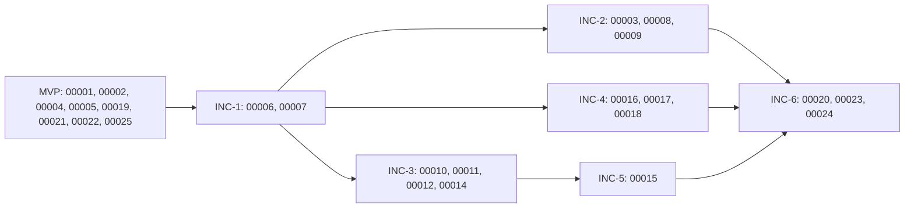
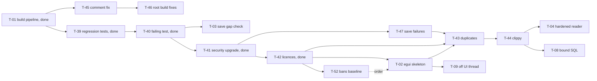
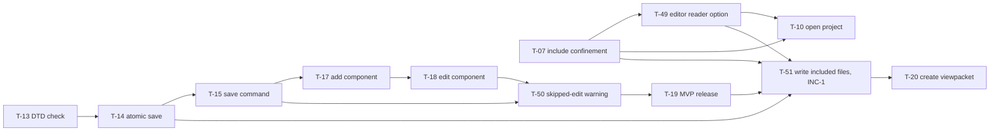

# GUI Editor Delivery Plan

## Introduction

### Purpose

Delivery order for `gui_editor`: the MVP, the increments after the MVP, and the tasks of each story.
Readers are the product owner and the developers of `gui_editor`.

### Vocabulary

- CI gate: The `cargo audit`, `cargo deny`, `cargo clippy`, and `cargo test` checks that CI runs for each crate.
- Included file: SAD XML file named by an `<Include>` element of the including project file.
- Increment: Releasable set of stories that builds only on earlier increments.
- MVP: Minimal viable product, the first release.
- Size: Relative effort of a task, S, M, or L, without calendar dates.
- Skipped edit: Edit to a Component or Team element loaded from an included file, which no save writes to that file.
- Spike: Time-boxed experiment that reduces a risk before the real work.
- Task: Unit of work small enough for one change set.
- Walking skeleton: Thin end-to-end path through all MVP components, built before any one is deepened.

### References

- Requirements: [REQUIREMENTS.md](REQUIREMENTS.md)
- Story cards: [USER_STORIES.md](USER_STORIES.md)

### Overview

- **[Goal](#goal):** what the plan delivers.
- **[Product owner decision](#product-owner-decision):** approved scope and order.
- **[Existing work](#existing-work):** state of the code and CI before the next task.
- **[MVP](#mvp):** first release scope and exit criteria.
- **[Increments](#increments):** releases after the MVP.
- **[Task list](#task-list):** tasks with size, definition of done, and delivery order.
- **[Dependency graph](#dependency-graph):** order between increments and between the first tasks.
- **[Deferred](#deferred):** stories and tasks outside the plan.
- **[Backlog](#backlog):** review nits, each attached to the task that touches the same code.
- **[Risks](#risks):** risks and mitigations.
- **[Security findings](#security-findings):** issues found in existing code.
- **[Open questions](#open-questions):** adopted defaults and pending questions.

## Goal

Maintainers update one or more SADs through a native Linux egui editor, without hand-editing XML, and every saved file validates and works with `sad2md`.

## Product Owner Decision

The product owner approved the plan on 2026-11-23.
After T-01, the product owner made the follow-up decisions in the rows marked "T-01 follow-up".
The product owner approved the task order of the T-01 follow-up on 2026-11-23.
After T-40, the product owner decided questions 11 to 13 and approved the revised order in [Delivery Order](#delivery-order) on 2026-11-24.
The decision on question 8 is provisional, because the product owner gave no answer.
After T-41, the product owner made the decisions in the rows marked "T-41 follow-up" on 2026-11-24.
After commit `5fbeeb3`, the product owner made the decisions in the rows marked "5fbeeb3 follow-up" on 2026-11-24.

| Question | Decision |
| --- | --- |
| Accepted save losses, requirements open question 8 | Accepted for the first release and recorded in REQUIREMENTS.md; no task. |
| Advisories in `aws2xml`, T-41 follow-up | Record risk only; no task; the 16 advisories stay unassigned, see [Security Findings](#security-findings). |
| Advisory fix, T-01 follow-up | Upgrade dependencies in task T-41; add no advisory exceptions. |
| Bans check baseline, 5fbeeb3 follow-up | Add task T-52, size S, before T-02, to bring the `cargo deny check` bans state back to the baseline before `5fbeeb3`; T-52 takes the `sad2md` wildcard from T-43. |
| Clippy gate, T-01 follow-up | Add `cargo clippy -D warnings` to CI in task T-44. |
| Clippy requirement, question 8, provisional | No answer; the planner default applies. T-44 stays under GEDT-STORY-00019 with GEDT-AR-00030 as the nearest requirement; the architect adds a clippy requirement later. |
| Deferred list | GEDT-STORY-00013 stays deferred; T-48 is not scheduled, see [Deferred](#deferred). |
| Delivery order, 5fbeeb3 follow-up | T-52, T-02, T-47, T-43, T-44, T-45, T-46, T-03, then the rest unchanged; T-43 keeps its dependencies T-02, T-42, and T-47. |
| Delivery order, T-01 follow-up | Approved as is: T-39, T-40, T-41, T-42, T-02, T-43, T-44, T-45, T-46, then T-03 onward. |
| Delivery order, revision after T-40 | Approved on 2026-11-24, with T-51 moved to INC-1 and T-48 removed, see [Delivery Order](#delivery-order). |
| DTD validation | Structural DTD checks in the Rust core now; the product owner approves `xmllint` as a CI-only tool when T-13 starts. |
| Duplicate `syn` versions, T-41 follow-up | T-43 removes the `syn` 2 and `syn` 3 duplicate in `tui_editor` by pinning `thiserror`, or by a `skip` entry with a reason. |
| Duplicate versions, T-01 follow-up | Remove duplicates through upgrades; `skip` only for windows-target duplicates, each with a reason; `multiple-versions = "deny"` stays. |
| Included-file writes, question 12 | T-51, size L, is the first task of INC-1, not part of the MVP; until T-51 lands, the T-50 warning tells users that edits to included-file items are skipped. |
| Increment order | INC-1 to INC-6 as listed. |
| Licence allow list, T-01 follow-up | Add Zlib and Unicode-3.0 to the `deny.toml` allow list in task T-42. |
| MVP scope | Components only; the MVP writes no included file; viewpackets, diagrams, and included-file writes follow in INC-1. |
| Next action | Start T-01, build pipeline; T-01 is done. |
| Old artifact `sad_xml_sql/dump_test_output.xml` | No task; git ignores the file. |
| Partial T-02 changes, question 6 | T-02 restarts clean; the partial T-02 changes leave the working tree before the T-01 commit. |
| Position of T-02, question 7 | T-02 stays after T-42. |
| Regression tests, T-01 follow-up | Task T-39 adds `sad2md` and `tui_editor` tests before any change to `sad_xml_sql`. |
| Repository-root findings, question 9 | Add task T-46, size S, after T-45, to fix the three repository-root findings. |
| Round-trip scope, question 11 | Shrink both tasks: T-03 becomes a short check of the save gaps left after T-40, and T-12 covers only what T-40 did not. |
| Save failure in `tui_editor`, requirements open question 10 | Task T-47 under GEDT-STORY-00002 fixes the silent save failure and keeps the `tui_out.xml` target. |
| Save target of `tui_editor`, question 13 | Keep `tui_out.xml`; T-48 is not scheduled, see [Deferred](#deferred). |
| Skipped-edit warning form, requirements open question 12 | Non-modal warning on a direct Save; on exit, a modal warning that lets the user cancel the exit; T-50 implements this form. |

## Existing Work

- T-01 is done and committed as `dd719d1`.
  - `gui_editor/build.sh` uses a pinned image and `--locked`, and runs `cargo audit` and `cargo deny` before `cargo build`.
  - CI gates every crate in the test matrix with audit and deny before `cargo test`, using `gui_editor/deny.toml` and `gui_editor/.cargo/audit.toml`.
- T-39 is done, reviewed, approved, and committed.
  - `sad2md` and `tui_editor` now have regression tests, so GEDT-AR-00030 protects both tools.
- T-40 is done, reviewed, approved with nits N1 to N6, and committed.
  - T-40 fixes the root cause of the `context_model` UNIQUE failure in `sad_xml_sql`.
  - T-40 also fixes the save round trip: DOCTYPE, `Version`, addresses, DTD order, no drift, DiagramKey, ViewPacket TeamId, and Include elements.
  - T-40 writes only items from the main file to the main file, and never writes included files.
  - T-03 and T-12 shrink to the gaps that T-40 left, as decided on question 11.
  - The review nits are in [Backlog](#backlog).
- T-41 is done and committed.
  - T-41 upgrades `ratatui` to 0.30.2 and replaces `tui-textarea` with `ratatui-textarea` 0.9.4.
  - T-41 removes RUSTSEC-2026-0459 from `aws2xml` as a side effect.
  - T-41 removes the `crossterm`, `rustix`, `linux-raw-sys`, `unicode-width`, and `windows_*` duplicates as a side effect.
  - T-41 adds a `syn` 2 and `syn` 3 duplicate in `tui_editor`, through `thiserror` 2 in `kasuari` and `ratatui-core`; T-43 resolves the duplicate.
  - `aws2xml` keeps 16 known advisories that predate T-41, see [Security Findings](#security-findings).
- T-42 is done; the product owner commits T-42.
  - The review nits R-02 to R-04 are in [Backlog](#backlog).
- Commit `5fbeeb3`, "Update sqlite to 0.41", broke the bans baseline of `cargo deny check`.
  - `5fbeeb3` adds the `bans.skip` entries `hashbrown@0.12.3`, `syn@2.0.104`, and `windows-sys@0.59.0` to `gui_editor/deny.toml`, which all four crates share through `--config`.
  - With cargo-deny 0.22.0 and `--deny warnings`, `tui_editor` passes, `gui_editor` reports `unmatched-skip` for all three entries, and `sad_xml_sql` and `sad2md` report `unmatched-skip` for `syn` and `windows-sys`.
  - The `hashbrown` and `syn` entries are not windows-target duplicates, against the T-01 follow-up decision on duplicate versions.
  - The `gui_editor` test `test_ar_00025_ac4_deny_bans_deny_multiple_versions_and_wildcards` fails with "bans.skip is not empty" at `gui_editor/tests/test_build_pipeline_config.rs:621`.
  - `sad2md` fails with `error[wildcard]`, because the `sad_xml_sql` path dependency in `sad2md/Cargo.toml` has no `version`; `tui_editor` already has `version = "0.7.3"`.
  - T-52 restores the baseline.
- Git status shows no partial T-02 change in `gui_editor`; T-02 restarts clean from the T-01 commit.
- CI stays red until T-52 and T-43 land, because `cargo deny check bans` fails for `gui_editor`, `sad2md`, `sad_xml_sql`, and `tui_editor`.
- The uncommitted change to `aws2xml/Cargo.lock` predates T-01 and belongs to no planned task.
- Save findings in shared and `tui_editor` code:
  - `tui_editor/src/work.rs` line 314 discards the `Result` of `dump_db_to_xml` and writes the fixed path `tui_out.xml`.
  - `dump_db_to_xml` writes in place with `File::create`, which is not atomic, against GEDT-AR-00007.
  - `dump_db_to_xml` prints debug lines with `println!`, which garble the `tui_editor` screen.
- `sad_xml_sql` loads and saves through in-memory SQLite, with the defects listed in [REQUIREMENTS.md](REQUIREMENTS.md#risks).
- No existing code fully covers any story.

## MVP

The MVP is a native Linux app that opens a project file safely, adds and edits components, and saves the file atomically so that the file validates and `sad2md` accepts the file.
The build, test, and release pipeline is part of the MVP.

| Story | Priority | Requirements |
| --- | --- | --- |
| GEDT-STORY-00001 | Critical | GEDT-AR-00001, 00012, 00013, 00027, GEDT-FR-00001, 00002, 00003, 00042 |
| GEDT-STORY-00002 | Critical | GEDT-AR-00001, 00002, 00030, GEDT-FR-00004, 00005, 00006, 00009, 00045 to 00048; GEDT-AR-00035, GEDT-FR-00043, 00044 land in INC-1 with T-51, see open question 19 |
| GEDT-STORY-00004 | Critical | GEDT-FR-00010, 00011, 00012, 00013 |
| GEDT-STORY-00005 | Critical | GEDT-FR-00013, 00014, 00015, 00016, 00045 |
| GEDT-STORY-00019 | Critical | GEDT-AR-00003, 00004, and GEDT-AR-00025, see open question 5 |
| GEDT-STORY-00021 | Critical | GEDT-AR-00010 to 00016, 00029, 00031, 00035 |
| GEDT-STORY-00022 | Critical | GEDT-AR-00007, 00008, 00009, GEDT-FR-00006 |
| GEDT-STORY-00025 | Critical | GEDT-AR-00009, 00015, 00023, 00024 |

### MVP Security

The only interface of the native app is the local project file and its included files.

- Input validation: the project file and its included files are untrusted input, see GEDT-STORY-00021.
- Write confinement: the MVP writes no included file, so the MVP exposes no included-file write surface.
  T-51 in INC-1 adds the write together with the write-time check of GEDT-AR-00035.
- Secrets: the app needs no credentials, and CI runs a secret scan.
- Authentication and authorization: not needed for a single-user local app.
  OS file permissions protect the project files, as the out-of-scope decision states.
- Supply chain: shipped crates get no advisory exceptions; T-41 fixes known advisories through upgrades.

### MVP Exit Criteria

- Open, then save, of every fixture gives equal canonical XML, apart from the [Known save limitations](REQUIREMENTS.md#known-save-limitations), passes `xmllint --noout --nonet --valid` in CI, and passes `sad2md`.
- No save writes an included file; every edit to a Component or Team element of an included file is a skipped edit, and the hash of each included file stays unchanged.
- Each explicit Save or exit with a skipped edit shows the warning of GEDT-FR-00045, which tells the user that edits to included-file items are skipped.
- Read-only directory and full-disk fixtures show an error naming the file and cause, keep the file, and keep the project marked modified.
- 1,000 kills during save leave zero corrupted files.
- The network namespace test sees zero outbound connections.
- All security fixtures pass, including include traversal and symlink fixtures on load, and 1 hour of reader fuzzing causes no crash.
- The `sad2md` and `tui_editor` test suites pass.
- The CI gate passes for `gui_editor`, `sad2md`, `sad_xml_sql`, and `tui_editor`.
- The app works on Fedora, on Wayland and on X11.

## Increments

### INC-1 Included Files, Viewpackets, and Diagrams

- Value: edits to included components reach their files, and maintainers edit all SAD content, not only components.
- Stories: GEDT-STORY-00006, GEDT-STORY-00007, both Critical; T-51 completes GEDT-STORY-00002, Critical, see open question 19.
- Requirements: GEDT-AR-00035, GEDT-FR-00017 to 00022, 00043, 00044; the MVP covers GEDT-FR-00011.
- Depends on: MVP.
- First task: T-51, write included files.
- Security: T-51 ships the write-time path check of GEDT-AR-00035 with the included-file write.
- Exit: an edit to an included component is written only to that included file, and all other elements of that file stay unchanged.
  Traversal and symlink-swap fixtures at write time are rejected with the file kept.
  The T-50 warning lists only Team edits of included files.
  Viewpackets and diagrams of all six styles are editable, and saved files pass the MVP checks.
- Also holds spike T-23 on multiple windows under Wayland, to test that risk early.

### INC-2 Editing Comfort

- Value: autosave, fast component search, and replicas shown as separate components.
- Stories: GEDT-STORY-00003, GEDT-STORY-00008, GEDT-STORY-00009.
- Requirements: GEDT-AR-00028, GEDT-FR-00007, 00008, 00023, 00024; the MVP covers GEDT-FR-00047 and 00048.
- Depends on: INC-1.
- Exit: autosave within 60 seconds, with a prompt before overwriting a file changed on disk.
  Autosave skips skipped edits without a warning.
  Search updates within 100 ms and matches `'`, `%`, and `_` literally.

### INC-3 Reading the Architecture

- Value: readers explore the architecture without the risk of changing the project.
- Stories: GEDT-STORY-00010, GEDT-STORY-00011, GEDT-STORY-00012, GEDT-STORY-00014.
- Requirements: GEDT-FR-00025 to 00029, 00031.
- Depends on: INC-1.
- Exit: the core rejects every change request in view mode, and filters and panes leave the modified flag unchanged.

### INC-4 Multiple Projects

- Value: maintainers work across several SADs and reference components between projects.
- Stories: GEDT-STORY-00016, GEDT-STORY-00017, GEDT-STORY-00018.
- Requirements: GEDT-FR-00034 to 00040.
- Depends on: MVP and INC-1.
- Exit: each project is saved only to its own file, and a reference to a project that is not loaded stays in the file after save.

### INC-5 Linked Windows

- Value: windows on several screens follow the same selection.
- Story: GEDT-STORY-00015.
- Requirements: GEDT-FR-00032, 00033.
- Depends on: INC-3.
- Exit: a selection reaches every window within 1 second, on Wayland and on X11.

### INC-6 Local Web App

- Value: maintainers edit in a browser on the local machine.
- Stories: GEDT-STORY-00020, GEDT-STORY-00023, GEDT-STORY-00024.
- Requirements: GEDT-AR-00005, 00017 to 00021, GEDT-FR-00041.
- Depends on: INC-1 to INC-5, because GEDT-FR-00041 requires every native function.
- Security: GEDT-STORY-00023 and GEDT-STORY-00024 ship with the web surface they protect.
- Exit: the Host, Origin, token, and Content-Security-Policy tests pass, and the shared UI suite passes in Firefox and Chromium.

## Task List

Requirement IDs in the definition of done are short forms, for example AR-00025 for GEDT-AR-00025.
Table rows are sorted by task ID; [Delivery Order](#delivery-order) gives the order of work.
Task T-48 is not scheduled and is listed in [Deferred](#deferred).

| ID | Task | Story | Inc | Depends on | Size | Definition of done |
| --- | --- | --- | --- | --- | --- | --- |
| T-01 | Build pipeline | 00019 | MVP | none | M | Done, committed as `dd719d1`. `build.sh` builds `gui_editor`, not `amber-dos`; image pinned by version and digest; `cargo build --locked`; `cargo audit` and `cargo deny` fail on unignored findings; secret scan; CI runs the `gui_editor`, `sad_xml_sql`, `sad2md`, and `tui_editor` tests; `.cargo-home/` ignored in `gui_editor` and `aws2xml` (AR-00024, AR-00025, AR-00030) |
| T-02 | egui walking skeleton | 00019 | MVP | T-01, T-42 | M | Restarted clean from the T-01 commit; eframe window starts on Fedora Wayland and X11, with an open-file dialog and an empty component list; new licences of egui dependencies, such as OFL-1.1, approved by the product owner and added to `deny.toml` with the allow-list test; windowing duplicates removed, or skipped for windows targets with a reason, see open question 20; backlog items R-02 to R-04 done; `gui_editor` CI gate green (AR-00003, AR-00004, AR-00025) |
| T-03 | Check of save gaps after T-40 | 00002 | MVP | T-01, T-40 | S | Short check, no fixes: open and save of every fixture compared with the source; each element that `sad_xml_sql` still drops or reorders, apart from the Known save limitations, listed and assigned to T-12 or proposed as a Known save limitation; elements fixed by T-40 not re-checked beyond the existing T-40 tests |
| T-04 | Hardened XML reader | 00021 | MVP | T-44 | M | External entity and entity expansion fixtures rejected; no external DTD loaded; file over 64 MiB or nesting over 32 levels rejected (AR-00010, AR-00011, AR-00031) |
| T-05 | Errors instead of crashes | 00021 | MVP | T-04 | M | No `expect`, panic, or exit on input paths, including `update_component_by_id`; legacy tests expect error values; 1 hour of fuzzing without crash (AR-00012) |
| T-06 | Field validation | 00021 | MVP | T-05 | S | Bad address, non-integer SortOrder, and FileId outside 1 to 255 rejected; `convert_from_address_to_id` fixed (AR-00013) |
| T-07 | Include confinement | 00021 | MVP | T-05 | S | Path traversal and symlink fixtures rejected; Include `url` never fetched; the path check is a reusable core function for T-51 (AR-00014, AR-00015) |
| T-08 | Bound SQL parameters | 00021 | MVP | T-44 | S | CI static check finds no SQL built by string formatting (AR-00016) |
| T-09 | Load and save off the UI thread | 00021 | MVP | T-02 | S | Each UI frame under 100 ms during load (AR-00029) |
| T-10 | Open project | 00001 | MVP | T-06, T-07, T-09, T-49 | M | All elements of the selected file loaded; only Component and Team elements of included files loaded, through the T-49 option; error names path, line, column, and rule; file hash and mtime unchanged (FR-00001 to FR-00003, FR-00042, AR-00001) |
| T-11 | Load benchmark | 00001 | MVP | T-10 | S | 2,000 components, 500 viewpackets, and 5,000 relations load within 2 seconds, checked in CI (AR-00027) |
| T-12 | Remaining writer fixes | 00002 | MVP | T-03 | M | Only the gaps that T-03 assigns are fixed, without rework of the T-40 fixes; canonical XML compare test for every fixture after open and save, apart from the Known save limitations; backlog items N1, N3, and N5 done; re-size to S if T-03 finds no gap (FR-00005, AR-00002, AR-00030) |
| T-13 | Pre-save DTD check | 00002 | MVP | T-12 | M | Core checks the DTD structure rules in Rust; a rule failure keeps the existing file and names the failing element; `xmllint` runs in CI only, and the product owner approves `xmllint` as a CI-only tool when T-13 starts; the CI `xmllint` step covers required counts such as `ViewPacket+`, `Component+`, and `ComponentId+`, backlog item N6 (FR-00006) |
| T-14 | Atomic save | 00022 | MVP | T-13 | M | Atomic save in the shared `sad_xml_sql` save path, replacing the in-place `File::create` of `dump_db_to_xml`, so the editor and `tui_editor` use one path; temporary file in the project directory with mode no wider than the project file; flush, rename, directory flush; mode bits kept; every failure returned as an error naming the file and cause; 1,000-kill test passes (AR-00007 to AR-00009, FR-00046) |
| T-15 | Save command and external-change check | 00002 | MVP | T-14 | M | Saves to the source file; asks before overwriting a file changed on disk; a failed save shows the error naming file and cause, keeps the file, and keeps the project marked modified, tested with read-only directory and full-disk fixtures (FR-00004, FR-00009, FR-00046 to FR-00048) |
| T-16 | Data stays local | 00025 | MVP | T-10 | S | Network namespace test sees zero connections; logs hold only paths, addresses, and error kinds (AR-00015, AR-00023, AR-00024) |
| T-17 | Add component | 00004 | MVP | T-15 | M | Unique address with FileId first; case-insensitive name order; duplicate name rejected; `template_sad.xml` updated (FR-00010 to FR-00013) |
| T-18 | Edit component | 00005 | MVP | T-17 | M | Every DTD child editable; address unchanged; rename shown in every view (FR-00013 to FR-00016) |
| T-19 | MVP release | 00019 | MVP | T-11, T-16, T-18, T-50 | S | Wayland and X11 demonstration; `sad2md` accepts a saved file; no included file written; `gui_editor/README.md` updated, including the Known save limitations and the skipped edits to included-file items until INC-1 |
| T-20 | Create viewpacket | 00006 | INC-1 | T-19 | M | Primary component must exist; types and styles from `create_styles`; unique address (FR-00011, FR-00017, FR-00018) |
| T-21 | Edit viewpacket | 00006 | INC-1 | T-20 | M | Every DTD child and attribute editable except the address (FR-00019) |
| T-22 | Diagram editor | 00007 | INC-1 | T-21 | L | Six styles; relation endpoints checked; removal from a diagram keeps the component (FR-00020 to FR-00022) |
| T-23 | Spike: multiple windows on Wayland | 00015 | INC-1 | T-02 | S | Time-boxed prototype of two egui windows; result recorded |
| T-24 | Autosave | 00003 | INC-2 | T-22 | M | Save within 60 seconds; no write without changes; skipped edits skipped without a warning and not counted as unsaved changes; prompt before overwrite; a failed autosave shows the error and keeps the project marked modified (FR-00007 to FR-00009, FR-00045, FR-00047, FR-00048, AR-00007, AR-00029) |
| T-25 | Component search | 00008 | INC-2 | T-22 | S | Case-insensitive; `LIKE` with `ESCAPE` so special characters match literally; under 100 ms for 2,000 components (FR-00024, AR-00016, AR-00028) |
| T-26 | Replica nodes | 00009 | INC-2 | T-22 | S | ETCD1 to ETCD3 fixture shows 3 nodes, each with its own relations (FR-00023) |
| T-27 | View mode | 00011 | INC-3 | T-22 | M | Core rejects changes in view mode; selection kept on mode switch (FR-00026 to FR-00028) |
| T-28 | Component overview | 00012 | INC-3 | T-27 | S | Lists only viewpackets with the component as primary (FR-00029) |
| T-29 | Panes | 00014 | INC-3 | T-27 | M | Two or more panes, each with its own view and selection (FR-00026, FR-00031) |
| T-30 | Client-server filter | 00010 | INC-3 | T-27 | S | Name filter shows matches and their direct relations; project data unchanged (FR-00025, FR-00026) |
| T-31 | Multi-project session | 00016 | INC-4 | T-22 | M | Two or more files loaded; FileIds unique; each project saved only to its own file (FR-00034, FR-00035) |
| T-32 | Cross-project references | 00017 | INC-4 | T-31 | M | Reference stored as address; unresolved references marked and kept on save (FR-00036 to FR-00038) |
| T-33 | Multi-project view | 00018 | INC-4 | T-32 | S | Each component shows the Title of the owning project (FR-00039, FR-00040) |
| T-34 | Linked windows | 00015 | INC-5 | T-23, T-29 | M | Selection reaches every window within 1 second (FR-00032, FR-00033) |
| T-35 | Web architecture decision | 00020 | INC-6 | T-34 | M | Decision record approved by the product owner |
| T-36 | Local server protection | 00023 | INC-6 | T-35 | M | Loopback only; wrong Host gets 421; foreign Origin gets 403; 128-bit per-launch token required (AR-00017 to AR-00020) |
| T-37 | Text-only rendering and CSP | 00024 | INC-6 | T-35 | S | `<script>` fixture shown as text; CSP allows scripts from the server origin only (AR-00021) |
| T-38 | Web feature parity | 00020 | INC-6 | T-36, T-37 | L | Shared UI suite passes in Firefox and Chromium (AR-00005, FR-00041) |
| T-39 | Regression tests for `sad2md` and `tui_editor` | 00002 | MVP | T-01 | M | Done, reviewed, approved, and committed. Fixed `tui_editor/Cargo.lock` with `sad_xml_sql` 0.7.3 committed; `sad2md` golden-output tests over the fixtures; `tui_editor` tests for load, edit, and save through `sad_xml_sql`, without a terminal; both suites run with `--locked` in CI and pass (AR-00030) |
| T-40 | Fix failing `sad_xml_sql` test | 00002 | MVP | T-39 | S | Done, reviewed, approved with nits N1 to N6, see [Backlog](#backlog), and committed. `db_update::tests::test_insert_into_context_model_ignore_duplicates_ignores_duplicate` passes without a panic at `src/db_update.rs:212`; root cause fixed in code, or test correction justified in the change set; `sad2md` and `tui_editor` suites pass (AR-00030). The change set also holds the save round-trip fix, so T-03 and T-12 cover only the remaining gaps |
| T-41 | Security upgrade of shipped crates | 00019 | MVP | T-40 | L | Done and committed; `ratatui` upgraded to 0.30.2 and `tui-textarea` replaced with `ratatui-textarea` 0.9.4. `rusqlite` 0.41 with `libsqlite3-sys` 0.39 or later in `sad_xml_sql`, `sad2md`, and `tui_editor`, fixing RUSTSEC-2026-0459; `tui_editor` upgrades fix RUSTSEC-2026-0009, RUSTSEC-2025-0055, RUSTSEC-2024-0436, RUSTSEC-2026-0253, RUSTSEC-2026-0002, and RUSTSEC-2026-0486; no new advisory ignore entries; `cargo audit` passes for all four crates; all test suites pass (AR-00025, AR-00030) |
| T-42 | Licences | 00019 | MVP | T-41 | S | Done; the product owner commits T-42; review nits R-02 to R-04 in [Backlog](#backlog). `license = "Apache-2.0"` in `sad2md`, `sad_xml_sql`, and `tui_editor`; Zlib and Unicode-3.0 in the `deny.toml` allow list; `deny.toml` key allow-list test in `gui_editor/tests/test_build_pipeline_config.rs` updated and passing; `cargo deny check licenses` passes for all four crates (AR-00025) |
| T-43 | Duplicate versions | 00019 | MVP | T-02, T-42, T-47 | M | Starts from the T-52 bans baseline; path dependency versions are out of scope, because T-52 fixes the `sad2md` wildcard and `tui_editor` already has `version = "0.7.3"`; one `hashbrown` version instead of 0.12 and 0.17; the `tui_editor` duplicates left after T-41 removed through upgrades, because T-41 already removed the `crossterm`, `rustix`, `linux-raw-sys`, `unicode-width`, and `windows_*` duplicates; the `syn` 2 and `syn` 3 duplicate in `tui_editor`, added by T-41 through `thiserror` 2 in `kasuari` and `ratatui-core`, resolved by pinning `thiserror`, or by a `skip` entry with a reason, as decided after T-41; `windows-sys` 0.59 and 0.61 removed, or skipped as a windows-target duplicate; other `skip` entries only for windows-target duplicates, each with a reason, see open question 20; `multiple-versions = "deny"` kept; `cargo deny check` passes for all four crates; all test suites pass (AR-00025, AR-00030) |
| T-44 | Clippy gate | 00019 | MVP | T-43 | M | Pinned image adds clippy through `rustup component add clippy`; CI runs `cargo clippy --locked --all-targets -- -D warnings` for all four crates; warnings fixed, not allowed in bulk; all test suites pass; CI fully green (AR-00030, see open question 8) |
| T-45 | Requirement IDs in advisory script | 00019 | MVP | T-01 | S | Backlog nit F-15: the three comments in `gui_editor/check_advisory_ignores.sh` cite GEDT-AR-00025 instead of `DEF-04` and `DEF-06` (AR-00025) |
| T-46 | Repository-root build fixes | 00019 | MVP | T-45 | S | Root `build.sh` uses the official `rust` image pinned by version and digest instead of `rust:latest`, runs `cargo build --locked`, names no `amber-dos` binary, and leaves build output owned by the invoking user under rootless Docker; `build_in_docker.sh` pins `rust:1.98` by digest; root `.gitignore` ignores `.cargo-home/`; `git status` shows no `.cargo-home/` entry after a build; both scripts pass `shellcheck` (AR-00025, nearest requirement, see open question 10) |
| T-47 | Save failures reported in core and `tui_editor` | 00002 | MVP | T-41 | S | `dump_db_to_xml` returns an error value naming the output file and the cause; the `println!` debug lines in `dump_db_to_xml` removed, so the `tui_editor` screen stays clean; `tui_editor/src/work.rs` line 314 handles the `Result` and shows the error on screen; the save target stays `tui_out.xml`; edits stay in the session after a failure; read-only directory and full-disk fixtures in the `sad_xml_sql` and `tui_editor` tests, without a terminal; backlog items N2 and N4 done; all test suites pass (FR-00046, FR-00047 and FR-00048 applied to `tui_editor`, AR-00030) |
| T-49 | Editor-only reader option for included files | 00001 | MVP | T-07 | M | `sad_xml_sql` reader option loads only Component and Team elements from included files and follows no Include of an included file; only `gui_editor` sets the option; the default read is unchanged, and the T-39 `sad2md` golden tests pass without change; tests cover both read paths (FR-00042, AR-00030) |
| T-50 | Skipped-edit warning | 00005 | MVP | T-15, T-18 | M | Core records each edit to a Component or Team element of an included file as a skipped edit; skipped edits leave the modified flag unchanged; a direct Save shows a non-modal warning naming the address and source file of each skipped edit; exit shows a modal warning that lets the user cancel the exit, as decided on requirements open question 12; until T-51 lands, the warning states that edits to included-file items are skipped; the warning repeats on each Save or exit, also when no file is written; tests for direct Save and exit; also traces to GEDT-STORY-00002 (FR-00008, FR-00045) |
| T-51 | Write included files | 00002 | INC-1 | T-07, T-14, T-15, T-19, T-49, T-50 | L | First task of INC-1. An included file is written only when the path resolved at write time is inside the directory of the including project file, and the write goes through the checked directory handle; traversal and symlink-swap fixtures rejected with the file kept (AR-00035); only the Component elements loaded from that file written (FR-00043); Document, Include, Team with `Member`, ViewPacket, ComponentRelation, Behavior, and Requirement copied from the file on disk and unchanged in a canonical XML compare (FR-00044); DTD check, atomic save, external-change check, and failure handling of T-13 to T-15 apply to each written file; the T-50 warning then lists only Team edits of included files; also traces to GEDT-STORY-00021 (FR-00009, FR-00046 to FR-00048) |
| T-52 | Bans check baseline | 00019 | MVP | T-42 | S | Runs before T-02. The three `bans.skip` entries added by `5fbeeb3`, `hashbrown@0.12.3`, `syn@2.0.104`, and `windows-sys@0.59.0`, removed from `gui_editor/deny.toml`, so `bans.skip` is empty as before `5fbeeb3`; the `sad_xml_sql` path dependency in `sad2md/Cargo.toml` gets `version = "0.7.3"`, as in `tui_editor`; `test_ar_00025_ac4_deny_bans_deny_multiple_versions_and_wildcards` passes; with cargo-deny 0.22.0 and `--deny warnings`, no crate reports `unmatched-skip` or `wildcard`, and `cargo deny check bans` passes for `gui_editor`, `sad2md`, and `sad_xml_sql`; the `tui_editor` duplicates that then fail, such as `syn` 2 and 3, `hashbrown`, and `windows-sys`, stay for T-43; no new `skip` entry added; `multiple-versions = "deny"` kept; all test suites pass (AR-00025, AR-00030) |

### Delivery Order

The product owner approved the revised order on 2026-11-24, and added T-52 before T-02 on 2026-11-24.
The list follows plan order, so the list is not sorted alphabetically.

- T-39, done and committed: CI runs real tests for `sad2md` and `tui_editor`. The product owner sees no app change.
- T-40, done and committed: all test jobs pass, and the shared writer keeps more of the file on save. The product owner sees green test steps; audit and deny stay red.
- T-41, done and committed: shipped `sad2md` and `tui_editor` no longer link the vulnerable SQLite. The product owner sees `cargo audit` green for every crate in the CI matrix, with unchanged tool behaviour.
- T-42, done, commit by the product owner pending: licence checks pass. The product owner sees `cargo deny` licence checks green; duplicate checks stay red.
- T-52: bans check baseline. The product owner sees no `unmatched-skip` or `wildcard` finding, `cargo deny check bans` green for `gui_editor`, `sad2md`, and `sad_xml_sql`, and the bans test passing; the `tui_editor` duplicate checks stay red until T-43.
- T-02: first GUI. The product owner sees an egui window on Fedora Wayland and X11, with an open-file dialog and an empty component list.
- T-47: `tui_editor` reports save failures. The product owner sees an error on the `tui_editor` screen when a save fails, and no debug lines over the screen.
- T-43: duplicate checks pass. The product owner sees the whole CI gate green for all four crates.
- T-44: clippy joins the CI gate. The product owner sees CI green with clippy.
- T-45: comment fix. The product owner sees no change.
- T-46: repository-root build fixes. The product owner sees pinned root build scripts and no `.cargo-home/` in `git status`.
- T-03: short check of the save gaps left after T-40. The product owner sees a list of the remaining save gaps.
- T-04, T-08, T-05, T-06, T-07: hardened shared reader. The product owner sees `sad2md` reject hostile fixtures with errors instead of crashes.
- T-49: editor-only reader option. The product owner sees unchanged `sad2md` output.
- T-09, T-10, T-11, T-16: the GUI opens a real project. The product owner sees the components of a project and of its included files in the window.
- T-12, T-13, T-14, T-15: the GUI saves. The product owner sees an unchanged project saved atomically, and save errors shown in the window.
- T-17, T-18: add and edit components. The product owner sees components added and edited in the GUI.
- T-50: skipped-edit warning. The product owner sees a warning on Save and on exit, stating that edits to included-file items are skipped.
- T-19: MVP release on Wayland and X11.
- T-51, first task of INC-1: included files written. The product owner sees an edit to an included component saved into the included file, with the rest of that file unchanged.
- T-20 onward: rest of INC-1 and later, as in the task list.

Reasons for the order:

- T-39 comes first, because the product owner requires regression tests before any change to `sad_xml_sql`.
- T-40 comes before T-41, so the upgrade starts from a green test baseline.
- T-41 stays early, because the advisories affect crates that ship today.
- T-42 and T-43 follow T-41, because the upgrades change the licence set and the duplicate set.
- T-02 follows T-42, because both edit `deny.toml` and its allow-list test; T-02 keeps the approved position.
- T-52 runs before T-02, by product owner decision after commit `5fbeeb3`, because `5fbeeb3` left unmatched and non-windows `skip` entries, a failing bans test, and a `sad2md` wildcard; T-02 and T-43 then start from the bans baseline.
- T-47 follows T-41, so the save-failure fix does not collide with the `rusqlite` upgrade in `sad_xml_sql` and `tui_editor`.
- T-47 follows T-02, so the GUI is not delayed, and precedes T-43 and T-44, so the silent data loss in a shipped tool ends before the remaining CI work, and the `tui_editor` upgrades and clippy fixes start from the fixed code.
- T-47 takes the `println!` removal, because T-47 already changes `dump_db_to_xml` and the debug lines break the `tui_editor` screen today.
- T-14 takes the atomic save of the shared core, because the editor save task needs GEDT-AR-00007, and one shared path avoids a second writer.
- T-04 and T-08 wait for T-44, so changes to the shared reader start on a fully green CI gate.
- T-49 follows T-07, because both change the include loading code, and precedes T-10, the first project load in the GUI.
- T-50 follows T-18, because edits to included components exist only from T-18, and precedes T-19, so the release loses no edit silently.
- T-51 follows T-07, T-14, and T-50, because the write needs the path check, the atomic save, and the skipped-edit tracking.
- T-51 is the first task of INC-1, by product owner decision on question 12; the T-50 warning covers the gap in the MVP.
- T-48 is not scheduled, by product owner decision on question 13, see [Deferred](#deferred).
- T-46 follows T-45 and precedes T-03, because the root findings affect the build of shipped crates.

## Dependency Graph

The story dependencies contain no cycles.

The first MVP tasks repair the CI gate before work on the shared reader starts.

The include and save tasks join the MVP path before the release; T-51 opens INC-1.

## Deferred

- GEDT-STORY-00013, Nice to have, with GEDT-FR-00030.
  - Reason: lowest priority; the story builds on GEDT-STORY-00012.
  - Size S; a candidate for INC-3 or later.
- T-48, `tui_editor` saves to the loaded project file, size S, no GEDT story or requirement.
  - Reason: the product owner keeps `tui_out.xml`, so `tui_editor` never overwrites a real project file with the Known save limitations and without an external-change check.
  - T-47 still adds save-failure reporting with the fixed `tui_out.xml` path.
  - Scope if scheduled later: save through the atomic save of T-14, no write to included files, the T-47 error on failure, and `tui_editor/README.md` naming the save target and the Known save limitations.

## Backlog

Review nits that need no product owner decision.
Each item rides with the task that touches the same code.

| Item | Location | Taken by |
| --- | --- | --- |
| Docs nit: sentences wrapped across lines in the "Included files" notes. | `gui_editor/docs/REQUIREMENTS.md` | Architect, in progress; no task |
| F-15, T-01 review: comments cite GEDT-AR-00025 instead of `DEF-04` and `DEF-06`. | `gui_editor/check_advisory_ignores.sh` | T-45 |
| N1, T-40 review: `Include` elements written in FileId order, not source order; use `ORDER BY rowid` and document that only the includes of the main file are stored. | `sad_xml_sql/src/db_retrieval.rs:473-475` | T-12 |
| N2, T-40 review: comment lines break mid-phrase. | `sad_xml_sql/src/db_dump_to_xml.rs:130-131` | T-47 |
| N3, T-40 review: comment lines break mid-phrase. | `sad_xml_sql/tests/test_xml_load_and_dump.rs:34-35` | T-12 |
| N4, T-40 review: comment lines break mid-phrase. | `tui_editor/src/editor_tests.rs:262-263`, `309-310` | T-47 |
| N5, T-40 review: tests leak the work directory when a test panics; reuse the `WorkDir` drop guard of `save_verification.rs` and fix the comment at lines 139-140. | `sad_xml_sql/tests/save_round_trip.rs` | T-12 |
| N6, T-40 review: the structural DTD check skips required counts such as `ViewPacket+`, `Component+`, and `ComponentId+`. | `sad_xml_sql` structural DTD check | T-13, CI `xmllint` step |
| R-02, T-42 review: comment lines break mid-phrase, against the comment rule. | `gui_editor/tests/test_build_pipeline_config.rs` | T-02 |
| R-03, T-42 review: comment lines break mid-phrase, against the comment rule. | `gui_editor/tests/test_build_pipeline_config.rs` | T-02 |
| R-04, T-42 review: the approved licence list is duplicated across two tests; share one const. | `gui_editor/tests/test_build_pipeline_config.rs` | T-02 |

## Risks

| Risk | Inc | Mitigation |
| --- | --- | --- |
| `aws2xml` keeps 16 known advisories in `rustls`, `rustls-webpki`, `h2`, `crypto-bigint`, and `ctutils`, and no CI gate checks `aws2xml`. | none | Unassigned, product owner decision: record risk only; see [Security Findings](#security-findings). |
| Changes to `sad_xml_sql` break `sad2md` or `tui_editor`. | MVP | T-01 runs all their test suites in CI; T-39 adds the tests that `sad2md` and `tui_editor` lacked. |
| Clippy with `-D warnings` reports many warnings in legacy crates. | MVP | T-44 fixes the warnings instead of allowing them; split T-44 per crate if the work grows past M. |
| Component reorder on first save produces large git diffs. | MVP | One reorder commit per existing project before first use. |
| Copying the other elements of an included file from disk picks up an external change made after load. | INC-1 | T-51 runs the external-change check of GEDT-FR-00009 for each written included file, see open question 14. |
| Dependencies of egui need new licences, such as OFL-1.1 for fonts, and add windowing duplicates. | MVP | T-02 asks the product owner for a one-time `deny.toml` decision; `skip` entries only for windows targets, each with a reason. |
| `dump_db_to_xml` writes in place with `File::create`, so an interrupted save truncates the file. | MVP | T-14 replaces the write with the atomic save in the shared core. |
| Edits to included components or teams are lost without notice. | MVP | T-50 lands before T-19 and warns on each explicit Save or exit that edits to included-file items are skipped; T-51 writes component edits in INC-1. |
| Include path traversal and crashes in the shared reader. | MVP | T-04 to T-07 land before T-10. |
| Multiple egui windows misbehave on Wayland. | INC-1 | Spike T-23, long before INC-5. |
| Open, then save, loses data because `sad_xml_sql` drops elements. | MVP | T-40 fixes most drops; check T-03 lists the rest; canonical compare tests in T-12; the product owner accepts the Known save limitations. |
| Partial T-02 changes from the stopped run enter the code unreviewed. | MVP | T-02 restarts clean from the T-01 commit. |
| Shared `deny.toml` turns a `skip` entry that one crate needs into an `unmatched-skip` failure in the other crates. | MVP | T-52 empties `bans.skip`; T-43 removes duplicates through upgrades; open question 20 decides how T-02 and T-43 handle a needed `skip`. |
| Symlink swap between the write-time check and the write redirects an included-file write. | INC-1 | T-51 checks at write time and writes through the checked directory handle; symlink-swap fixture. |
| T-40 grew past its S size and overlaps T-03 and T-12. | MVP | The T-40 review passed with the `sad2md` and `tui_editor` suites; T-03 and T-12 shrink to the remaining gaps, as decided on question 11. |
| Template `template_sad.xml` uses IDs such as `1101`, which the reader rejects. | MVP | Addresses with FileId first; T-17 updates the template. |
| Two read paths in the shared reader drift apart. | MVP | T-49 tests both paths; the `sad2md` golden tests guard the default path. |
| Upgrade to `rusqlite` 0.41 changes APIs or behaviour in `sad_xml_sql`. | MVP | T-39 and T-40 give a green test baseline first; T-41 is sized L. |
| Upgrades for the `tui_editor` advisories need a major upgrade of the terminal UI stack. | MVP | T-39 tests the `tui_editor` core paths; a manual `tui_editor` check closes T-41. |
| Web API reached through DNS rebinding or a cross-site page. | INC-6 | T-36 ships with the web surface. |
| Web architecture is open, so the INC-6 effort is uncertain. | INC-6 | Decision T-35 before any web code. |

## Security Findings

Findings in existing code, found during planning, during T-01, during the T-40 review, and during T-41.

| Finding | Location | Fixed by |
| --- | --- | --- |
| Build pins `rust:1.98` without a digest. | `build_in_docker.sh` at the repository root | [T-46](#task-list) |
| Build uses the unpinned `rust:latest` image, names the `amber-dos` binary, and has a file ownership issue under rootless Docker. | `build.sh` at the repository root | [T-46](#task-list) |
| Build uses the unpinned `rust:latest` image, runs without `--locked`, and names the `amber-dos` binary. | `gui_editor/build.sh` | T-01, done |
| Include path traversal is marked TODO; `sad2md` is affected today. | `sad_xml_sql/src/db_populate_from_xml.rs` | T-07 |
| Known advisories RUSTSEC-2026-0098, 0099, 0104, 0258, 0346 to 0349, 0382, 0383, 0385 to 0387, 0441, 0543, and 0592 in `rustls` 0.21 and 0.23, `rustls-webpki` 0.101, `h2` 0.3, `crypto-bigint`, and `ctutils`; the advisories predate T-41, and `aws2xml` is not in the CI matrix. | `aws2xml` | Unassigned, product owner decision: record risk only |
| Malformed input crashes the reader through `expect`; `sad2md` is affected today. | `sad_xml_sql/src/db_update.rs`, `sad_xml_sql/src/db_populate_from_xml.rs` | T-05 |
| Save discards the `dump_db_to_xml` result, so a failed save loses edits without notice. | `tui_editor/src/work.rs` line 314 | [T-47](#task-list) |
| Save writes in place with `File::create`, so an interrupted save truncates the file. | `sad_xml_sql/src/db_dump_to_xml.rs` | [T-14](#task-list) |
| SQLite CVE through `libsqlite3-sys` 0.33, RUSTSEC-2026-0459. | `aws2xml`, `sad2md`, `sad_xml_sql`, `tui_editor` | T-41, done; `aws2xml` fixed as a side effect |
| Untracked `.cargo-home/` at the repository root can be committed by accident. | Repository root | [T-46](#task-list) |
| Untracked `.cargo-home/` registry caches can be committed by accident. | `aws2xml/`, `gui_editor/` | T-01, done |
| Vulnerable, unsound, or unmaintained `time`, `tracing-subscriber`, `paste`, `lru`, and `rustix` versions. | `tui_editor` | T-41, done |

## Open Questions

The architect open questions do not block the plan.
The plan adopts these defaults:

- 1, address scheme: `a.b.c.d` with FileId first; T-17 updates `template_sad.xml`.
- 2, client-server filter: Name substring, because the SAD DTD has no component type.
- 3, diagram styles: installation means Install; context means the ContextModelKey diagram.
- 4, benchmark: 2,000 components, 500 viewpackets, 5,000 relations; 4 cores, 8 GiB RAM.
- 5, GEDT-AR-00025 has no story: the plan attaches the requirement to GEDT-STORY-00019, so the MVP build enforces the requirement.

Questions from the re-plan after T-01, decided by the product owner:

- 6, partial T-02 changes: T-02 restarts clean.
- 7, position of T-02: after T-42.
- 8, T-44 has no requirement for clippy: provisional default, because the product owner gave no answer.
  T-44 stays under GEDT-STORY-00019 with GEDT-AR-00030 as the nearest requirement.
  The architect adds a clippy requirement later.
- 9, repository-root findings: task T-46 fixes the findings after T-45.

Questions from the re-plan after T-40, decided by the product owner on 2026-11-24:

- 11, T-40 overlaps T-03 and T-12: T-03 becomes a short check of the remaining gaps, size S, and T-12 covers only what T-40 did not, size M.
- 12, position of T-51: first task of INC-1; until T-51 lands, the T-50 warning tells users that edits to included-file items are skipped.
- 13, save target of `tui_editor`: keep `tui_out.xml`; T-48 is not scheduled.
- Requirements open question 12, warning form: non-modal on a direct Save; on exit, a modal warning that lets the user cancel the exit.

Questions for the architect:

- 10, T-46 has no exact requirement: GEDT-AR-00025 covers `--locked` and the audit gate, but not image digests or the root scripts.
  GEDT-AR-00034 covers the official image, and GEDT-AR-00024 covers credentials, which an unignored `.cargo-home/` can hold in `credentials.toml`.
  All three requirements scope the `gui_editor` build, not the repository-root scripts.
  Default: keep GEDT-AR-00025 as the nearest requirement, and ask the architect to extend the requirement to image digests and the root scripts.
- 14, GEDT-FR-00044 keeps the other elements of an included file unchanged, but the file on disk can change after load.
  Default: the GEDT-FR-00009 prompt covers each written included file, and T-51 copies from the current file after the user agrees.
- 15, the design decision for the editor-only reader option skips viewpackets of included files, but GEDT-FR-00042 loads only Component and Team elements.
  Default: T-49 follows GEDT-FR-00042.
- 16, the Known save limitations list ViewPacket `DiagramKey` as dropped, but T-40 writes `DiagramKey`.
  Default: the architect updates the table now that the T-40 review has passed.
- 17, the exit warning form: closed, see the decided questions above.
- 18, T-48 has no GEDT story or requirement: closed, because T-48 is not scheduled.
- 19, GEDT-STORY-00002 now spans the MVP and INC-1, because T-51 writes included files in INC-1.
  GEDT-STORY-00021 also lists GEDT-AR-00035, which only T-51 implements.
  Options: the architect splits the included-file write part, GEDT-FR-00043, GEDT-FR-00044, and GEDT-AR-00035, into a new INC-1 story; keep GEDT-STORY-00002 in the MVP and record T-51 as its INC-1 completion.
  Default: the architect splits the story; until then the plan keeps GEDT-STORY-00002 in the MVP with T-51 in INC-1.

Questions from the re-plan after commit `5fbeeb3`, pending, not blocking T-52:

- 20, the shared `deny.toml` and `--deny warnings` turn every `skip` entry into an `unmatched-skip` failure in each crate without that duplicate, and the bans test requires an empty `bans.skip`.
  The T-01 follow-up decision allows windows-target `skip` entries, and the T-41 follow-up decision allows a `syn` `skip` entry in T-43; neither works with the shared config.
  Options: remove duplicates only through upgrades, with no `skip`; one `deny.toml` per crate, with the bans test adjusted; allow `unmatched-skip` as a warning, which weakens the gate.
  Default: remove duplicates only through upgrades; decide before T-02 adds a `skip` entry.

## Next Step

After the product owner commits T-42, hand off to developer GEDT-STORY-00019, task T-52.
