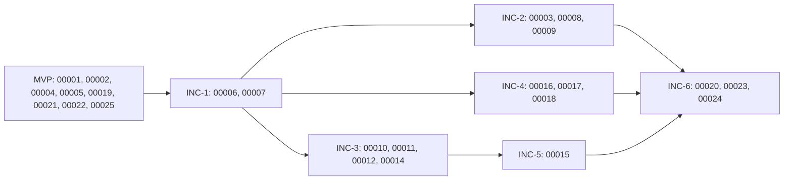

# GUI Editor Delivery Plan

## Introduction

### Purpose

Delivery order for `gui_editor`: the MVP, the increments after the MVP, and the tasks of each story.
Readers are the product owner and the developers of `gui_editor`.

### Vocabulary

- Increment: Releasable set of stories that builds only on earlier increments.
- MVP: Minimal viable product, the first release.
- Size: Relative effort of a task, S, M, or L, without calendar dates.
- Spike: Time-boxed experiment that reduces a risk before the real work.
- Task: Unit of work small enough for one change set.
- Walking skeleton: Thin end-to-end path through all MVP components, built before any one is deepened.

### References

- Requirements: [REQUIREMENTS.md](REQUIREMENTS.md)
- Story cards: [USER_STORIES.md](USER_STORIES.md)

### Overview

- **[Goal](#goal):** what the plan delivers.
- **[Product owner decision](#product-owner-decision):** approved scope and order.
- **[MVP](#mvp):** first release scope and exit criteria.
- **[Increments](#increments):** releases after the MVP.
- **[Task list](#task-list):** tasks with size and definition of done.
- **[Dependency graph](#dependency-graph):** order between increments.
- **[Deferred](#deferred):** stories outside the plan.
- **[Risks](#risks):** risks and mitigations.
- **[Security findings](#security-findings):** issues found in existing code.
- **[Open questions](#open-questions):** adopted defaults.

## Goal

Maintainers update one or more SADs through a native Linux egui editor,
without hand-editing XML, and every saved file validates and works with `sad2md`.

## Product Owner Decision

The product owner approved the plan on 2026-11-23.

| Question | Decision |
| --- | --- |
| Deferred list | GEDT-STORY-00013 stays deferred. |
| Increment order | INC-1 to INC-6 as listed. |
| MVP scope | Components only; viewpackets and diagrams follow in INC-1. |
| Next action | Start T-01, build pipeline. |

## Existing Work

- `gui_editor/src/main.rs` is a "Hello, world" stub, and `Cargo.toml` has no dependencies.
- `sad_xml_sql` loads and saves through in-memory SQLite, with the defects listed in
  [REQUIREMENTS.md](REQUIREMENTS.md#risks).
- No existing code fully covers any story.
- `sad_xml_sql/src/db_populate_from_xml.rs` has uncommitted changes.
  Commit the changes before T-04 to avoid merge conflicts.

## MVP

The MVP is a native Linux app that opens a project file safely, adds and edits components,
and saves the file atomically so that the file validates and `sad2md` accepts the file.
The build, test, and release pipeline is part of the MVP.

| Story | Priority | Requirements |
| --- | --- | --- |
| GEDT-STORY-00001 | Critical | GEDT-AR-00001, 00012, 00013, 00027, GEDT-FR-00001, 00002, 00003 |
| GEDT-STORY-00002 | Critical | GEDT-AR-00001, 00002, 00030, GEDT-FR-00004, 00005, 00006, 00009 |
| GEDT-STORY-00004 | Critical | GEDT-FR-00010, 00011, 00012, 00013 |
| GEDT-STORY-00005 | Critical | GEDT-FR-00013, 00014, 00015, 00016 |
| GEDT-STORY-00019 | Critical | GEDT-AR-00003, 00004, and GEDT-AR-00025, see open question 5 |
| GEDT-STORY-00021 | Critical | GEDT-AR-00010 to 00016, 00029, 00031 |
| GEDT-STORY-00022 | Critical | GEDT-AR-00007, 00008, 00009, GEDT-FR-00006 |
| GEDT-STORY-00025 | Critical | GEDT-AR-00009, 00015, 00023, 00024 |

### MVP Security

The only interface of the native app is the local project file.

- Input validation: the project file is untrusted input, see GEDT-STORY-00021.
- Secrets: the app needs no credentials, and CI runs a secret scan.
- Authentication and authorization: not needed for a single-user local app.
  OS file permissions protect the project files, as the out-of-scope decision states.

### MVP Exit Criteria

- Open, then save, of every fixture gives equal canonical XML,
  passes `xmllint --noout --nonet --valid`, and passes `sad2md`.
- 1,000 kills during save leave zero corrupted files.
- The network namespace test sees zero outbound connections.
- All security fixtures pass, and 1 hour of reader fuzzing causes no crash.
- The `sad2md` and `tui_editor` test suites pass.
- The app works on Fedora, on Wayland and on X11.

## Increments

### INC-1 Viewpackets and Diagrams

- Value: maintainers edit all SAD content, not only components.
- Stories: GEDT-STORY-00006, GEDT-STORY-00007, both Critical.
- Requirements: GEDT-FR-00017 to 00022; the MVP covers GEDT-FR-00011.
- Depends on: MVP.
- Exit: viewpackets and diagrams of all six styles are editable, and saved files pass the MVP checks.
- Also holds spike T-23 on multiple windows under Wayland, to test that risk early.

### INC-2 Editing Comfort

- Value: autosave, fast component search, and replicas shown as separate components.
- Stories: GEDT-STORY-00003, GEDT-STORY-00008, GEDT-STORY-00009.
- Requirements: GEDT-AR-00028, GEDT-FR-00007, 00008, 00023, 00024.
- Depends on: INC-1.
- Exit: autosave within 60 seconds, with a prompt before overwriting a file changed on disk.
  Search updates within 100 ms and matches `'`, `%`, and `_` literally.

### INC-3 Reading the Architecture

- Value: readers explore the architecture without the risk of changing the project.
- Stories: GEDT-STORY-00010, GEDT-STORY-00011, GEDT-STORY-00012, GEDT-STORY-00014.
- Requirements: GEDT-FR-00025 to 00029, 00031.
- Depends on: INC-1.
- Exit: the core rejects every change request in view mode,
  and filters and panes leave the modified flag unchanged.

### INC-4 Multiple Projects

- Value: maintainers work across several SADs and reference components between projects.
- Stories: GEDT-STORY-00016, GEDT-STORY-00017, GEDT-STORY-00018.
- Requirements: GEDT-FR-00034 to 00040.
- Depends on: MVP and INC-1.
- Exit: each project is saved only to its own file,
  and a reference to a project that is not loaded stays in the file after save.

### INC-5 Linked Windows

- Value: windows on several screens follow the same selection.
- Story: GEDT-STORY-00015.
- Requirements: GEDT-FR-00032, 00033.
- Depends on: INC-3.
- Exit: a selection reaches every window within 1 second, on Wayland and on X11.

### INC-6 Local Web App

- Value: maintainers edit in a browser on the local machine.
- Stories: GEDT-STORY-00020, GEDT-STORY-00023, GEDT-STORY-00024.
- Requirements: GEDT-AR-00005, 00017 to 00021, GEDT-FR-00041.
- Depends on: INC-1 to INC-5, because GEDT-FR-00041 requires every native function.
- Security: GEDT-STORY-00023 and GEDT-STORY-00024 ship with the web surface they protect.
- Exit: the Host, Origin, token, and Content-Security-Policy tests pass,
  and the shared UI suite passes in Firefox and Chromium.

## Task List

Requirement IDs in the definition of done are short forms, for example AR-00025 for GEDT-AR-00025.

| ID | Task | Story | Inc | Depends on | Size | Definition of done |
| --- | --- | --- | --- | --- | --- | --- |
| T-01 | Build pipeline | 00019 | MVP | none | M | `build.sh` builds `gui_editor`, not `amber-dos`; image pinned by version and digest; `cargo build --locked`; `cargo audit` and `cargo deny` fail on unignored findings; secret scan; CI runs the `gui_editor`, `sad_xml_sql`, `sad2md`, and `tui_editor` tests; `.cargo-home/` ignored in `gui_editor` and `aws2xml` (AR-00024, AR-00025, AR-00030) |
| T-02 | egui walking skeleton | 00019 | MVP | T-01 | S | eframe window starts on Fedora Wayland and X11, with an open-file dialog and an empty component list (AR-00003, AR-00004) |
| T-03 | Spike: open-then-save round trip | 00002 | MVP | T-01 | S | Golden-file test lists every element that `sad_xml_sql` drops or reorders on save; fix plan recorded |
| T-04 | Hardened XML reader | 00021 | MVP | T-01 | M | External entity and entity expansion fixtures rejected; no external DTD loaded; file over 64 MiB or nesting over 32 levels rejected (AR-00010, AR-00011, AR-00031) |
| T-05 | Errors instead of crashes | 00021 | MVP | T-04 | M | No `expect`, panic, or exit on input paths; legacy tests expect error values; 1 hour of fuzzing without crash (AR-00012) |
| T-06 | Field validation | 00021 | MVP | T-05 | S | Bad address, non-integer SortOrder, and FileId outside 1 to 255 rejected; `convert_from_address_to_id` fixed (AR-00013) |
| T-07 | Include confinement | 00021 | MVP | T-05 | S | Path traversal and symlink fixtures rejected; Include `url` never fetched (AR-00014, AR-00015) |
| T-08 | Bound SQL parameters | 00021 | MVP | T-01 | S | CI static check finds no SQL built by string formatting (AR-00016) |
| T-09 | Load and save off the UI thread | 00021 | MVP | T-02 | S | Each UI frame under 100 ms during load (AR-00029) |
| T-10 | Open project | 00001 | MVP | T-06, T-07, T-09 | M | All elements loaded; error names path, line, column, and rule; file hash and mtime unchanged (FR-00001 to FR-00003, AR-00001) |
| T-11 | Load benchmark | 00001 | MVP | T-10 | S | 2,000 components, 500 viewpackets, and 5,000 relations load within 2 seconds, checked in CI (AR-00027) |
| T-12 | Writer fixes | 00002 | MVP | T-03 | L | All DTD elements written in DTD order with the `Version` attribute; equal canonical XML after open and save (FR-00005, AR-00002, AR-00030) |
| T-13 | Pre-save DTD check | 00002 | MVP | T-12 | M | A rule failure keeps the existing file and names the failing element; `xmllint` runs in CI (FR-00006) |
| T-14 | Atomic save | 00022 | MVP | T-13 | M | Temporary file in the project directory with mode no wider than the project file; flush, rename, directory flush; mode bits kept; 1,000-kill test passes (AR-00007 to AR-00009) |
| T-15 | Save command and external-change check | 00002 | MVP | T-14 | M | Saves to the source file; asks before overwriting a file changed on disk (FR-00004, FR-00009) |
| T-16 | Data stays local | 00025 | MVP | T-10 | S | Network namespace test sees zero connections; logs hold only paths, addresses, and error kinds (AR-00015, AR-00023, AR-00024) |
| T-17 | Add component | 00004 | MVP | T-15 | M | Unique address with FileId first; case-insensitive name order; duplicate name rejected; `template_sad.xml` updated (FR-00010 to FR-00013) |
| T-18 | Edit component | 00005 | MVP | T-17 | M | Every DTD child editable; address unchanged; rename shown in every view (FR-00013 to FR-00016) |
| T-19 | MVP release | 00019 | MVP | T-11, T-16, T-18 | S | Wayland and X11 demonstration; `sad2md` accepts a saved file; `gui_editor/README.md` updated |
| T-20 | Create viewpacket | 00006 | INC-1 | T-19 | M | Primary component must exist; types and styles from `create_styles`; unique address (FR-00011, FR-00017, FR-00018) |
| T-21 | Edit viewpacket | 00006 | INC-1 | T-20 | M | Every DTD child and attribute editable except the address (FR-00019) |
| T-22 | Diagram editor | 00007 | INC-1 | T-21 | L | Six styles; relation endpoints checked; removal from a diagram keeps the component (FR-00020 to FR-00022) |
| T-23 | Spike: multiple windows on Wayland | 00015 | INC-1 | T-02 | S | Time-boxed prototype of two egui windows; result recorded |
| T-24 | Autosave | 00003 | INC-2 | T-22 | M | Save within 60 seconds; no write without changes; prompt before overwrite (FR-00007 to FR-00009, AR-00007, AR-00029) |
| T-25 | Component search | 00008 | INC-2 | T-22 | S | Case-insensitive; `LIKE` with `ESCAPE` so special characters match literally; under 100 ms for 2,000 components (FR-00024, AR-00016, AR-00028) |
| T-26 | Replica nodes | 00009 | INC-2 | T-22 | S | ETCD1 to ETCD3 fixture shows 3 nodes, each with its own relations (FR-00023) |
| T-27 | View mode | 00011 | INC-3 | T-22 | M | Core rejects changes in view mode; selection kept on mode switch (FR-00026 to FR-00028) |
| T-28 | Component overview | 00012 | INC-3 | T-27 | S | Lists only viewpackets with the component as primary (FR-00029) |
| T-29 | Panes | 00014 | INC-3 | T-27 | M | Two or more panes, each with its own view and selection (FR-00026, FR-00031) |
| T-30 | Client-server filter | 00010 | INC-3 | T-27 | S | Name filter shows matches and their direct relations; project data unchanged (FR-00025, FR-00026) |
| T-31 | Multi-project session | 00016 | INC-4 | T-22 | M | Two or more files loaded; FileIds unique; each project saved only to its own file (FR-00034, FR-00035) |
| T-32 | Cross-project references | 00017 | INC-4 | T-31 | M | Reference stored as address; unresolved references marked and kept on save (FR-00036 to FR-00038) |
| T-33 | Multi-project view | 00018 | INC-4 | T-32 | S | Each component shows the Title of the owning project (FR-00039, FR-00040) |
| T-34 | Linked windows | 00015 | INC-5 | T-23, T-29 | M | Selection reaches every window within 1 second (FR-00032, FR-00033) |
| T-35 | Web architecture decision | 00020 | INC-6 | T-34 | M | Decision record approved by the product owner |
| T-36 | Local server protection | 00023 | INC-6 | T-35 | M | Loopback only; wrong Host gets 421; foreign Origin gets 403; 128-bit per-launch token required (AR-00017 to AR-00020) |
| T-37 | Text-only rendering and CSP | 00024 | INC-6 | T-35 | S | `<script>` fixture shown as text; CSP allows scripts from the server origin only (AR-00021) |
| T-38 | Web feature parity | 00020 | INC-6 | T-36, T-37 | L | Shared UI suite passes in Firefox and Chromium (AR-00005, FR-00041) |

## Dependency Graph

The story dependencies contain no cycles.

## Deferred

- GEDT-STORY-00013, Nice to have, with GEDT-FR-00030.
  - Reason: lowest priority; the story builds on GEDT-STORY-00012.
  - Size S; a candidate for INC-3 or later.

## Risks

| Risk | Inc | Mitigation |
| --- | --- | --- |
| Changes to `sad_xml_sql` break `sad2md` or `tui_editor`. | MVP | T-01 runs all their test suites in CI from the start. |
| Component reorder on first save produces large git diffs. | MVP | One reorder commit per existing project before first use. |
| Include path traversal and crashes in the shared reader. | MVP | T-04 to T-07 land before T-10. |
| Multiple egui windows misbehave on Wayland. | INC-1 | Spike T-23, long before INC-5. |
| Open, then save, loses data because `sad_xml_sql` drops elements. | MVP | Spike T-03 first, then golden-file tests in T-12. |
| Template `template_sad.xml` uses IDs such as `1101`, which the reader rejects. | MVP | Addresses with FileId first; T-17 updates the template. |
| Web API reached through DNS rebinding or a cross-site page. | INC-6 | T-36 ships with the web surface. |
| Web architecture is open, so the INC-6 effort is uncertain. | INC-6 | Decision T-35 before any web code. |

## Security Findings

Findings in existing code, found during planning.

| Finding | Location | Fixed by |
| --- | --- | --- |
| Build uses the unpinned `rust:latest` image, runs without `--locked`, and names the `amber-dos` binary. | `gui_editor/build.sh` | T-01 |
| Include path traversal is marked TODO; `sad2md` is affected today. | `sad_xml_sql/src/db_populate_from_xml.rs` | T-07 |
| Malformed input crashes the reader through `expect`; `sad2md` is affected today. | `sad_xml_sql/src/db_update.rs`, `sad_xml_sql/src/db_populate_from_xml.rs` | T-05 |
| Untracked `.cargo-home/` registry caches can be committed by accident. | `aws2xml/`, `gui_editor/` | T-01 |

## Open Questions

The architect open questions do not block the plan.
The plan adopts these defaults:

- 1, address scheme: `a.b.c.d` with FileId first; T-17 updates `template_sad.xml`.
- 2, client-server filter: Name substring, because the SAD DTD has no component type.
- 3, diagram styles: installation means Install; context means the ContextModelKey diagram.
- 4, benchmark: 2,000 components, 500 viewpackets, 5,000 relations; 4 cores, 8 GiB RAM.
- 5, GEDT-AR-00025 has no story: the plan attaches the requirement to GEDT-STORY-00019,
  so the MVP build enforces the requirement.

## Next Step

Hand off to developer GEDT-STORY-00019, task T-01.
Commit the pending changes in `sad_xml_sql/src/db_populate_from_xml.rs` first.
