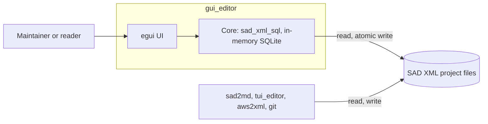

# GUI Editor Requirements

## Introduction

### Purpose

Technical requirements for `gui_editor`, derived from the story cards in
[USER_STORIES.md](USER_STORIES.md).
Readers are the planner, the developers, and the testers of `gui_editor`.

### Scope

- In scope: native Linux app, later local web app, editing and viewing of SAD XML projects.
- Out of scope: multi-user service, authentication of users, storage formats other than SAD XML, the repository-root build scripts `build.sh` and `build_in_docker.sh`.
  - Product owner answer to plan open question 10 on 2026-11-25, quoted: "leave the root scripts alone".
  - No requirement covers the repository-root build scripts; GEDT-AR-00025 and GEDT-AR-00034 cover the `gui_editor` build only.
- Included files: the editor loads Component and Team elements and writes back Component elements only,
  see GEDT-FR-00042 to GEDT-FR-00045.
  The product owner states this scope may change in the future.
- Adopted defaults for the business-analyst open questions:
  - 2: Detect external file changes and ask before overwriting, see GEDT-FR-00009.
  - 3: Fixed autosave interval of 60 seconds, see GEDT-FR-00007.
  - 4: No replica grouping in the first release, see GEDT-FR-00023.
  - 6: Fedora, current release, on Wayland and X11, see GEDT-AR-00004.
  - 8: `software_architecture_documentation.dtd` is the SAD DTD, see GEDT-AR-00001.

### Vocabulary

- Address: Element ID in the form `a.b.c.d`, each part a decimal number from 0 to 255.
- Build run: Build, test, or check run for the checked crates, on a developer machine or in CI, including the build of the tool image and the CI secret scan.
- Checked crates: The `gui_editor`, `sad2md`, `sad_xml_sql`, and `tui_editor` crates.
- Checked dependency graph: Resolved dependency graph of a checked crate, with all features and dev-dependencies, for the target `x86_64-unknown-linux-gnu`.
- Committed: Tracked by git in the `idea-to-product` repository, in any top-level directory.
- Core: Project model, XML reader, XML writer, and in-memory SQLite database.
- Dev account: Host account under which the developer works on the development machine, product owner term "devaccount".
- DTD rules: Element order, required elements, and required attributes of the SAD DTD,
  plus the field rules of GEDT-AR-00013.
- FileId: Number in `<Document><FileId>` that identifies a project.
- Included file: SAD XML file named by an `<Include>` element of the including project file.
- Rootless container engine: Container engine whose daemon or process runs under a host user other than root, so that every container process maps to that user or to a subordinate uid of that user.
  - A container process may run as uid 0 inside the user namespace of the container; that uid holds no root privilege on the host.
  - Rootless docker and rootless podman both qualify.
- SAD: Software Architecture Documentation.
- SAD DTD: `sad_xml_sql/tests/software_architecture_documentation.dtd`, version 0.1.0.
- Session: One run of the editor, with one or more loaded projects.
- Supported platform: Operating system and processor architecture on which the project verifies the build or the run of an app, see GEDT-AR-00049 and GEDT-AR-00050.
  - The project gives no build or run commitment for any other platform.
- Skipped edit: Edit to a Component or Team element loaded from an included file,
  which no save writes to that file.
- SRS: Software Requirements Specification.
- STS: Software Testing Specification.
- Test output directory: Git-ignored `test-output` directory at the root of a crate.
- Tool image: Build image of GEDT-AR-00034.

### References

- Story cards: [USER_STORIES.md](USER_STORIES.md)
- Design decisions awaiting product owner review: [DESIGN.md](DESIGN.md)
- Opportunity assessment: [02_opportunity_assesmemt.md](02_opportunity_assesmemt.md)
- SAD DTD: [software_architecture_documentation.dtd](../../sad_xml_sql/tests/software_architecture_documentation.dtd)
- SAD concepts: [SoftwareArchitectureDocumentationOverview.md](../../docs/SoftwareArchitectureDocumentationOverview.md)
- Shared model library: [sad_xml_sql](../../sad_xml_sql/src/lib.rs)
- Requirement format: [requirements-writing skill](../../.claude/skills/requirements-writing/SKILL.md)

### Overview

- [Traceability matrix](#traceability-matrix): story to requirement mapping.
- [Architecture and interface overview](#architecture-and-interface-overview): components and context.
- [Requirements](#requirements): functional and architectural requirements.
- [Interfaces](#interfaces): protocols, formats, and error handling.
- [Design decisions](#design-decisions): decisions with rejected alternatives.
- [Risks](#risks): technical risks and mitigations.
- [Open questions](#open-questions): questions for the product owner.

## Traceability matrix

| Story | Requirements |
| --- | --- |
| GEDT-STORY-00001 | GEDT-AR-00001, GEDT-AR-00012, GEDT-AR-00013, GEDT-AR-00027, GEDT-FR-00001, GEDT-FR-00002, GEDT-FR-00003, GEDT-FR-00042 |
| GEDT-STORY-00002 | GEDT-AR-00001, GEDT-AR-00002, GEDT-AR-00030, GEDT-FR-00004, GEDT-FR-00005, GEDT-FR-00006, GEDT-FR-00009, GEDT-FR-00045, GEDT-FR-00046, GEDT-FR-00047, GEDT-FR-00048, GEDT-FR-00049 |
| GEDT-STORY-00003 | GEDT-AR-00007, GEDT-AR-00029, GEDT-FR-00007, GEDT-FR-00008, GEDT-FR-00009, GEDT-FR-00047, GEDT-FR-00048 |
| GEDT-STORY-00004 | GEDT-FR-00010, GEDT-FR-00011, GEDT-FR-00012, GEDT-FR-00013 |
| GEDT-STORY-00005 | GEDT-FR-00013, GEDT-FR-00014, GEDT-FR-00015, GEDT-FR-00016, GEDT-FR-00045 |
| GEDT-STORY-00006 | GEDT-FR-00011, GEDT-FR-00017, GEDT-FR-00018, GEDT-FR-00019 |
| GEDT-STORY-00007 | GEDT-FR-00011, GEDT-FR-00020, GEDT-FR-00021, GEDT-FR-00022 |
| GEDT-STORY-00008 | GEDT-AR-00016, GEDT-AR-00028, GEDT-FR-00024 |
| GEDT-STORY-00009 | GEDT-FR-00023 |
| GEDT-STORY-00010 | GEDT-FR-00025, GEDT-FR-00026 |
| GEDT-STORY-00011 | GEDT-FR-00026, GEDT-FR-00027, GEDT-FR-00028 |
| GEDT-STORY-00012 | GEDT-FR-00029 |
| GEDT-STORY-00013 | GEDT-FR-00030 |
| GEDT-STORY-00014 | GEDT-FR-00026, GEDT-FR-00031 |
| GEDT-STORY-00015 | GEDT-FR-00032, GEDT-FR-00033 |
| GEDT-STORY-00016 | GEDT-FR-00034, GEDT-FR-00035 |
| GEDT-STORY-00017 | GEDT-FR-00036, GEDT-FR-00037, GEDT-FR-00038 |
| GEDT-STORY-00018 | GEDT-FR-00039, GEDT-FR-00040 |
| GEDT-STORY-00019 | GEDT-AR-00003, GEDT-AR-00004 |
| GEDT-STORY-00020 | GEDT-AR-00003, GEDT-AR-00005, GEDT-FR-00041 |
| GEDT-STORY-00021 | GEDT-AR-00010, GEDT-AR-00011, GEDT-AR-00012, GEDT-AR-00013, GEDT-AR-00014, GEDT-AR-00015, GEDT-AR-00016, GEDT-AR-00029, GEDT-AR-00031, GEDT-AR-00035 |
| GEDT-STORY-00022 | GEDT-AR-00007, GEDT-AR-00008, GEDT-AR-00009, GEDT-FR-00006 |
| GEDT-STORY-00023 | GEDT-AR-00017, GEDT-AR-00018, GEDT-AR-00019, GEDT-AR-00020 |
| GEDT-STORY-00024 | GEDT-AR-00021 |
| GEDT-STORY-00025 | GEDT-AR-00009, GEDT-AR-00015, GEDT-AR-00023, GEDT-AR-00024 |
| GEDT-STORY-00026 | GEDT-AR-00035, GEDT-FR-00009, GEDT-FR-00043, GEDT-FR-00044 |

GEDT-STORY-00026 holds the included-file write split from GEDT-STORY-00002 on 2026-11-25, product owner answer to plan open question 19, quoted: "go with the default".

Traceability gaps:

- Secondary: GEDT-AR-00025, supply-chain hygiene.
  - No story asks for GEDT-AR-00025; the repository security policy mandates the requirement.
- Secondary: GEDT-AR-00032, committed program code in Rust.
  - No story asks for GEDT-AR-00032; the product owner mandates the requirement as a process parameter.
- Secondary: GEDT-AR-00033, committed scripts in Bash.
  - No story asks for GEDT-AR-00033; the product owner mandates the requirement as a process parameter.
- Secondary: GEDT-AR-00034, build image derived from the pinned official Rust image.
  - No story asks for GEDT-AR-00034; the product owner mandates the requirement as a process parameter.
- Secondary: GEDT-AR-00036, version bump on change.
  - No story asks for GEDT-AR-00036; the product owner mandates the requirement as a process parameter.
- Secondary: GEDT-AR-00037, zero lint warnings in the four crates.
  - No story asks for GEDT-AR-00037; the product owner mandates the requirement as a process parameter.
  - `PLAN.md` task T-44 implements GEDT-AR-00037; T-44 traced provisionally to GEDT-AR-00030 before.
- Secondary: GEDT-AR-00038, standard formatting in the four crates.
  - No story asks for GEDT-AR-00038; the product owner mandates the requirement as a process parameter.
  - `PLAN.md` task T-44 implements GEDT-AR-00038.
- Secondary: GEDT-AR-00039 to GEDT-AR-00048, build and supply-chain policy.
  - No story asks for GEDT-AR-00039 to GEDT-AR-00048; product owner answers on 2026-11-24 and 2026-11-25 mandate the requirements, see [Build and supply chain](#build-and-supply-chain).
- Secondary: GEDT-AR-00049 and GEDT-AR-00050, x86_64 Linux as the only supported platform for build and run.
  - No story asks for GEDT-AR-00049 or GEDT-AR-00050; the product owner mandates the requirements as a process parameter on 2026-11-25.
  - GEDT-STORY-00019 and the story Out of Scope entry "Native app on platforms other than Linux" agree, but cover the native `gui_editor` only, so neither is the trace source.
- Secondary: GEDT-AR-00051, dev account access to rootless container engines only.
  - No story asks for GEDT-AR-00051; the product owner mandates the requirement on 2026-11-25 and restates the requirement on 2026-11-26.
- Secondary: GEDT-AR-00052, no `sudo` access for the dev account.
  - No story asks for GEDT-AR-00052; the product owner mandates the requirement on 2026-11-26, answer to open question 22.
- Orphaned requirements: none.
- Stories without a requirement: none.
- Removed: GEDT-AR-00006 and GEDT-AR-00022, together with the web app architecture decision.
  - The IDs stay retired.

## Architecture and interface overview

The native app runs the egui UI and the core in one process.
The core reuses and extends the `sad_xml_sql` library, shared with `sad2md` and `tui_editor`.
The web app architecture is not decided; the web app is outside the first release.

| Component | Status | Responsibility |
| --- | --- | --- |
| Core | Changed, `sad_xml_sql` | XML read and write, DTD rule check, in-memory SQLite model, ID allocation. |
| egui UI | New | Edit mode, view mode, panes, windows, diagrams, search, filters. |
| SAD XML project files | Existing | Source of truth, one file per project. |

## Requirements

Priority follows the highest priority among the traced stories.
Requirements traced only to GEDT-STORY-00023 or GEDT-STORY-00024 are Critical for the web release.

### Storage

| ID | Requirement | Traces to | Priority | Verification |
| --- | --- | --- | --- | --- |
| GEDT-AR-00001 | The core shall use SAD XML files that follow the SAD DTD as the only persistent project store. | 00001, 00002 | Critical | Inspection |
| GEDT-AR-00002 | `sad2md` and `sad_xml_sql` shall process every file saved by the editor without error. | 00002 | Critical | Test |
| GEDT-AR-00007 | When a save is interrupted at any point, the project file shall contain either the complete previous content or the complete new content. | 00003, 00022 | Critical | Test, kill during save |
| GEDT-AR-00008 | A save shall keep the permission mode bits of the existing project file. | 00022 | Critical | Test |
| GEDT-AR-00009 | The editor shall write project data only to project files and to temporary files in the same directory, with permission mode bits no wider than the project file. | 00022, 00025 | Critical | Test, inspection |
| GEDT-AR-00030 | The core shall extend the shared `sad_xml_sql` library, keeping the `sad2md` and `tui_editor` test suites passing. | 00002 | Critical | Test |
| GEDT-AR-00035 | The editor shall write an included file only when the resolved path, after symlink resolution at write time, is inside the directory of the including project file. | 00021, 00026 | Critical | Test, traversal and symlink swap fixtures |
| GEDT-FR-00001 | When the user selects a SAD XML file, the editor shall load every Component, ViewPacket, ComponentRelation, Behavior, Team, Requirement, and Include element into the session. | 00001 | Critical | Test |
| GEDT-FR-00002 | When a file fails XML parsing or the DTD rules, the editor shall reject the whole file with an error naming the file path, line, column, and failed rule. | 00001 | Critical | Test |
| GEDT-FR-00003 | The editor shall open a project file without writing to the file. | 00001 | Critical | Test, compare hash and mtime |
| GEDT-FR-00004 | On a save request, the editor shall write each modified project to the file the project was loaded from. | 00002 | Critical | Test |
| GEDT-FR-00005 | A save without edits shall preserve every element, attribute, and text value that the SAD DTD defines in the loaded file. | 00002 | Critical | Test, canonical XML compare |
| GEDT-FR-00006 | Before writing, the editor shall check the project against the DTD rules and, on failure, keep the existing file and show the failing element ID. | 00002, 00022 | Critical | Test |
| GEDT-FR-00007 | With unsaved changes, the editor shall save the project within 60 seconds of the first unsaved change. | 00003 | Value adding | Test |
| GEDT-FR-00008 | Without unsaved changes, the editor shall not write the project file. | 00003 | Value adding | Test |
| GEDT-FR-00009 | Before each save, including autosave, the editor shall ask the user before overwriting a file that changed on disk since the last load or save. | 00002, 00003, 00026 | Critical | Test |
| GEDT-FR-00042 | From an included file, the core shall load only the Component and Team elements into the editor session, keeping the default read of the shared `sad_xml_sql` reader unchanged. | 00001 | Critical | Test, `sad2md` golden tests |
| GEDT-FR-00043 | When a save writes an included file, the editor shall write to that file only the Component elements loaded from that file. | 00026 | Critical | Test |
| GEDT-FR-00044 | When a save writes an included file, the editor shall keep the Document, Include, Team, ViewPacket, ComponentRelation, Behavior, and Requirement elements of that file unchanged. | 00026 | Critical | Test, canonical XML compare |
| GEDT-FR-00045 | When the user selects Save, directly or through exit, while the session holds a skipped edit, the editor shall show a warning that names the address and the source file of each element with a skipped edit. | 00002, 00005 | Critical | Test: direct Save shows a non-modal warning; exit shows a modal warning that lets the user cancel the exit; autosave shows no warning |
| GEDT-FR-00046 | The core shall return every save failure as an error value that names the project file and the failure cause. | 00002 | Critical | Test, read-only directory and full disk fixtures |
| GEDT-FR-00047 | When a save fails, the editor shall show the user the error of GEDT-FR-00046. | 00002, 00003 | Critical | Test |
| GEDT-FR-00048 | After a failed save, the editor shall keep the project marked as modified. | 00002, 00003 | Critical | Test |
| GEDT-FR-00049 | After a failed F7 save, `tui_editor` shall keep the editor pane open. | 00002 | Value adding | Test: an F7 save that fails leaves the editor pane open |

TOOD fix this AI generated shit show. Update the requirements skill to adhere to a correct req doc formatting, including where to put requirement notes.

Included files:

- Source: product owner decision, quoted: "only components and teams are read from an include file and only those are written back.
  This may change in the future."
- The product owner answer to open question 9 corrects the write-back part, quoted: "GEDT-FR-00043 is wrong, it should state: When a save writes an included file, the editor shall write to that file only the Component loaded from that file."
  GEDT-FR-00043 reads "Component" as "Component elements".
  The read part stays: GEDT-FR-00042 loads Component and Team elements.
- No save writes Team elements to an included file.
  GEDT-FR-00044 keeps the Team elements of an included file unchanged, including Team `Member`.
- Stability of GEDT-FR-00042 to GEDT-FR-00045: Low.
  The product owner states the scope may change.
- GEDT-FR-00001 applies to the project file the user selects.
  GEDT-FR-00042 limits the editor session to Component and Team elements of an included file.
- GEDT-FR-00042 follows the product owner answer to open question 5.
  The shared `sad_xml_sql` reader gets an option that loads only Component and Team elements from an included file.
  The option skips the viewpackets, relations, behaviors, and nested Include elements of an included file.
  Only the editor sets the option.
  The default read stays unchanged, so `sad2md` output and its golden tests stay unchanged, GEDT-AR-00030.
- GEDT-FR-00043 depends on GEDT-AR-00014 and GEDT-AR-00035.
  `PLAN.md` task T-07 adds the include path check; a later save task writes included files.
  Until then, a save writes no included file.
- GEDT-FR-00044 follows the product owner answer to open question 6.
  The SAD DTD requires `ViewPacket+` in every file, so a file with only Component elements fails the DTD rules.
- GEDT-FR-00044 keeps Team elements as the included file defines them on disk, because the `sad_xml_sql` model does not hold Team `Member`.
- Product owner answer to open question 13 on 2026-11-25, option a of [DESIGN.md](DESIGN.md#external-change-of-an-included-file), quoted: "provide a prompt of file changed on disk with an option to overwrite".
  GEDT-FR-00009 applies to each included file before a save writes that file.
  The prompt names the included file.
  When the user declines, the save leaves that included file as the file is on disk.
  When the user confirms, GEDT-FR-00044 keeps the other elements as the included file holds them on disk at write time.
  The save therefore overwrites only the Component elements of the included file.
- GEDT-FR-00045 follows the product owner answers to open questions 7 and 11.
  The editor allows edits to Component and Team elements of included files.
  Until a save writes included files, every save skips both.
  After that, every save still skips the Team edits, GEDT-FR-00043.
- GEDT-FR-00045 covers Team edits of included files, so no edit is lost silently.
- Autosave, GEDT-FR-00007, skips the skipped edits without a warning.
  The user gets the warning on the next explicit Save or exit.
- Product owner decision: a skipped edit does not count as an unsaved change for GEDT-FR-00007 and GEDT-FR-00008.
  Autosave therefore does not rewrite an unchanged file every 60 seconds.
- Product owner decision: GEDT-FR-00045 shows the warning on an explicit Save or exit, also when GEDT-FR-00008 leaves every file unwritten.
- Product owner answer to open question 12: the warning of GEDT-FR-00045 is non-modal on a direct Save.
  On exit, the warning is modal and lets the user cancel the exit, because a non-modal warning closes with the window.
- Skipped edits stay in the session until the session ends, so each explicit Save or exit repeats the warning.
- A crash before the next explicit Save or exit loses the skipped edits without a warning, like every other unsaved change.
- GEDT-AR-00035 repeats the GEDT-AR-00014 check at write time, because a symlink can change between load and save.

Save failures:

- GEDT-FR-00006 covers a DTD rule failure before the write;
  GEDT-FR-00046 to GEDT-FR-00048 cover every other save failure,
  for example a failed open, write, flush, or rename.
- GEDT-FR-00046 applies to `tui_editor` through the shared core, GEDT-AR-00030.
- GEDT-FR-00048 keeps the next autosave attempt,
  because GEDT-FR-00008 writes only with unsaved changes.
- Source: tester finding in `tui_editor/src/work.rs` line 314.
  Product owner decision: a new task under GEDT-STORY-00002 fixes the silent save failure.
- Product owner decision, open question 10: `tui_editor` keeps the save target `tui_out.xml`.
  `PLAN.md` task T-48, which changes the `tui_editor` save target to the loaded project file, is deferred and unscheduled.
  T-48 is a `tui_editor` task outside the `gui_editor` scope, with no GEDT story or requirement.
- GEDT-FR-00049 follows a product owner answer on 2026-11-26 to a developer question during `PLAN.md` task T-47.
  - Question, quoted: "After the failed save, should tui_editor go back to the previous pane, as it always has, or stay in the editor pane so you can press F7 again right away?"
  - Product owner answer, quoted: "b: stay in editor".
  - Option b, quoted: "A failed F7 keeps the editor pane open so you can retry at once; the developer changes the F7 handler and tests."
  - GEDT-FR-00049 traces to GEDT-STORY-00002 only, because F7 is an explicit save request and GEDT-STORY-00003 covers autosave.
  - Priority Value adding is the architect's choice, because the product owner gave none and the edits stay in the session after a failed save.
- After a successful F7 save, `tui_editor` returns to the previous pane.
  - The return is existing behaviour that the product owner answer leaves unchanged, not a requirement.

GEDT-FR-00005 note:

- The product owner accepts the losses in [Known save limitations](#known-save-limitations) for the first release.
- GEDT-FR-00005 stays the target; the accepted losses are known exceptions,
  and the round-trip tests exclude only those items.

#### Known save limitations

The `sad_xml_sql` reader reads none of the elements below from any file,
so a save of the including project file drops them.
Included files are not written yet, so included files lose nothing today.
The product owner accepts these losses as a known limitation,
in the answer to open question 8.

| Dropped item | Conflict with GEDT-STORY-00002 criterion | Conflict with requirements |
| --- | --- | --- |
| Team `Member` | None; the criterion names components, viewpackets, and relations only. | GEDT-FR-00001, GEDT-FR-00005; the including project file only, because GEDT-FR-00044 keeps Team elements of an included file unchanged. |
| Top-level `Requirement` | None; the criterion names components, viewpackets, and relations only. | GEDT-FR-00001, GEDT-FR-00005. |
| ViewPacket `ChildViewPacketId`, `ParentViewPacketId`, `SiblingViewPacketId` | Yes: each viewpacket stays, but the viewpacket loses the links to other viewpackets. | GEDT-FR-00005. |
| ViewPacket `DiagramKey` | Yes: each viewpacket and each ComponentRelation stays, but a relation whose `Key` matches only a dropped `DiagramKey` no longer belongs to any viewpacket diagram. | GEDT-FR-00005. |
| XML comments, in any file | None. | None; the SAD DTD defines no comments, so GEDT-FR-00005 does not cover comments. |

Behavior `DiagramKey` is not a loss: `PLAN.md` task T-40, reviewed and approved, writes Behavior `DiagramKey` back exactly as in the source.
The accepted loss is ViewPacket `DiagramKey` only, which the `sad_xml_sql` reader never reads.

Consequences of the accepted losses:

- The GEDT-STORY-00002 criterion for a save without edits is knowingly not fully met.
  The criterion reads: "Opening, then saving without edits, keeps every component, viewpacket, and relation."
  The ViewPacket `DiagramKey` and viewpacket link losses cause the gap.
  The business analyst aligns the story criterion when the product owner asks.
- GEDT-FR-00001 and GEDT-FR-00005 keep the full target; the dropped items are accepted exceptions.
- Team `Member` in included files is not lost, because no save writes Team elements to an included file,
  product owner answer to open question 9.

### Components

| ID | Requirement | Traces to | Priority | Verification |
| --- | --- | --- | --- | --- |
| GEDT-FR-00010 | In edit mode, the editor shall create a component from a form with Name and Summary. | 00004 | Critical | Demonstration |
| GEDT-FR-00011 | The editor shall assign each new Component, ViewPacket, and ComponentRelation an address unused by any element of the same type in the loaded projects, with the project FileId as first part. | 00004, 00006, 00007 | Critical | Test |
| GEDT-FR-00012 | The editor shall write Component elements in ascending case-insensitive order of Name, with ties ordered by address. | 00004 | Critical | Test |
| GEDT-FR-00013 | The editor shall reject a create or rename that gives a component a Name already used in the same project, with an error naming the existing component. | 00004, 00005 | Critical | Test |
| GEDT-FR-00014 | In edit mode, the editor shall let the user change the Name attribute and every child element of a component defined by the SAD DTD. | 00005 | Critical | Demonstration |
| GEDT-FR-00015 | The editor shall keep the component address unchanged when the user edits the component. | 00005 | Critical | Test |
| GEDT-FR-00016 | After a component rename, every view shall show the new Name within the same session. | 00005 | Critical | Test |

### Viewpackets

| ID | Requirement | Traces to | Priority | Verification |
| --- | --- | --- | --- | --- |
| GEDT-FR-00017 | The editor shall create a viewpacket only with a primary ComponentId that references a component in the loaded projects. | 00006 | Critical | Test |
| GEDT-FR-00018 | The editor shall offer only the ViewType and ViewStyle values listed by `sad_xml_sql::create_styles`. | 00006 | Critical | Test |
| GEDT-FR-00019 | In edit mode, the editor shall let the user change every child element and attribute of a viewpacket defined by the SAD DTD, except the address. | 00006 | Critical | Demonstration |

Rationale for GEDT-FR-00018: the SAD DTD declares ViewType and ViewStyle as CDATA,
so the allowed set comes from `sad_xml_sql`, the list that `sad2md` processes.

### Diagrams

| ID | Requirement | Traces to | Priority | Verification |
| --- | --- | --- | --- | --- |
| GEDT-FR-00020 | In edit mode, the editor shall add and remove ComponentRelation elements in the diagram of a viewpacket with style ClientServer, Decomposition, Deployment, Install, or Uses, and in context diagrams. | 00007 | Critical | Demonstration |
| GEDT-FR-00021 | The editor shall accept a relation endpoint only when the endpoint references a component in the loaded projects. | 00007 | Critical | Test |
| GEDT-FR-00022 | Removing a component from a diagram shall remove the relations of that diagram only, keeping the Component element. | 00007 | Critical | Test |
| GEDT-FR-00023 | The diagram editor shall draw each component address as a separate node with its own relations. | 00009 | Value adding | Test, ETCD1 to ETCD3 fixture |
| GEDT-FR-00024 | While adding components to a diagram, the editor shall list only components whose Name contains the search text, ignoring letter case and matching every character literally. | 00008 | Value adding | Test, includes `'`, `%`, `_` |
| GEDT-FR-00025 | With a filter text applied to a ClientServer primary diagram, the editor shall show only components whose Name contains the filter text, plus their direct relations. | 00010 | Value adding | Test |

### Viewing

| ID | Requirement | Traces to | Priority | Verification |
| --- | --- | --- | --- | --- |
| GEDT-FR-00026 | Filters, selections, pane layout, and mode changes shall leave the project data and its modified flag unchanged. | 00010, 00011, 00014 | Value adding | Test |
| GEDT-FR-00027 | In view mode, the editor shall reject every request that changes project data. | 00011 | Value adding | Test, core level |
| GEDT-FR-00028 | Switching between view mode and edit mode shall keep the current selection. | 00011 | Value adding | Test |
| GEDT-FR-00029 | On component selection, the editor shall list every viewpacket with that component as primary ComponentId, and no other viewpacket. | 00012 | Value adding | Test |
| GEDT-FR-00030 | On component selection, the editor shall list, apart from the primary list, every viewpacket whose ComponentId list or diagram relations reference the component as non-primary. | 00013 | Nice to have | Test |
| GEDT-FR-00031 | The editor shall show at least two panes side by side in one window, each pane with its own view and selection. | 00014 | Value adding | Demonstration |
| GEDT-FR-00032 | The editor shall open at least two windows on the same session. | 00015 | Value adding | Demonstration |
| GEDT-FR-00033 | A component selection in one window shall show the component in every other window within 1 second. | 00015 | Value adding | Test |

### Multiple projects

| ID | Requirement | Traces to | Priority | Verification |
| --- | --- | --- | --- | --- |
| GEDT-FR-00034 | The editor shall load at least two project files in one session. | 00016 | Value adding | Test |
| GEDT-FR-00035 | A save shall write the data of each project only to the file of that project. | 00016 | Value adding | Test |
| GEDT-FR-00036 | The editor shall let a viewpacket or relation in one project reference a component of another loaded project. | 00017 | Value adding | Test |
| GEDT-FR-00037 | The editor shall save a cross-project reference as the component address, whose first part is the FileId of the owning project. | 00017 | Value adding | Test |
| GEDT-FR-00038 | The editor shall mark a reference to a project that is not loaded as unresolved, and shall keep the reference on save. | 00017 | Value adding | Test |
| GEDT-FR-00039 | The editor shall show components of at least two loaded projects in one view. | 00018 | Value adding | Demonstration |
| GEDT-FR-00040 | Each component in a multi-project view shall show the Title of the owning project. | 00018 | Value adding | Demonstration |

### Platforms

| ID | Requirement | Traces to | Priority | Verification |
| --- | --- | --- | --- | --- |
| GEDT-AR-00003 | The editor shall use the egui toolkit. | 00019, 00020 | Critical | Inspection |
| GEDT-AR-00004 | The native app shall open, edit, and save a project on the current Fedora release, on Wayland and on X11. | 00019 | Critical | Demonstration |
| GEDT-AR-00005 | The web app shall run in the current Firefox release and the current Chromium release. | 00020 | Value adding | Demonstration |
| GEDT-FR-00041 | The web app shall offer every edit and view function of the native app. | 00020 | Value adding | Test, shared UI suite |
| GEDT-AR-00032 | Every committed file of hand-written program code shall be written in Rust. | Secondary | Critical | Test, automated repository check |
| GEDT-AR-00033 | Every committed hand-written script shall be written in Bash. | Secondary | Critical | Test, automated repository check |
| GEDT-AR-00034 | The build shall compile `gui_editor` in an image built from the Docker Official Image `docker.io/library/rust`, pinned by version tag and `sha256` digest, that adds to the base only the version-pinned build and check tools `cargo-audit`, `cargo-deny`, `clippy`, and `rustfmt`. | Secondary | Critical | Inspection of build and image definition |
| GEDT-AR-00036 | When a branch changes a file under `gui_editor/src` or `gui_editor/Cargo.toml`, the branch shall set the `gui_editor` package version in `Cargo.toml` to a semantic version higher than the version on `master`. | Secondary | Critical | Inspection of the branch diff against `master` |
| GEDT-AR-00037 | Each commit that merges into `master` shall produce zero warnings from the default lint set of the compiler and of the official Rust linter of the GEDT-AR-00034 toolchain, in every library, binary, test, example, and benchmark target of the `gui_editor`, `sad2md`, `sad_xml_sql`, and `tui_editor` crates. | Secondary | Value adding | Inspection of the build gate; test: a commit with one lint warning fails the gate |
| GEDT-AR-00038 | Each commit that merges into `master` shall hold the Rust source of the `gui_editor`, `sad2md`, `sad_xml_sql`, and `tui_editor` crates in the default style of the official Rust formatter of the GEDT-AR-00034 toolchain. | Secondary | Value adding | Inspection of the build gate; test: a commit with one formatting deviation fails the gate |
| GEDT-AR-00049 | Linux on the x86_64 processor architecture shall be the only supported platform of the build environment of the checked crates. | Secondary | Critical | Inspection: the tool image of GEDT-AR-00034 and every CI runner are x86_64 Linux, and the build documentation names x86_64 Linux as the only supported build platform |
| GEDT-AR-00050 | Linux on the x86_64 processor architecture shall be the only supported host platform for running the `gui_editor`, `sad2md`, and `tui_editor` apps. | Secondary | Critical | Inspection: every release demonstration and test run is on x86_64 Linux, and the user documentation of each app names x86_64 Linux as the only supported platform |

Rationale for GEDT-AR-00032 and GEDT-AR-00033: the product owner limits the languages to reduce toolchains, reviewer skills, and supply-chain surface.
The product owner widened the scope on 2026-11-25 from `gui_editor` to every committed file, quoted: "the important part is that only Rust and Bash is what is committed as part of the committed product."
The scope therefore covers `aws2xml`, `gui_editor`, `sad2md`, `sad_xml_sql`, `tui_editor`, the CI definitions, and the container files.
The IDs stay, because the need and the source stay the same; only the scope widens.
Two IDs stay, because each requirement names one language, per the Single quality rule.
Third-party sources fetched by cargo are not committed and not hand-written.
Data and configuration formats are not program code or scripts, for example TOML, YAML, XML, Markdown, Mermaid, and `Containerfile`.
Code generated by the Rust toolchain, for example `wasm-bindgen` JavaScript glue, is not hand-written.

Rationale for GEDT-AR-00034: the product owner limits the build base to one trusted upstream image to reduce supply-chain surface.
The digest pin makes each build reproducible against the same base.
The derived image changes no base package, installs no other package, and pins `cargo-audit` and `cargo-deny` by version with `--locked`.
`clippy` and `rustfmt` come from `rustup component add` and follow the toolchain version of the pinned base.

Rationale for GEDT-AR-00037 and GEDT-AR-00038: the product owner wants the four crates to follow the standard Rust lint and formatting conventions.
GEDT-AR-00037 keeps defects that static analysis finds out of every release, for example a discarded `Result` like the silent `tui_editor` save failure that GEDT-FR-00046 fixes.
GEDT-AR-00038 keeps every change reviewable without style noise.
Two IDs, because lint and format serve two needs, per the Single quality rule.
Both requirements name the outcome; the implementation team picks the gate.
Priority Value adding: no story fails without the requirements, and code review is a workaround.
GEDT-AR-00037 supports the Critical GEDT-AR-00012 and GEDT-FR-00046; reconsider GEDT-AR-00037 if those change.
`aws2xml` is outside the scope, product owner answer to open question 16 on 2026-11-25, quoted: "no leave aws2xml out, it is still a proof-of-concept".

Rationale for GEDT-AR-00049 and GEDT-AR-00050:

- Source: product owner request on 2026-11-25, quoted: "If there is no AR please create an AR stating that linux is the only support platform for build and running the apps".
- Two IDs, because the build and the run are two needs, per the Single quality rule.
- GEDT-AR-00049 names the checked crates, because the build gate builds and tests all four, including the `sad_xml_sql` library that every app compiles in.
- GEDT-AR-00050 names the three apps with a binary that a user runs; `sad_xml_sql` is a library and never runs alone.
- `aws2xml` is outside both requirements, product owner answer to open question 20 on 2026-11-25, quoted: "q20 fucking forget about aws2xml until it is specifically requested".
- Both requirements name x86_64, product owner answer to open question 19 on 2026-11-25, quoted: "q19a".
  - The checked dependency graph covers `x86_64-unknown-linux-gnu`, so the supported platform and the checked platform match.
- The web app of GEDT-STORY-00020 stays in scope.
  - A "host platform" is the system that runs the app process or the browser, so a browser target such as WebAssembly does not breach GEDT-AR-00050.
  - GEDT-AR-00017 binds the web server to the local machine, so GEDT-AR-00005 applies to Firefox and Chromium on an x86_64 Linux host.
- Priority Critical: the requirements bound the platform that GEDT-AR-00039 and GEDT-AR-00041 check, and those support the Critical GEDT-AR-00025.
  - A dependency used only on another operating system or processor architecture escapes the checked dependency graph, so the build gate gives no supply-chain assurance for that platform.
- GEDT-AR-00004 stays, and narrows GEDT-AR-00050 for `gui_editor` to the current Fedora release on Wayland and on X11.

The web app architecture is decided with the product owner when the web release starts.

### Security

| ID | Requirement | Traces to | Priority | Verification |
| --- | --- | --- | --- | --- |
| GEDT-AR-00010 | The XML reader shall resolve no external entity and load no external DTD subset. | 00021 | Critical | Test, XXE fixtures |
| GEDT-AR-00011 | The XML reader shall reject a file that declares an entity, with an error. | 00021 | Critical | Test, billion laughs fixture |
| GEDT-AR-00012 | The core shall report every malformed-input condition as an error value, without panic or process exit. | 00001, 00021 | Critical | Test, fuzzing |
| GEDT-AR-00013 | The core shall reject a file with an address outside `a.b.c.d` with parts 0 to 255, a non-integer SortOrder, or a FileId outside 1 to 255. | 00001, 00021 | Critical | Test |
| GEDT-AR-00014 | The core shall load an Include file only when the resolved path, after symlink resolution, is inside the directory of the including project file. | 00021 | Critical | Test, traversal fixtures |
| GEDT-AR-00015 | The editor shall open no outbound network connection, and shall never fetch an Include url attribute. | 00021, 00025 | Critical | Test, network namespace without route |
| GEDT-AR-00016 | The core shall pass every value from files or user input to SQLite as a bound parameter. | 00008, 00021 | Critical | Inspection, static check |
| GEDT-AR-00017 | The web server shall listen only on 127.0.0.1 and ::1. | 00023 | Critical, web release | Test |
| GEDT-AR-00018 | The web server shall reject a request whose Host header is not `localhost`, `127.0.0.1`, or `[::1]` with the server port, with status 421. | 00023 | Critical, web release | Test, DNS rebinding case |
| GEDT-AR-00019 | The web server shall reject a state-changing request whose Origin header differs from the server origin, with status 403. | 00023 | Critical, web release | Test |
| GEDT-AR-00020 | The web server shall require, on every API request, a per-launch token of at least 128 bits from the OS random source, kept out of logs and request URLs. | 00023 | Critical, web release | Test, inspection |
| GEDT-AR-00021 | The web app shall render project text only as text, and every server response shall carry a Content-Security-Policy that allows scripts from the server origin only. | 00024 | Critical, web release | Test, `<script>` fixture |
| GEDT-AR-00023 | Diagnostic logs shall contain file paths, addresses, and error kinds only, without field text or tokens, and shall stay on the local machine. | 00025 | Critical | Inspection, test |
| GEDT-AR-00024 | The editor shall require and store no credentials, and the source shall contain no credentials. | 00025 | Critical | Inspection, secret scan |
| GEDT-AR-00025 | The build shall use the committed `Cargo.lock` with `--locked`, and shall fail on any unignored `cargo audit` or `cargo deny` finding. | Secondary | Critical | Inspection of build |
| GEDT-AR-00031 | The XML reader shall reject a file larger than 64 MiB, or with element nesting deeper than 32 levels, with an error. | 00021 | Critical | Test |

### Build and supply chain

| ID | Requirement | Traces to | Priority | Verification |
| --- | --- | --- | --- | --- |
| GEDT-AR-00039 | The build shall fail when the checked dependency graph of any checked crate holds two or more versions of one crate that GEDT-AR-00040 does not exempt. | Secondary | Value adding | Inspection of the build gate; test: an unexempted duplicate fails the gate |
| GEDT-AR-00040 | The GEDT-AR-00039 check shall exempt only the `gui_editor` duplicates `linux-raw-sys` 0.4, `rustix` 0.38, `syn` 2, `thiserror` 1, and `thiserror-impl` 1. | Secondary | Value adding | Test: the policy test fails on any other exemption entry |
| GEDT-AR-00041 | The build shall fail when the checked dependency graph of any checked crate holds a crate under a licence outside the list Apache-2.0, ISC, MIT, Unicode-3.0, and Zlib that GEDT-AR-00042 does not exempt. | Secondary | Critical | Inspection of the build gate; test: a crate under another licence fails the gate |
| GEDT-AR-00042 | The GEDT-AR-00041 check shall accept the licences OFL-1.1 and Ubuntu-font-1.0 only for the `epaint_default_fonts` crate in the checked dependency graph of `gui_editor`. | Secondary | Critical | Test: the policy test fails on any other licence exception |
| GEDT-AR-00043 | Code that runs in the tool image during a build, test, or check run shall have write access only to the host paths `target/`, `.cargo-home`, and the test output directory of each crate. | Secondary | Critical | Test: a write to any other mounted host path fails |
| GEDT-AR-00044 | The build shall start a run in a directory that holds `.cargo/config.toml` or `.cargo/config` only when git tracks that file at the start of the run. | Secondary | Critical | Test: untracked file, tracked file, no git available |
| GEDT-AR-00045 | The build shall refuse to start a run when the repository root holds `.cargo/config.toml`. | Secondary | Critical | Test |
| GEDT-AR-00046 | Each `cargo audit` check and each `cargo deny` check shall read advisory databases fetched in the same run into the temporary file system of the run container. | Secondary | Critical | Inspection of build and CI; test: a database left by an earlier run is not read |
| GEDT-AR-00047 | The manifest of each of the `aws2xml`, `gui_editor`, `sad2md`, `sad_xml_sql`, and `tui_editor` crates shall state a version requirement on every path dependency. | Secondary | Value adding | Test, manifest check |
| GEDT-AR-00048 | The CI workflow shall build the tool image in each run, without publishing the image to a registry. | Secondary | Critical | Inspection of the CI workflow and its token permissions |
| GEDT-AR-00051 | The dev account shall have access only to rootless container engines. | Secondary | Critical | Inspection of the development machine: every container engine that the dev account can reach runs under a host user other than root |
| GEDT-AR-00052 | The dev account shall have no `sudo` access. | Secondary | Critical | Inspection of the development machine: the `sudo` configuration grants the dev account no right to run a command through `sudo` |

Sources, each a product owner answer quoted verbatim:

- GEDT-AR-00039 and GEDT-AR-00040: question 20, "Upgrades only": remove duplicates only by upgrading crates, never by skipping them.
  - T-02 question "Duplicates", "a: targets + own policy", revises question 20 for `gui_editor`: the `gui_editor` duplicates that eframe 0.37 forces stay exempt until eframe moves to a newer winit.
  - The `[graph] targets` part of the same answer sets the target of the checked dependency graph.
- GEDT-AR-00041 and GEDT-AR-00042: T-42, Zlib and Unicode-3.0 allowed; T-02, "Allow ISC"; T-02, "Exception, one crate" for OFL-1.1 and Ubuntu-font-1.0 in `epaint_default_fonts`.
  - Apache-2.0 and MIT come from the committed policy of T-01.
- GEDT-AR-00043: T-54 question 1, "1a", with the follow-up "Folder + change tests".
- GEDT-AR-00044: T-54 question 2, "2a": refuse the file when the file is untracked.
  - Question 22, "c": no extra check on tracked files; a change to a tracked file goes through review.
- GEDT-AR-00045: T-54 question 2, option A, as recorded in the `PLAN.md` row "Cargo config check, T-54 follow-up".
- GEDT-AR-00046: T-54 R-T54-01, "B: fresh DB per run", stored in the container `/tmp`.
- GEDT-AR-00047: T-52 question, "Add and fix".
- GEDT-AR-00048: T-54 CI image, "Build each run".
- GEDT-AR-00051: product owner request on 2026-11-25, "Please create an AR that the docker containers have to run rootless and the create a plan for how to implement it and make that the top priority".
  - Plan approval answer on 2026-11-26 replaces the build-run check: "That requirement is wrong, running a verification is useless and time wasting. The requirement is: The devaccount must only have access to rootles container engine."
  - Plan open question 29 answer on 2026-11-26, on the CI container engine: "There is no specifica requirement to the pipeline, whatever is available."
- GEDT-AR-00052: open question 22 answer on 2026-11-26, "Add a new AR stating the development account must not have sudo access."

Rationale and notes:

- GEDT-AR-00039 to GEDT-AR-00048 support the Critical GEDT-AR-00025; reconsider them if GEDT-AR-00025 changes.
- GEDT-AR-00040 has Stability Low: `PLAN.md` task T-43 removes the exemptions when eframe moves to a newer winit, and the architect then retires GEDT-AR-00040.
- GEDT-AR-00043 keeps code in the container from rewriting host scripts, security defect D-T54-04, High.
- GEDT-AR-00044 and GEDT-AR-00045 keep an unreviewed cargo configuration from redirecting the build, for example to another registry or runner.
- GEDT-AR-00046 keeps code under test from editing the advisory data of a later check, finding R-T54-01.
- GEDT-AR-00047 includes `aws2xml`, which CI does not build; open question 16 keeps `aws2xml` out of GEDT-AR-00037 and GEDT-AR-00038 only.
- GEDT-AR-00048 needs no registry write permission for the CI token.
- GEDT-AR-00051 keeps the dev account, and every container the dev account starts, from holding root privileges on the host.
  - An account with access to a rootful engine holds root-equivalent access to the host, also with a non-root `--user` in the container.
  - The product owner wrote "docker" in the first request; rootless podman meets the same outcome, so both engines qualify.
  - GEDT-AR-00051 bounds the account, not a script, so the requirement covers every container the dev account starts, the repository-root `build.sh` and `build_in_docker.sh` included.
  - GEDT-AR-00051 asks for no check of the engine mode in a build run; the product owner rejected the earlier build-run check on 2026-11-26.
  - The CI pipeline has no container engine requirement, product owner answer to plan open question 29.
  - GEDT-AR-00043 stays unchanged and applies inside the rootless engine.
  - Priority Critical: the product owner names the implementation as the top priority; the plan order follows that request.
- GEDT-AR-00052 keeps the dev account from gaining root privileges on the host through `sudo`.
  - A `sudo` right lets the dev account start a rootful container engine, which GEDT-AR-00051 does not bound.
  - GEDT-AR-00052 supports the Critical GEDT-AR-00051, so GEDT-AR-00052 is Critical; reconsider GEDT-AR-00052 if GEDT-AR-00051 changes.
- Implementation choices recorded in `PLAN.md`, not requirements: the two cargo-deny policy files, the `flate2` 1.1.9 lock, the `rfd` 0.18 `xdg-portal` feature, the `ADVISORY_DB_DIR` variable, the tool image tag hash, and the CI build without a layer cache.
- Accepted risks without a requirement: cache poisoning, O-1, O-2, and the `zenity` fallback, see [Risks](#risks).

### Performance

| ID | Requirement | Traces to | Priority | Verification |
| --- | --- | --- | --- | --- |
| GEDT-AR-00027 | The editor shall load a project with 2,000 components, 500 viewpackets, and 5,000 relations within 2 seconds on the reference workstation. | 00001 | Critical | Test, benchmark |
| GEDT-AR-00028 | The component search shall update the result list within 100 ms of a keystroke for 2,000 components. | 00008 | Value adding | Test, benchmark |
| GEDT-AR-00029 | The editor shall run load and save outside the UI thread, keeping each UI frame under 100 ms. | 00003, 00021 | Critical | Test |

Reference workstation: 4 CPU cores, 8 GiB RAM, SSD, current Fedora release.
The project size targets are assumptions; see [open questions](#open-questions).

### Quality attributes

| Attribute | Measurable target | Verification |
| --- | --- | --- |
| Availability | Malformed input never terminates the process, GEDT-AR-00012. | Fuzzing of the XML reader, 1 hour without crash. |
| Compatibility | 100% of saved files pass `xmllint --noout --nonet --valid` and `sad2md`. | CI test on every fixture. |
| Maintainability | One shared core for `gui_editor`, `sad2md`, and `tui_editor`, GEDT-AR-00030; zero lint warnings and zero formatting deviations, GEDT-AR-00037 and GEDT-AR-00038. | CI runs all three test suites and the lint and format gate. |
| Observability | Every error names the file, and the line and column or the address. | Test of each error path. |
| Performance | Load within 2 seconds, search within 100 ms, UI frame under 100 ms. | Benchmarks in CI. |
| Portability | Build and run on x86_64 Linux only, GEDT-AR-00049 and GEDT-AR-00050; native on Fedora Wayland and X11; web in Firefox and Chromium. | Release demonstration; inspection of the tool image, CI runners, and user documentation. |
| Reliability | Zero corrupted files after 1,000 kills during save. | Kill-loop test. |
| Security | Zero outbound connections; all security tests pass; zero rootful container engines reachable by the dev account, GEDT-AR-00051; zero `sudo` access for the dev account, GEDT-AR-00052. | Network namespace test, security fixtures, inspection of the development machine. |

## Interfaces

| Interface | Protocol | Format | Direction | Error handling | Versioning |
| --- | --- | --- | --- | --- | --- |
| Include reference | Local file read, atomic write after GEDT-AR-00035 | Relative path in `<Include>`; reads Component and Team elements, GEDT-FR-00042; writes Component elements only, GEDT-FR-00043 and GEDT-FR-00044 | Core reads; core writes in a later save task | Path outside project directory or missing file: error, project loads without the include; write check fails: error, included file kept. | SAD DTD version |
| SAD XML project file | Local file read, atomic write | XML 1.0, UTF-8, SAD DTD | Core reads and writes | Parse or rule failure: error with path, line, column; write failure: previous file kept, error shown, project stays modified, GEDT-FR-00046 to GEDT-FR-00048. | Root `Version` attribute, 0.1.0 |
| Selection events | In-process | Rust types, window and address | Core to all windows | A window that closed is dropped from the receivers. | Crate version |

Web app interfaces are defined with the web app architecture.

## Design decisions

### In-memory SQLite through sad_xml_sql

- Decision: Confirm the business-analyst assumption.
  The core holds loaded projects in in-memory SQLite, through the `sad_xml_sql` library.
- Rationale: `sad2md` and `tui_editor` already use the same schema; SQLite serves search and filters.
- Rejected: Plain Rust structs; duplicates the model and search of `sad_xml_sql`.
- Rejected: On-disk SQLite; creates a second source of truth and a copy of sensitive data.

### Hardened shared library

- Decision: Extend `sad_xml_sql` in place for error values, lossless round trip, and DTD order.
- Rationale: One parser to secure and test, used by every tool in the repository.
- Rejected: Fork the code into `gui_editor`; the copies drift, and the `sad2md` parser stays unsafe.

### Cross-project references by address

- Decision: A reference is the component address, with the owning project FileId as first part.
  FileIds stay unique across loaded projects.
- Rationale: The DTD and `sad_xml_sql` already use this address form; no DTD change is needed.
- Rejected: New project attribute on references; changes the DTD and breaks `sad2md`.
- Rejected: Name-based references; renames break the links.

### Atomic save

- Decision: Write a temporary file in the project directory, flush, rename over the project file,
  then flush the directory.
- Rationale: Rename is atomic on Linux file systems; the temporary file stays on the same device.
- Rejected: In-place write; a crash leaves a truncated file.
- Rejected: Backup copy then overwrite; leaves a corruption window and an extra copy of the data.

### DTD rule check in Rust

- Decision: The core checks DTD rules in Rust; CI also runs `xmllint --noout --nonet --valid`.
- Rationale: No C XML library at runtime; `xmllint` gives an independent check in tests.
- Rejected: libxml2 at runtime; adds a C dependency with a history of entity and memory bugs.

### Accepted save losses

- Decision: Accept the losses in [Known save limitations](#known-save-limitations) for the first release.
- Source: product owner answer to open question 8.
- Rationale: The fix needs reader, writer, and schema changes in `sad_xml_sql` for each dropped item.
- Rejected: Fix the DTD-defined items before the first release; delays the first release.
- Consequence: The GEDT-STORY-00002 save criterion is knowingly not fully met.

### Editor-only reader option for included files

- Decision: Add an option to the shared `sad_xml_sql` reader that loads only Component and Team elements from an included file, GEDT-FR-00042.
  The option skips the viewpackets, relations, behaviors, and nested Include elements of an included file.
  Only the editor sets the option.
- Source: product owner answer to open question 5.
- Rationale: The default read stays unchanged, so `sad2md` output and golden tests stay unchanged.
- Rejected: Restrict the default shared reader to Component and Team elements of included files; removes the external viewpacket links in `sad2md` output.
- Cost: Two read paths to test.

### Component-only write-back for included files

- Decision: A save writes only Component elements to an included file;
  Team elements stay unchanged.
- Source: product owner answer to open question 9.
- Rationale: The `sad_xml_sql` model drops Team `Member`,
  so a Team write-back loses data the user did not edit.
- Rejected: Write Team elements back without `Member`; extends the accepted loss to included files.
- Rejected: Read and write Team `Member` first; needs reader, writer, and schema changes.
- Cost: Team edits of included files are never saved; GEDT-FR-00045 warns the user.

### Encryption

- Decision: The editor adds no encryption; data at rest relies on OS disk encryption.
- Rationale: Data stays on the local machine, GEDT-AR-00009 and GEDT-AR-00015.
- Rejected: File encryption; breaks `sad2md`, git diffs, and the XML constraint.

## Risks

| Risk | Likelihood | Impact | Mitigation |
| --- | --- | --- | --- |
| Account on the development machine reaches a rootful container engine without being root, so every process of the account holds root-equivalent access to the host. | Medium | High | GEDT-AR-00051; `PLAN.md` task T-56 sets up rootless Docker for the dev account; inspection confirms that no rootful engine stays reachable. |
| Account on the development machine starts a rootful container engine through `sudo`, so the account holds root access to the host despite GEDT-AR-00051. | Medium | High | GEDT-AR-00052; inspection of the development machine confirms that the dev account has no `sudo` access. |
| Address parts that are not numbers silently become 0 in `convert_from_address_to_id`. | High | High | GEDT-AR-00013. |
| Autosave overwrites a file changed by `aws2xml` or a hand edit. | Medium | High | GEDT-FR-00009. |
| Cached crate sources in the writable `.cargo-home/registry/src` are poisoned by code under test and pass audit and deny in a later build. | Low | High | Accepted for the MVP by product owner answer "A: accept for MVP" on 2026-11-25; `PLAN.md` holds an unassigned backlog item. |
| Changes to `sad_xml_sql` break `sad2md` or `tui_editor`. | Medium | Medium | GEDT-AR-00030; CI runs all suites. |
| CI pipeline runs build containers on whatever container engine the runner offers, for example rootful Docker on GitHub-hosted runners, where the runner account also has passwordless sudo, so a container escape reaches root on the runner. | Low | Medium | Accepted by product owner answer to plan open question 29, "There is no specifica requirement to the pipeline, whatever is available."; the runner is discarded after each job. |
| Component reorder on first save produces large git diffs in existing files. | Medium | Low | One-time reorder commit before first use. |
| Dependencies used only by the web app escape the duplicate and licence checks, because the checked dependency graph covers `x86_64-unknown-linux-gnu` only. | Medium | Medium | Review the target of GEDT-AR-00039 and GEDT-AR-00041 when the web release starts. |
| Dump in `sad_xml_sql` drops DTD-defined items on save. | Certain | High | T-40 restores Include elements, ViewPacket `TeamId`, and Behavior `DiagramKey`; T-03 lists the remaining gaps; GEDT-FR-00005 golden-file round-trip tests; the rest is in [Known save limitations](#known-save-limitations). |
| Dump in `sad_xml_sql` regresses to the root attribute `version="0.1.1"`, fixed by T-40; the DTD requires `Version`. | Low | High | GEDT-FR-00006; round-trip tests. |
| Dump in `sad_xml_sql` regresses to writing elements out of DTD order, fixed by T-40. | Low | High | GEDT-FR-00006; round-trip tests. |
| Edits to components of an included file are lost, because no save writes included files yet. | High | Medium | GEDT-FR-00045 warns on each explicit Save or exit; a later save task writes included files. |
| Edits to teams of an included file are lost, because no save writes Team elements to an included file. | High | Medium | GEDT-FR-00045 warns on each explicit Save or exit. |
| File dialog falls back to `zenity` from `PATH` when the xdg portal fails, so a planted `zenity` earlier in `PATH` runs. | Low | Medium | Accepted by product owner answer "Accept, documented"; documented in `gui_editor/README.md`. |
| Git config check of the build trusts the `PATH` and shell functions of the caller, O-1. | Low | Medium | Accepted by product owner answer "A: accept, document"; documented in `gui_editor/README.md`. |
| Host-side `cargo test` follows symlinks that a container planted in a test output directory, O-2. | Low | Medium | Accepted by product owner answer "A: accept, document"; documented in `gui_editor/README.md`. |
| Include path traversal, marked TODO in `db_populate_from_xml.rs`. | High | High | GEDT-AR-00014 before first release. |
| Included file written with only Component elements fails the SAD DTD rule `ViewPacket+` and loses content. | Medium | High | GEDT-FR-00044. |
| Linux build for an architecture other than x86_64, for example aarch64, pulls dependencies that the checked dependency graph does not check. | Low | Medium | GEDT-AR-00049 and GEDT-AR-00050 support x86_64 Linux only, which the checked dependency graph covers, product owner answer to open question 19. |
| Loader in `sad_xml_sql` panics or exits on malformed input, losing unsaved work. | Certain | High | GEDT-AR-00012. |
| Multiple egui windows misbehave on Wayland. | Medium | Medium | Prototype GEDT-FR-00032 early. |
| Repository-root `build.sh` uses the unpinned `rust:latest` image, and `build_in_docker.sh` pins `rust:1.98` without a digest. | Medium | Medium | None; the product owner keeps the root scripts unchanged, plan open question 10; the scripts do not build `gui_editor`. |
| Restricting the shared reader to Component and Team elements removes the external viewpacket links that `sad2md` writes for included files. | Low | Medium | GEDT-FR-00042 with an editor-only reader option; GEDT-AR-00030. |
| Save in `tui_editor/src/work.rs` line 314 discards the `Result` of `dump_db_to_xml`, so a failed save is silent and the user loses edits. | Certain | High | GEDT-FR-00046 to GEDT-FR-00048; new task under GEDT-STORY-00002. |
| Save in `tui_editor/src/work.rs` line 314 writes to the fixed relative path `tui_out.xml` in the working directory, not to the loaded project file. | Certain | Medium | GEDT-FR-00004 for the editor; for `tui_editor`, the product owner keeps `tui_out.xml`, open question 10, so `PLAN.md` task T-48 is deferred and unscheduled. |
| Symlink swap between load and save redirects a write of an included file outside the project directory. | Low | High | GEDT-AR-00035. |
| Template `template_sad.xml` uses IDs such as `1101`, which the loader rejects. | High | Medium | Open question 1; update the template. |
| Web API reached by DNS rebinding or a cross-site page. | Medium | High | GEDT-AR-00018, GEDT-AR-00019, GEDT-AR-00020. |

## Backwards compatibility

- Files saved by the editor stay readable by `sad2md`, `sad_xml_sql`, and `tui_editor`.
- Existing files gain alphabetical Component order on first save, GEDT-FR-00012.
- The writer fix changes the root attribute from `version` to `Version`, as the DTD requires.
- Files that `sad_xml_sql` accepts today, but that break the DTD rules, fail to open in the editor.
  The error names the failing rule, so the maintainer can fix the file.
- Viewpackets, relations, behaviors, and requirements of an included file do not show in the editor,
  GEDT-FR-00042.
  `sad2md` keeps the viewpackets of included files,
  because the default read of the shared reader is unchanged.
- A save drops the items in [Known save limitations](#known-save-limitations);
  the product owner accepts the loss.

## Feature interaction

- `aws2xml` and hand edits can change a file during a session, see GEDT-FR-00009.
- `sad2md` shares the hardened parser, so `sad2md` gains the same input protection.
- Git provides history and audit, so the editor keeps no audit log.

## Requirements to be tested

- Fixture set: valid files, DTD-rule failures, XXE, entity expansion, deep nesting,
  path traversal, `<script>` text, special characters in names.
- Round trip: open and save each valid fixture, then compare canonical XML and run `xmllint`.
  The compare excludes only the items in [Known save limitations](#known-save-limitations).
- Save failure: save into a read-only directory and onto a full disk,
  then assert the error, the kept file, and the modified flag.
- Kill loop: kill the editor at random points during save, then validate the file.
- Network: run the editor in a network namespace without a route, and assert zero connection attempts.
- Web security: Host, Origin, token, and CSP tests against the local server.

## Legacy test case updates

- `sad_xml_sql` tests that expect a panic, for example on a malformed address,
  change to expect an error value.
- `db_dump_to_xml` tests add checks for the `Version` attribute and DTD element order.

## Open questions

No open question blocks the first release or a `PLAN.md` task.

- 1: Address scheme.
  `sad_xml_sql` assumes the first address part is the FileId; `template_sad.xml` uses IDs such as `1101`.
  Options: `a.b.c.d` with FileId first, or a new scheme with a DTD change.
  Proposed default: `a.b.c.d` with FileId first, and update `template_sad.xml`.
- 2: Client-server filter criteria, GEDT-STORY-00010.
  The business-analyst default is component type, but the SAD DTD has no component type.
  Options: Name substring, a new `Type` element in the DTD, or the component Title.
  Proposed default: Name substring; a DTD change also touches `sad2md`.
- 3: Diagram styles in GEDT-STORY-00007.
  The story names context and installation; the DTD values are ContextModelKey and Install.
  Proposed default: installation means Install; context means the ContextModelKey diagram.
- 4: Project size and reference workstation for GEDT-AR-00027 and GEDT-AR-00028.
  Proposed default: 2,000 components, 500 viewpackets, 5,000 relations, 4 cores, 8 GiB RAM.
- 5: Answered: editor-only reader option, see GEDT-FR-00042.
- 6: Answered: keep the other elements of an included file unchanged, see GEDT-FR-00044.
- 7: Answered: allow edits and warn on save, see GEDT-FR-00045.
- 8: Answered: accept the losses, see [Known save limitations](#known-save-limitations).
- 9: Answered: a save writes only Component elements to an included file, see GEDT-FR-00043.
- 10: Answered: `tui_editor` keeps `tui_out.xml`; task T-48 is deferred and unscheduled, see [Save failures](#storage).
- 11: Answered: warn when the user selects Save, directly or through exit, see GEDT-FR-00045.
- 12: Answered: a non-modal warning on direct Save; on exit, a modal warning that lets the user cancel the exit, see GEDT-FR-00045.
- 13: Answered on 2026-11-25: option a, a prompt for each changed included file with an option to overwrite; no requirement changes, see [DESIGN.md](DESIGN.md#external-change-of-an-included-file).
- 14: Answered on 2026-11-25: the build may run in a tool image derived from the digest-pinned `docker.io/library/rust` base, see GEDT-AR-00034.
  The product owner chose option A of `PLAN.md` open question 21, for task T-54.
- 15: Answered on 2026-11-25, product owner decision: a `Containerfile` is a configuration format, not a script, for GEDT-AR-00032 and GEDT-AR-00033.
- 16: Answered on 2026-11-25: `aws2xml` stays out of GEDT-AR-00037 and GEDT-AR-00038, because `aws2xml` is still a proof of concept.
- 17: Answered on 2026-11-25: option a of `PLAN.md` open question 26, T-43 removes the `tui_editor` `syn` duplicate by upgrade or pin; GEDT-AR-00039 and GEDT-AR-00040 are unchanged.
  - Product owner answer, quoted: "Q26a".
- 18: Answered on 2026-11-25: option a of `PLAN.md` open question 27, GEDT-AR-00035 traces to GEDT-STORY-00021 and GEDT-STORY-00026, with the plan recording delivery in INC-1 by T-51; no requirement or trace changes.
  - Product owner answer, quoted: "q27a."
- 19: Answered on 2026-11-25: option a, GEDT-AR-00049 and GEDT-AR-00050 name x86_64; GEDT-AR-00039 and GEDT-AR-00041 are unchanged.
  - Product owner answer, quoted: "q19a".
- 20: Answered on 2026-11-25: option a, `aws2xml` stays out of GEDT-AR-00049 and GEDT-AR-00050.
  - Product owner answer, quoted: "q20 fucking forget about aws2xml until it is specifically requested".
  - The answer reaches beyond open question 20; the other `aws2xml` scope statements in this document and in USER_STORIES.md wait for a product owner decision.
- 21: Closed on 2026-11-26 as moot: the question asked whether the repository-root `build.sh` and `build_in_docker.sh` fall under GEDT-AR-00051.
  - The product owner restated GEDT-AR-00051 on 2026-11-26 as a limit on the dev account, not on a script.
  - Every container the dev account starts runs on a rootless container engine, root script runs included, with no change to the root scripts.
  - The answer to plan open question 10, "leave the root scripts alone", stays intact.
- 22: Answered on 2026-11-26: the question asked whether the access limit of GEDT-AR-00051 covers access through `sudo`.
  - Product owner answer, quoted: "Add a new AR stating the development account must not have sudo access."
  - The answer adds GEDT-AR-00052 instead of choosing option a or option b; GEDT-AR-00051 is unchanged.
