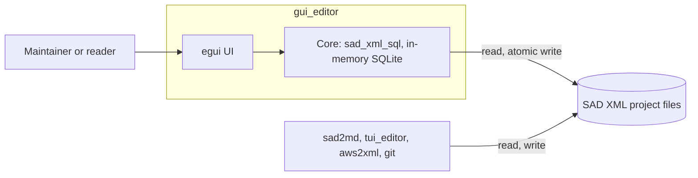

# GUI Editor Requirements

## Introduction

### Purpose

Technical requirements for `gui_editor`, derived from the story cards in
[USER_STORIES.md](USER_STORIES.md).
Readers are the planner, the developers, and the testers of `gui_editor`.

### Scope

- In scope: native Linux app, later local web app, editing and viewing of SAD XML projects.
- Out of scope: multi-user service, authentication of users, storage formats other than SAD XML.
- Adopted defaults for the business-analyst open questions:
  - 2: Detect external file changes and ask before overwriting, see GEDT-FR-00009.
  - 3: Fixed autosave interval of 60 seconds, see GEDT-FR-00007.
  - 4: No replica grouping in the first release, see GEDT-FR-00023.
  - 6: Fedora, current release, on Wayland and X11, see GEDT-AR-00004.
  - 8: `software_architecture_documentation.dtd` is the SAD DTD, see GEDT-AR-00001.

### Vocabulary

- Address: Element ID in the form `a.b.c.d`, each part a decimal number from 0 to 255.
- Core: Project model, XML reader, XML writer, and in-memory SQLite database.
- DTD rules: Element order, required elements, and required attributes of the SAD DTD,
  plus the field rules of GEDT-AR-00013.
- FileId: Number in `<Document><FileId>` that identifies a project.
- SAD: Software Architecture Documentation.
- SAD DTD: `sad_xml_sql/tests/software_architecture_documentation.dtd`, version 0.1.0.
- Session: One run of the editor, with one or more loaded projects.
- SRS: Software Requirements Specification.
- STS: Software Testing Specification.

### References

- Story cards: [USER_STORIES.md](USER_STORIES.md)
- Opportunity assessment: [02_opportunity_assesmemt.md](02_opportunity_assesmemt.md)
- SAD DTD: [software_architecture_documentation.dtd](../../sad_xml_sql/tests/software_architecture_documentation.dtd)
- SAD concepts: [SoftwareArchitectureDocumentationOverview.md](../../docs/SoftwareArchitectureDocumentationOverview.md)
- Shared model library: [sad_xml_sql](../../sad_xml_sql/src/lib.rs)
- Requirement format: [requirements-writing skill](../../.claude/skills/requirements-writing/SKILL.md)

### Overview

- [Traceability matrix](#traceability-matrix): story to requirement mapping.
- [Architecture and interface overview](#architecture-and-interface-overview): components and context.
- [Requirements](#requirements): functional and architectural requirements.
- [Interfaces](#interfaces): protocols, formats, and error handling.
- [Design decisions](#design-decisions): decisions with rejected alternatives.
- [Risks](#risks): technical risks and mitigations.
- [Open questions](#open-questions): questions for the product owner.

## Traceability matrix

| Story | Requirements |
| --- | --- |
| GEDT-STORY-00001 | GEDT-AR-00001, GEDT-AR-00012, GEDT-AR-00013, GEDT-AR-00027, GEDT-FR-00001, GEDT-FR-00002, GEDT-FR-00003 |
| GEDT-STORY-00002 | GEDT-AR-00001, GEDT-AR-00002, GEDT-AR-00030, GEDT-FR-00004, GEDT-FR-00005, GEDT-FR-00006, GEDT-FR-00009 |
| GEDT-STORY-00003 | GEDT-AR-00007, GEDT-AR-00029, GEDT-FR-00007, GEDT-FR-00008, GEDT-FR-00009 |
| GEDT-STORY-00004 | GEDT-FR-00010, GEDT-FR-00011, GEDT-FR-00012, GEDT-FR-00013 |
| GEDT-STORY-00005 | GEDT-FR-00013, GEDT-FR-00014, GEDT-FR-00015, GEDT-FR-00016 |
| GEDT-STORY-00006 | GEDT-FR-00011, GEDT-FR-00017, GEDT-FR-00018, GEDT-FR-00019 |
| GEDT-STORY-00007 | GEDT-FR-00011, GEDT-FR-00020, GEDT-FR-00021, GEDT-FR-00022 |
| GEDT-STORY-00008 | GEDT-AR-00016, GEDT-AR-00028, GEDT-FR-00024 |
| GEDT-STORY-00009 | GEDT-FR-00023 |
| GEDT-STORY-00010 | GEDT-FR-00025, GEDT-FR-00026 |
| GEDT-STORY-00011 | GEDT-FR-00026, GEDT-FR-00027, GEDT-FR-00028 |
| GEDT-STORY-00012 | GEDT-FR-00029 |
| GEDT-STORY-00013 | GEDT-FR-00030 |
| GEDT-STORY-00014 | GEDT-FR-00026, GEDT-FR-00031 |
| GEDT-STORY-00015 | GEDT-FR-00032, GEDT-FR-00033 |
| GEDT-STORY-00016 | GEDT-FR-00034, GEDT-FR-00035 |
| GEDT-STORY-00017 | GEDT-FR-00036, GEDT-FR-00037, GEDT-FR-00038 |
| GEDT-STORY-00018 | GEDT-FR-00039, GEDT-FR-00040 |
| GEDT-STORY-00019 | GEDT-AR-00003, GEDT-AR-00004 |
| GEDT-STORY-00020 | GEDT-AR-00003, GEDT-AR-00005, GEDT-FR-00041 |
| GEDT-STORY-00021 | GEDT-AR-00010, GEDT-AR-00011, GEDT-AR-00012, GEDT-AR-00013, GEDT-AR-00014, GEDT-AR-00015, GEDT-AR-00016, GEDT-AR-00029, GEDT-AR-00031 |
| GEDT-STORY-00022 | GEDT-AR-00007, GEDT-AR-00008, GEDT-AR-00009, GEDT-FR-00006 |
| GEDT-STORY-00023 | GEDT-AR-00017, GEDT-AR-00018, GEDT-AR-00019, GEDT-AR-00020 |
| GEDT-STORY-00024 | GEDT-AR-00021 |
| GEDT-STORY-00025 | GEDT-AR-00009, GEDT-AR-00015, GEDT-AR-00023, GEDT-AR-00024 |

Traceability gaps:

- Secondary: GEDT-AR-00025, supply-chain hygiene.
  No story asks for GEDT-AR-00025; the repository security policy mandates the requirement.
- Secondary: GEDT-AR-00032, program code in Rust.
  No story asks for GEDT-AR-00032; the product owner mandates the requirement as a process parameter.
- Secondary: GEDT-AR-00033, scripts in Bash.
  No story asks for GEDT-AR-00033; the product owner mandates the requirement as a process parameter.
- Orphaned requirements: none.
- Stories without a requirement: none.
- Removed: GEDT-AR-00006 and GEDT-AR-00022, together with the web app architecture decision.
  The IDs stay retired.

## Architecture and interface overview

The native app runs the egui UI and the core in one process.
The core reuses and extends the `sad_xml_sql` library, shared with `sad2md` and `tui_editor`.
The web app architecture is not decided; the web app is outside the first release.

| Component | Status | Responsibility |
| --- | --- | --- |
| Core | Changed, `sad_xml_sql` | XML read and write, DTD rule check, in-memory SQLite model, ID allocation. |
| egui UI | New | Edit mode, view mode, panes, windows, diagrams, search, filters. |
| SAD XML project files | Existing | Source of truth, one file per project. |

## Requirements

Priority follows the highest priority among the traced stories.
Requirements traced only to GEDT-STORY-00023 or GEDT-STORY-00024 are Critical for the web release.

### Storage

| ID | Requirement | Traces to | Priority | Verification |
| --- | --- | --- | --- | --- |
| GEDT-AR-00001 | The core shall use SAD XML files that follow the SAD DTD as the only persistent project store. | 00001, 00002 | Critical | Inspection |
| GEDT-AR-00002 | `sad2md` and `sad_xml_sql` shall process every file saved by the editor without error. | 00002 | Critical | Test |
| GEDT-AR-00007 | When a save is interrupted at any point, the project file shall contain either the complete previous content or the complete new content. | 00003, 00022 | Critical | Test, kill during save |
| GEDT-AR-00008 | A save shall keep the permission mode bits of the existing project file. | 00022 | Critical | Test |
| GEDT-AR-00009 | The editor shall write project data only to project files and to temporary files in the same directory, with permission mode bits no wider than the project file. | 00022, 00025 | Critical | Test, inspection |
| GEDT-AR-00030 | The core shall extend the shared `sad_xml_sql` library, keeping the `sad2md` and `tui_editor` test suites passing. | 00002 | Critical | Test |
| GEDT-FR-00001 | When the user selects a SAD XML file, the editor shall load every Component, ViewPacket, ComponentRelation, Behavior, Team, Requirement, and Include element into the session. | 00001 | Critical | Test |
| GEDT-FR-00002 | When a file fails XML parsing or the DTD rules, the editor shall reject the whole file with an error naming the file path, line, column, and failed rule. | 00001 | Critical | Test |
| GEDT-FR-00003 | The editor shall open a project file without writing to the file. | 00001 | Critical | Test, compare hash and mtime |
| GEDT-FR-00004 | On a save request, the editor shall write each modified project to the file the project was loaded from. | 00002 | Critical | Test |
| GEDT-FR-00005 | A save without edits shall preserve every element, attribute, and text value that the SAD DTD defines in the loaded file. | 00002 | Critical | Test, canonical XML compare |
| GEDT-FR-00006 | Before writing, the editor shall check the project against the DTD rules and, on failure, keep the existing file and show the failing element ID. | 00002, 00022 | Critical | Test |
| GEDT-FR-00007 | With unsaved changes, the editor shall save the project within 60 seconds of the first unsaved change. | 00003 | Value adding | Test |
| GEDT-FR-00008 | Without unsaved changes, the editor shall not write the project file. | 00003 | Value adding | Test |
| GEDT-FR-00009 | Before each save, including autosave, the editor shall ask the user before overwriting a file that changed on disk since the last load or save. | 00002, 00003 | Critical | Test |

### Components

| ID | Requirement | Traces to | Priority | Verification |
| --- | --- | --- | --- | --- |
| GEDT-FR-00010 | In edit mode, the editor shall create a component from a form with Name and Summary. | 00004 | Critical | Demonstration |
| GEDT-FR-00011 | The editor shall assign each new Component, ViewPacket, and ComponentRelation an address unused by any element of the same type in the loaded projects, with the project FileId as first part. | 00004, 00006, 00007 | Critical | Test |
| GEDT-FR-00012 | The editor shall write Component elements in ascending case-insensitive order of Name, with ties ordered by address. | 00004 | Critical | Test |
| GEDT-FR-00013 | The editor shall reject a create or rename that gives a component a Name already used in the same project, with an error naming the existing component. | 00004, 00005 | Critical | Test |
| GEDT-FR-00014 | In edit mode, the editor shall let the user change the Name attribute and every child element of a component defined by the SAD DTD. | 00005 | Critical | Demonstration |
| GEDT-FR-00015 | The editor shall keep the component address unchanged when the user edits the component. | 00005 | Critical | Test |
| GEDT-FR-00016 | After a component rename, every view shall show the new Name within the same session. | 00005 | Critical | Test |

### Viewpackets

| ID | Requirement | Traces to | Priority | Verification |
| --- | --- | --- | --- | --- |
| GEDT-FR-00017 | The editor shall create a viewpacket only with a primary ComponentId that references a component in the loaded projects. | 00006 | Critical | Test |
| GEDT-FR-00018 | The editor shall offer only the ViewType and ViewStyle values listed by `sad_xml_sql::create_styles`. | 00006 | Critical | Test |
| GEDT-FR-00019 | In edit mode, the editor shall let the user change every child element and attribute of a viewpacket defined by the SAD DTD, except the address. | 00006 | Critical | Demonstration |

Rationale for GEDT-FR-00018: the SAD DTD declares ViewType and ViewStyle as CDATA,
so the allowed set comes from `sad_xml_sql`, the list that `sad2md` processes.

### Diagrams

| ID | Requirement | Traces to | Priority | Verification |
| --- | --- | --- | --- | --- |
| GEDT-FR-00020 | In edit mode, the editor shall add and remove ComponentRelation elements in the diagram of a viewpacket with style ClientServer, Decomposition, Deployment, Install, or Uses, and in context diagrams. | 00007 | Critical | Demonstration |
| GEDT-FR-00021 | The editor shall accept a relation endpoint only when the endpoint references a component in the loaded projects. | 00007 | Critical | Test |
| GEDT-FR-00022 | Removing a component from a diagram shall remove the relations of that diagram only, keeping the Component element. | 00007 | Critical | Test |
| GEDT-FR-00023 | The diagram editor shall draw each component address as a separate node with its own relations. | 00009 | Value adding | Test, ETCD1 to ETCD3 fixture |
| GEDT-FR-00024 | While adding components to a diagram, the editor shall list only components whose Name contains the search text, ignoring letter case and matching every character literally. | 00008 | Value adding | Test, includes `'`, `%`, `_` |
| GEDT-FR-00025 | With a filter text applied to a ClientServer primary diagram, the editor shall show only components whose Name contains the filter text, plus their direct relations. | 00010 | Value adding | Test |

### Viewing

| ID | Requirement | Traces to | Priority | Verification |
| --- | --- | --- | --- | --- |
| GEDT-FR-00026 | Filters, selections, pane layout, and mode changes shall leave the project data and its modified flag unchanged. | 00010, 00011, 00014 | Value adding | Test |
| GEDT-FR-00027 | In view mode, the editor shall reject every request that changes project data. | 00011 | Value adding | Test, core level |
| GEDT-FR-00028 | Switching between view mode and edit mode shall keep the current selection. | 00011 | Value adding | Test |
| GEDT-FR-00029 | On component selection, the editor shall list every viewpacket with that component as primary ComponentId, and no other viewpacket. | 00012 | Value adding | Test |
| GEDT-FR-00030 | On component selection, the editor shall list, apart from the primary list, every viewpacket whose ComponentId list or diagram relations reference the component as non-primary. | 00013 | Nice to have | Test |
| GEDT-FR-00031 | The editor shall show at least two panes side by side in one window, each pane with its own view and selection. | 00014 | Value adding | Demonstration |
| GEDT-FR-00032 | The editor shall open at least two windows on the same session. | 00015 | Value adding | Demonstration |
| GEDT-FR-00033 | A component selection in one window shall show the component in every other window within 1 second. | 00015 | Value adding | Test |

### Multiple projects

| ID | Requirement | Traces to | Priority | Verification |
| --- | --- | --- | --- | --- |
| GEDT-FR-00034 | The editor shall load at least two project files in one session. | 00016 | Value adding | Test |
| GEDT-FR-00035 | A save shall write the data of each project only to the file of that project. | 00016 | Value adding | Test |
| GEDT-FR-00036 | The editor shall let a viewpacket or relation in one project reference a component of another loaded project. | 00017 | Value adding | Test |
| GEDT-FR-00037 | The editor shall save a cross-project reference as the component address, whose first part is the FileId of the owning project. | 00017 | Value adding | Test |
| GEDT-FR-00038 | The editor shall mark a reference to a project that is not loaded as unresolved, and shall keep the reference on save. | 00017 | Value adding | Test |
| GEDT-FR-00039 | The editor shall show components of at least two loaded projects in one view. | 00018 | Value adding | Demonstration |
| GEDT-FR-00040 | Each component in a multi-project view shall show the Title of the owning project. | 00018 | Value adding | Demonstration |

### Platforms

| ID | Requirement | Traces to | Priority | Verification |
| --- | --- | --- | --- | --- |
| GEDT-AR-00003 | The editor shall use the egui toolkit. | 00019, 00020 | Critical | Inspection |
| GEDT-AR-00004 | The native app shall open, edit, and save a project on the current Fedora release, on Wayland and on X11. | 00019 | Critical | Demonstration |
| GEDT-AR-00005 | The web app shall run in the current Firefox release and the current Chromium release. | 00020 | Value adding | Demonstration |
| GEDT-FR-00041 | The web app shall offer every edit and view function of the native app. | 00020 | Value adding | Test, shared UI suite |
| GEDT-AR-00032 | Hand-written program code of `gui_editor` shall be written in Rust. | Secondary | Critical | Inspection of repository |
| GEDT-AR-00033 | When `gui_editor` needs a hand-written script, the script shall be written in Bash. | Secondary | Critical | Inspection of repository |

Rationale for GEDT-AR-00032 and GEDT-AR-00033: the product owner limits the languages to reduce toolchains, reviewer skills, and supply-chain surface.
Data and configuration formats are not program code or scripts, for example TOML, YAML, XML, Markdown, and Mermaid.
Code generated by the Rust toolchain, for example `wasm-bindgen` JavaScript glue, is not hand-written.

The web app architecture is decided with the product owner when the web release starts.

### Security

| ID | Requirement | Traces to | Priority | Verification |
| --- | --- | --- | --- | --- |
| GEDT-AR-00010 | The XML reader shall resolve no external entity and load no external DTD subset. | 00021 | Critical | Test, XXE fixtures |
| GEDT-AR-00011 | The XML reader shall reject a file that declares an entity, with an error. | 00021 | Critical | Test, billion laughs fixture |
| GEDT-AR-00012 | The core shall report every malformed-input condition as an error value, without panic or process exit. | 00001, 00021 | Critical | Test, fuzzing |
| GEDT-AR-00013 | The core shall reject a file with an address outside `a.b.c.d` with parts 0 to 255, a non-integer SortOrder, or a FileId outside 1 to 255. | 00001, 00021 | Critical | Test |
| GEDT-AR-00014 | The core shall load an Include file only when the resolved path, after symlink resolution, is inside the directory of the including project file. | 00021 | Critical | Test, traversal fixtures |
| GEDT-AR-00015 | The editor shall open no outbound network connection, and shall never fetch an Include url attribute. | 00021, 00025 | Critical | Test, network namespace without route |
| GEDT-AR-00016 | The core shall pass every value from files or user input to SQLite as a bound parameter. | 00008, 00021 | Critical | Inspection, static check |
| GEDT-AR-00017 | The web server shall listen only on 127.0.0.1 and ::1. | 00023 | Critical, web release | Test |
| GEDT-AR-00018 | The web server shall reject a request whose Host header is not `localhost`, `127.0.0.1`, or `[::1]` with the server port, with status 421. | 00023 | Critical, web release | Test, DNS rebinding case |
| GEDT-AR-00019 | The web server shall reject a state-changing request whose Origin header differs from the server origin, with status 403. | 00023 | Critical, web release | Test |
| GEDT-AR-00020 | The web server shall require, on every API request, a per-launch token of at least 128 bits from the OS random source, kept out of logs and request URLs. | 00023 | Critical, web release | Test, inspection |
| GEDT-AR-00021 | The web app shall render project text only as text, and every server response shall carry a Content-Security-Policy that allows scripts from the server origin only. | 00024 | Critical, web release | Test, `<script>` fixture |
| GEDT-AR-00023 | Diagnostic logs shall contain file paths, addresses, and error kinds only, without field text or tokens, and shall stay on the local machine. | 00025 | Critical | Inspection, test |
| GEDT-AR-00024 | The editor shall require and store no credentials, and the source shall contain no credentials. | 00025 | Critical | Inspection, secret scan |
| GEDT-AR-00025 | The build shall use the committed `Cargo.lock` with `--locked`, and shall fail on any unignored `cargo audit` or `cargo deny` finding. | Secondary | Critical | Inspection of build |
| GEDT-AR-00031 | The XML reader shall reject a file larger than 64 MiB, or with element nesting deeper than 32 levels, with an error. | 00021 | Critical | Test |

### Performance

| ID | Requirement | Traces to | Priority | Verification |
| --- | --- | --- | --- | --- |
| GEDT-AR-00027 | The editor shall load a project with 2,000 components, 500 viewpackets, and 5,000 relations within 2 seconds on the reference workstation. | 00001 | Critical | Test, benchmark |
| GEDT-AR-00028 | The component search shall update the result list within 100 ms of a keystroke for 2,000 components. | 00008 | Value adding | Test, benchmark |
| GEDT-AR-00029 | The editor shall run load and save outside the UI thread, keeping each UI frame under 100 ms. | 00003, 00021 | Critical | Test |

Reference workstation: 4 CPU cores, 8 GiB RAM, SSD, current Fedora release.
The project size targets are assumptions; see [open questions](#open-questions).

### Quality attributes

| Attribute | Measurable target | Verification |
| --- | --- | --- |
| Availability | Malformed input never terminates the process, GEDT-AR-00012. | Fuzzing of the XML reader, 1 hour without crash. |
| Compatibility | 100% of saved files pass `xmllint --noout --nonet --valid` and `sad2md`. | CI test on every fixture. |
| Maintainability | One shared core for `gui_editor`, `sad2md`, and `tui_editor`, GEDT-AR-00030. | CI runs all three test suites. |
| Observability | Every error names the file, and the line and column or the address. | Test of each error path. |
| Performance | Load within 2 seconds, search within 100 ms, UI frame under 100 ms. | Benchmarks in CI. |
| Portability | Native on Fedora Wayland and X11; web in Firefox and Chromium. | Release demonstration. |
| Reliability | Zero corrupted files after 1,000 kills during save. | Kill-loop test. |
| Security | Zero outbound connections; all security tests pass. | Network namespace test, security fixtures. |

## Interfaces

| Interface | Protocol | Format | Direction | Error handling | Versioning |
| --- | --- | --- | --- | --- | --- |
| Include reference | Local file read | Relative path in `<Include>` | Core reads | Path outside project directory or missing file: error, project loads without the include. | SAD DTD version |
| SAD XML project file | Local file read, atomic write | XML 1.0, UTF-8, SAD DTD | Core reads and writes | Parse or rule failure: error with path, line, column; write failure: previous file kept. | Root `Version` attribute, 0.1.0 |
| Selection events | In-process | Rust types, window and address | Core to all windows | A window that closed is dropped from the receivers. | Crate version |

Web app interfaces are defined with the web app architecture.

## Design decisions

### In-memory SQLite through sad_xml_sql

- Decision: Confirm the business-analyst assumption.
  The core holds loaded projects in in-memory SQLite, through the `sad_xml_sql` library.
- Rationale: `sad2md` and `tui_editor` already use the same schema; SQLite serves search and filters.
- Rejected: Plain Rust structs; duplicates the model and search of `sad_xml_sql`.
- Rejected: On-disk SQLite; creates a second source of truth and a copy of sensitive data.

### Hardened shared library

- Decision: Extend `sad_xml_sql` in place for error values, lossless round trip, and DTD order.
- Rationale: One parser to secure and test, used by every tool in the repository.
- Rejected: Fork the code into `gui_editor`; the copies drift, and the `sad2md` parser stays unsafe.

### Cross-project references by address

- Decision: A reference is the component address, with the owning project FileId as first part.
  FileIds stay unique across loaded projects.
- Rationale: The DTD and `sad_xml_sql` already use this address form; no DTD change is needed.
- Rejected: New project attribute on references; changes the DTD and breaks `sad2md`.
- Rejected: Name-based references; renames break the links.

### Atomic save

- Decision: Write a temporary file in the project directory, flush, rename over the project file,
  then flush the directory.
- Rationale: Rename is atomic on Linux file systems; the temporary file stays on the same device.
- Rejected: In-place write; a crash leaves a truncated file.
- Rejected: Backup copy then overwrite; leaves a corruption window and an extra copy of the data.

### DTD rule check in Rust

- Decision: The core checks DTD rules in Rust; CI also runs `xmllint --noout --nonet --valid`.
- Rationale: No C XML library at runtime; `xmllint` gives an independent check in tests.
- Rejected: libxml2 at runtime; adds a C dependency with a history of entity and memory bugs.

### Encryption

- Decision: The editor adds no encryption; data at rest relies on OS disk encryption.
- Rationale: Data stays on the local machine, GEDT-AR-00009 and GEDT-AR-00015.
- Rejected: File encryption; breaks `sad2md`, git diffs, and the XML constraint.

## Risks

| Risk | Likelihood | Impact | Mitigation |
| --- | --- | --- | --- |
| Address parts that are not numbers silently become 0 in `convert_from_address_to_id`. | High | High | GEDT-AR-00013. |
| Autosave overwrites a file changed by `aws2xml` or a hand edit. | Medium | High | GEDT-FR-00009. |
| Changes to `sad_xml_sql` break `sad2md` or `tui_editor`. | Medium | Medium | GEDT-AR-00030; CI runs all suites. |
| Component reorder on first save produces large git diffs in existing files. | Medium | Low | One-time reorder commit before first use. |
| Dump in `sad_xml_sql` drops Include, Requirement, and most Component and ViewPacket children. | Certain | High | GEDT-FR-00005; golden-file round-trip tests. |
| Dump in `sad_xml_sql` writes Component `Title` before `TeamId`, against DTD order. | Certain | High | GEDT-FR-00006; fix the writer. |
| Dump in `sad_xml_sql` writes root `version="0.1.1"`; the DTD requires `Version`. | Certain | High | GEDT-FR-00006; fix the writer. |
| Include path traversal, marked TODO in `db_populate_from_xml.rs`. | High | High | GEDT-AR-00014 before first release. |
| Loader in `sad_xml_sql` panics or exits on malformed input, losing unsaved work. | Certain | High | GEDT-AR-00012. |
| Multiple egui windows misbehave on Wayland. | Medium | Medium | Prototype GEDT-FR-00032 early. |
| Template `template_sad.xml` uses IDs such as `1101`, which the loader rejects. | High | Medium | Open question 1; update the template. |
| Web API reached by DNS rebinding or a cross-site page. | Medium | High | GEDT-AR-00018, GEDT-AR-00019, GEDT-AR-00020. |

## Backwards compatibility

- Files saved by the editor stay readable by `sad2md`, `sad_xml_sql`, and `tui_editor`.
- Existing files gain alphabetical Component order on first save, GEDT-FR-00012.
- The writer fix changes the root attribute from `version` to `Version`, as the DTD requires.
- Files that `sad_xml_sql` accepts today, but that break the DTD rules, fail to open in the editor.
  The error names the failing rule, so the maintainer can fix the file.

## Feature interaction

- `aws2xml` and hand edits can change a file during a session, see GEDT-FR-00009.
- `sad2md` shares the hardened parser, so `sad2md` gains the same input protection.
- Git provides history and audit, so the editor keeps no audit log.

## Requirements to be tested

- Fixture set: valid files, DTD-rule failures, XXE, entity expansion, deep nesting,
  path traversal, `<script>` text, special characters in names.
- Round trip: open and save each valid fixture, then compare canonical XML and run `xmllint`.
- Kill loop: kill the editor at random points during save, then validate the file.
- Network: run the editor in a network namespace without a route, and assert zero connection attempts.
- Web security: Host, Origin, token, and CSP tests against the local server.

## Legacy test case updates

- `sad_xml_sql` tests that expect a panic, for example on a malformed address,
  change to expect an error value.
- `db_dump_to_xml` tests add checks for the `Version` attribute and DTD element order.

## Open questions

None blocks the first release; the proposed defaults are in the requirements above.

- 1: Address scheme.
  `sad_xml_sql` assumes the first address part is the FileId; `template_sad.xml` uses IDs such as `1101`.
  Options: `a.b.c.d` with FileId first, or a new scheme with a DTD change.
  Proposed default: `a.b.c.d` with FileId first, and update `template_sad.xml`.
- 2: Client-server filter criteria, GEDT-STORY-00010.
  The business-analyst default is component type, but the SAD DTD has no component type.
  Options: Name substring, a new `Type` element in the DTD, or the component Title.
  Proposed default: Name substring; a DTD change also touches `sad2md`.
- 3: Diagram styles in GEDT-STORY-00007.
  The story names context and installation; the DTD values are ContextModelKey and Install.
  Proposed default: installation means Install; context means the ContextModelKey diagram.
- 4: Project size and reference workstation for GEDT-AR-00027 and GEDT-AR-00028.
  Proposed default: 2,000 components, 500 viewpackets, 5,000 relations, 4 cores, 8 GiB RAM.
