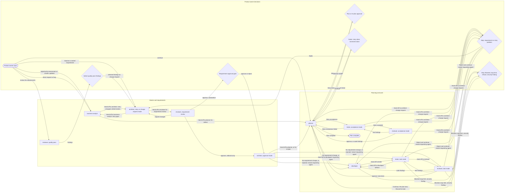
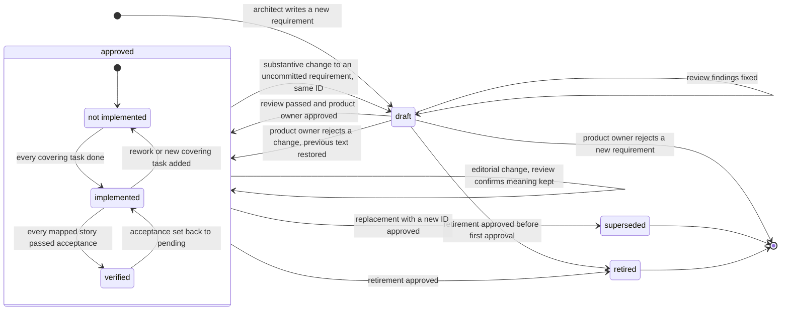
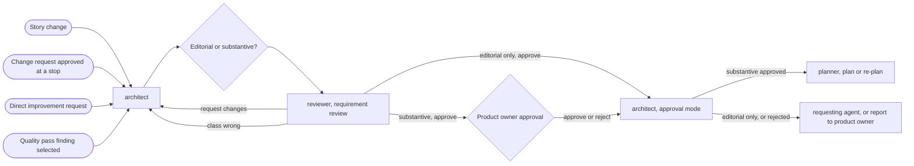
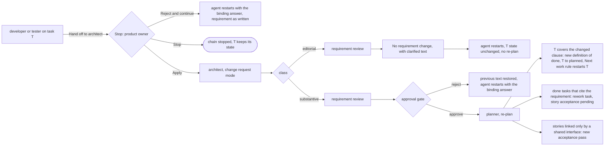
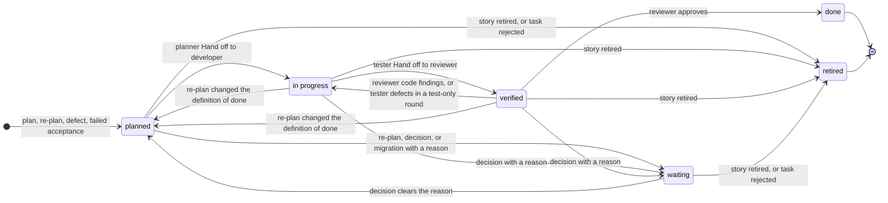
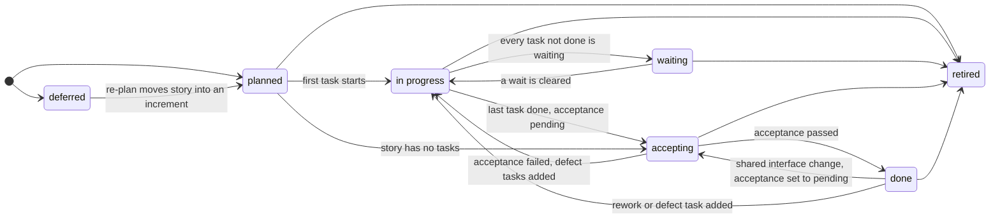
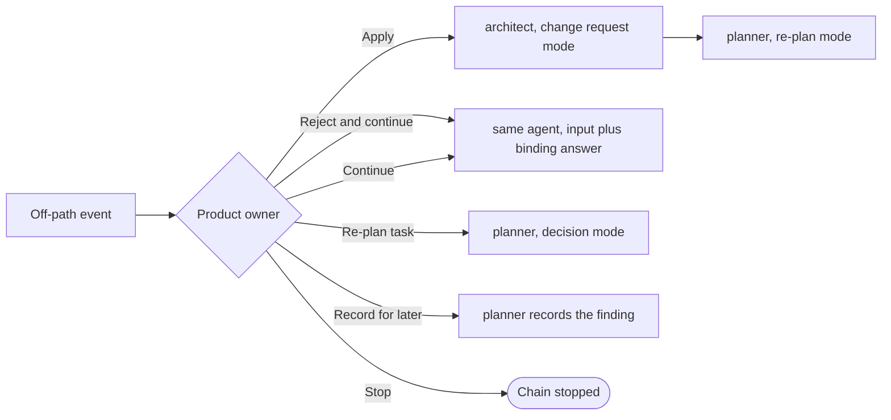
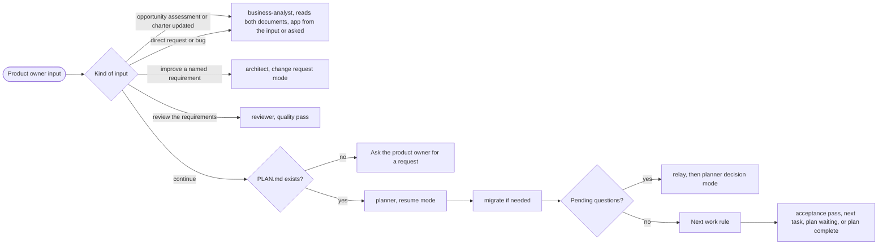

# Proposed Workflow State Machine

## Introduction

### Purpose

This document proposes the state machine that the idea-to-product agents follow, from a raw request to reviewed code.
It covers the current agent files in `.claude/agents/` plus the fixes proposed after the third audit and the requirement lifecycle, and lists the scenarios used to check the design.

### Vocabulary

- Acceptance pass: Tester and reviewer run over a whole story after its last task is done.
- Approved requirement: Requirement that passed requirement review and, for a substantive change, product owner approval; the only kind the planner plans from.
- Binding answer: Product owner answer that overrides an agent rule for the item it answers.
- Charter: Product owner document `<app>/docs/01_initial_charter.md` with the vision, mission, scope, and objectives of an application.
- Committed requirement: Requirement whose ID appears in `REQUIREMENTS.md` at git `HEAD`.
- Definition of done: Task field that names the story acceptance criteria and requirement clauses the task covers.
- Draft requirement: New or substantively changed requirement that has not passed requirement review and approval.
- Editorial change: Requirement change that keeps the meaning, for example wording or a typo; never changes a number, boundary, actor, or interface.
- Event: Agent output signal, read from its Next step line, together with the sender and mode.
- Gate: Point where the orchestrator asks the product owner to decide before the chain continues.
- Main path: Planning, tasks through developer, tester, and reviewer with their defect and review rounds, and acceptance passes.
- Opportunity assessment: Product owner document `<app>/docs/02_opportunity_*.md` with the voice of the customer, developer, business, and other stakeholders; the primary source of the stories.
- Product owner: The user.
- Quality pass: Requirement review over every approved requirement, started by the product owner.
- Requirement review: Reviewer check of new and changed requirements against the requirements-writing skill checklist and traceability.
- Stop: Off-path event that halts the chain and asks the product owner a question with fixed options.
- Substantive change: Requirement change that changes the meaning; any change to a number, boundary, actor, or interface is substantive.
- Superseded requirement: Committed requirement replaced by an approved requirement with a new ID.
- Waiting: Task state for work that must not start until the product owner or an external event clears it.

### References

- [orchestrator.md](.claude/agents/orchestrator.md): routing, event table, stops, gates, session start.
- [planner.md](.claude/agents/planner.md): modes, state transitions, Next work rule, `PLAN.md` structure.
- [requirements-writing skill](.claude/skills/requirements-writing/SKILL.md): requirement IDs and identifier changes.
- [USER_STORIES_template.md](.claude/doc_templates/USER_STORIES_template.md): story fields.
- [gui_editor/docs/PLAN.md](gui_editor/docs/PLAN.md): existing plan used for the migration scenario.

### Overview

- **[Design principles](#design-principles):** rules that keep the state machine small.
- **[Ownership](#ownership):** who writes which file.
- **[Chain](#chain):** agents and the main path.
- **[Signals](#signals):** every Next step signal and its sender.
- **[Requirement states](#requirement-states):** requirement lifecycle from draft to verified, superseded, or retired.
- **[Requirement changes](#requirement-changes):** editorial and substantive changes, review, approval, the quality pass, and a problem found during work.
- **[Task states](#task-states):** the stored work state with transitions.
- **[Story and increment states](#story-and-increment-states):** states derived from task states.
- **[Stops](#stops):** off-path events and their options.
- **[Restart safety](#restart-safety):** rules that make a second run harmless.
- **[Session start](#session-start):** how a new session resumes.
- **[Persisted data](#persisted-data):** what `PLAN.md` must hold.
- **[Scenarios](#scenarios):** the scenario set and the status of each.
- **[Open items](#open-items):** known limits of this proposal.

## Design principles

- The product owner's opportunity assessment and charter are the source of every story; each story quotes its voice entry in the `VoC` field.
- The orchestrator automates the main path only.
  Every other event stops the chain and asks the product owner.
- Two states are stored: the task state in `PLAN.md` and the requirement status in `REQUIREMENTS.md`.
  Story, increment, and requirement coverage states are derived from them.
- The planner plans only from approved requirements.
- The planner is the only writer of `<app>/docs/PLAN.md`, and every state change goes through the planner.
- Every agent starts with no memory, so everything an agent needs is in the handoff or in a file it reads.
- A second run of any agent with the same input changes nothing that the first run already changed.
- A product owner answer is binding for the item it answers.
- Agents never commit to git; the product owner commits by hand at any time.
- Only the orchestrator talks to the product owner, so every question is relayed and every answer is recorded.

## Ownership

| File or field | Writer | Readers |
| --- | --- | --- |
| `<app>/docs/01_initial_charter.md` | product owner | business-analyst, architect, planner |
| `<app>/docs/02_opportunity_*.md` | product owner | business-analyst, architect |
| `<app>/docs/DESIGN.md` architecture decisions | architect | all agents |
| `<app>/docs/DESIGN.md` own decision entries | developer, planner, tester | all agents |
| `<app>/docs/PLAN.md` | planner | architect, developer, orchestrator |
| Production code | developer | reviewer, tester |
| `<app>/docs/REQUIREMENTS.md`, including status and change history | architect | developer, planner, reviewer, tester |
| Test code | developer, tester | reviewer |
| `<app>/docs/USER_STORIES.md` Requirements field | architect | developer, planner, reviewer, tester |
| `<app>/docs/USER_STORIES.md` other story fields | business-analyst | all agents |

## Chain

The diagram is the state machine of the chain.
Each box is a state: the agent, in its mode, that holds control.
Each arrow is a transition: the signal that agent emits, routed by the orchestrator.
The product owner decision points are on the left, the requirement states in the middle, and the work on the right.

- A problem with a requirement or a story found by the developer, tester, or reviewer, in task or acceptance mode, or by the planner, always goes to the change request stop.
  - Apply starts the architect in change request mode.
  - A requirement problem then follows the requirement review and approval path.
  - A story problem makes the architect return `Hand off to business-analyst` with the story gap, and the business-analyst hands the corrected story back to the architect.
  - Reject and continue restarts the requesting agent with the binding answer; the diagram draws this edge only to the developer, tester, and reviewer, but it applies to the planner and the acceptance modes too.
- `Ask product owner` from any agent other than the planner relays the question and restarts the same agent; the diagram leaves out these self-loops.
- Stop, as an option at every product owner decision, halts the chain; the diagram leaves out these edges.
- The orchestrator routes every output through its event table and never edits files.
- The planner answers every task state update with the next step: the next task, an acceptance pass, a waiting report, or plan complete.
- Story done and increment done are gates; the planner writes them as gate lines before its next step.
- Every requirement change passes requirement review before the planner sees it; see [Requirement changes](#requirement-changes).

## Signals

| Signal | Sender | Meaning |
| --- | --- | --- |
| Approve, approve with nits, request changes | reviewer | Verdict on a task, an acceptance pass, or a requirement review, with findings split by area. |
| `Ask product owner` | any agent | Questions for the product owner; the planner also stores them in `PLAN.md`. |
| `Blocked` | developer, reviewer, tester | Work cannot continue for a reason no agent can fix. |
| `Done` | business-analyst | Question answered or request out of scope; no handoff. |
| `Hand off to architect` | developer, planner, reviewer, tester | Requirement change request; always a stop. |
| `Hand off to architect` | business-analyst | New, changed, and retired stories for story mode. |
| `Hand off to business-analyst` | architect | Story gaps the architect cannot resolve. |
| `Hand off to developer` | planner, tester | Next task, or task defects. |
| `Hand off to planner` | architect | Requirements for a first plan. |
| `Hand off to planner for defect` | business-analyst | Bug against an existing story. |
| `Hand off to planner for re-plan` | architect | Requirement changes for an existing plan. |
| `Hand off to reviewer` | tester | Task verified. |
| `Hand off to reviewer for requirement review` | architect | Proposed: new and changed requirement IDs, each classed editorial or substantive. |
| `Hand off to tester` | developer | Task implemented. |
| `Increment done` | planner | Gate line: every story of the increment is done or retired. |
| `No requirement change` | architect | Approved change request needs no substantive requirement change; an editorial clarification may come with it. |
| `Plan complete` | planner | Every task is done or retired and no story is accepting. |
| `Plan waiting` | planner | Proposed: tasks remain, but each one is waiting or depends on a waiting task. |
| `Refused` | planner | Proposed: a state update broke a transition rule; always a stop. |
| `Requirements updated` | architect, approval mode | Proposed: editorial changes recorded, or a direct request handled, with no effect on the plan. |
| `Security finding` | developer, reviewer, tester | Proposed: security issue outside the task scope; always a stop after the current event. |
| `State updated` | planner | State change recorded; take the pending next action. |
| `Story acceptance` | planner | Start the acceptance pass of the named story. |
| `Story acceptance failed` | tester | Acceptance pass found defects. |
| `Story accepted` | tester | Acceptance pass found no defects. |
| `Story done` | planner | Gate line: the story passed acceptance. |

## Requirement states

The architect stores the status of each requirement in `REQUIREMENTS.md`: draft, approved, superseded, or retired.
The planner derives implemented and verified for each approved requirement from the task and story states, and records them in a requirement coverage table in `PLAN.md`.

| From | To | Trigger | Who sets it |
| --- | --- | --- | --- |
| approved | approved | Editorial change; requirement review confirms the meaning is kept | architect, approval mode |
| approved | draft | Substantive change to an uncommitted requirement; previous text kept in the change history | architect, change request or story mode |
| approved | retired | No active story traces to it, or the product owner retires it; retirement approved | architect, approval mode |
| approved | superseded | Substantive change to a committed requirement; the replacement with a new ID is approved | architect, approval mode |
| draft | approved | Requirement review passed and the product owner approved | architect, approval mode |
| draft | approved | Product owner rejected the change; the previous approved text is restored | architect, approval mode |
| draft | discarded | Product owner rejected a new requirement; the ID is never reused | architect, approval mode |
| draft | draft | Requirement review findings fixed | architect, change request or story mode |
| draft | retired | Retirement approved before the first approval | architect, approval mode |

- A substantive change to a committed requirement never edits it in place.
  The architect writes a draft with a new ID that records the ID it replaces; the old requirement stays approved until the replacement is approved, then becomes superseded.
- Implemented and verified are never written by the architect; they follow from the work.
- A requirement stays not implemented while any task that covers one of its clauses is not done.

## Requirement changes

Every requirement change has one path, whatever its source.

### Sources

- Story change: the business-analyst hands off new, changed, or retired stories; the architect runs in story mode.
- Change request: an agent raised it during work, and the product owner chose apply at the stop.
- Direct improvement request: the product owner asks to improve a named requirement; session start routes it to the architect in change request mode with the request as the source.
- Quality pass: the product owner asks to review the requirements; the reviewer checks every approved requirement against the skill checklist, the product owner selects which findings to fix, and the selection goes to the architect as one change request.

### Classification

- The architect classes every change as editorial or substantive before writing it.
- Any change to a number, boundary, actor, trigger, or interface is substantive, whatever its size.
- The reviewer checks the class; a change it finds substantive goes back to the architect as substantive.
- Editorial: same ID, same status, entry in the change history, no product owner approval, no re-plan.
- Substantive: the identifier change rules of the requirements-writing skill apply, then requirement review, then the product owner approval gate, then a re-plan.

### Requirement review

- The reviewer runs in requirement review mode on the new and changed requirement IDs, or on every approved requirement in a quality pass.
- The checklist is the requirements-writing skill: atomic, testable, abstract, traceable, no untagged constraint, consistent with the other requirements and the stories.
- Request changes returns the findings to the architect; three rounds without approval is a loop limit stop.
- The reviewer never edits requirements.

### Approval gate

- The orchestrator asks the product owner to approve each substantive change, with the old text, the new text, the class, the affected stories, and the done tasks that cite the requirement.
- Approve: the architect sets the status, and hands off to the planner for a plan or re-plan.
- Reject: the architect restores the previous text or discards the draft, and the answer is binding for the agent that requested the change.
- A change request from an agent passes two product owner decisions.
  The stop decides whether to change the requirement at all; the approval gate confirms the text the architect wrote.
- All substantive changes of one architect run go to one approval question.

### Problem found during work

A developer or tester who finds a problem in a requirement while working on task T raises a change request.
T keeps its state, in progress or verified, until the product owner and the architect decide.

- Scenarios z10, z11, and z12 describe these paths; none is audited yet.
- The change request waiting at the stop is not persisted; see [Open items](#open-items).

## Task states

Task state is stored in `PLAN.md`.
The planner applies every change, and refuses any change the table below does not allow.

| From | To | Trigger | Who sets it |
| --- | --- | --- | --- |
| in progress | planned | Re-plan changed the definition of done | planner, re-plan mode |
| in progress | retired | Story retired | planner, re-plan mode |
| in progress | verified | Tester `Hand off to reviewer` | planner, state update mode |
| in progress | waiting | Product owner answer with a wait reason | planner, decision mode |
| planned | in progress | Planner `Hand off to developer`, plan approved, dependencies done | planner, state update mode |
| planned | retired | Story retired, or product owner rejected the task | planner, re-plan or decision mode |
| planned | waiting | Wait reason from a re-plan, a decision, or migration | planner, re-plan, decision, or migration mode |
| verified | done | Reviewer approves | planner, state update mode |
| verified | in progress | Reviewer code findings, or tester defects in a test-only round | planner, state update mode |
| verified | planned | Re-plan changed the definition of done | planner, re-plan mode |
| verified | retired | Story retired | planner, re-plan mode |
| verified | waiting | Product owner answer with a wait reason | planner, decision mode |
| waiting | planned | Product owner answer clears the reason | planner, decision mode |
| waiting | retired | Story retired, or product owner rejected the task | planner, re-plan or decision mode |

When a task is retired, the planner removes it from the `depends on` list of every other task, or replaces it with the task that takes over its work.

## Story and increment states

Story states are derived from task states and the story acceptance field, in this order of precedence.
Retired tasks are ignored.

- retired: the story is retired.
- deferred: the story is in the deferred list; it has no tasks.
- waiting: every task that is not done is waiting.
- done: every task is done, or the story has no tasks, and the story acceptance passed.
- accepting: every task is done, or the story has no tasks, and the story acceptance is pending.
- planned: every task is planned.
- in progress: any other combination.

An increment is done when every story in it is done or retired, and every cleanup task of its retired stories is done.

## Stops

A stop halts the chain and asks one self-contained question with fixed options.
The answer is binding: the agent that is started again must not raise the same item again.

| Event | Options | Effect |
| --- | --- | --- |
| `Blocked` | Continue, stop | Continue starts the same agent with its input and the answer, for example a fixed environment. |
| Loop limit | Re-plan task, accept findings, stop | Proposed: re-plan task changes or splits the task; accept findings lets the reviewer approve with the findings recorded. |
| `Refused` | Stop | Proposed: a refusal is a design defect; the product owner decides outside the chain. |
| Requirement approval gate | Approve, reject | Proposed: approve sets the status and starts the plan or re-plan; reject restores the previous text or discards the draft. |
| Requirement change request | Apply, reject and continue, stop | Apply runs the architect with the answer as source; reject restarts the agent with the binding answer. |
| `Security finding` | Raise change request, record for later, stop | Proposed: record for later makes the planner store the finding; the current task continues. |
| Third failed acceptance pass | Continue, wait, stop | Proposed: wait sets the story's open tasks to waiting with the answer as reason. |

## Restart safety

An agent can be started again with its original input after a question or a stop.
A second run must change nothing that the first run already changed.

- Every agent that writes files asks all its questions before it writes any file.
- The planner stores its questions in the pending questions section of `PLAN.md` and answers them in decision mode, without the original input.
- Proposed: the planner records each applied input in an applied inputs list in `PLAN.md`, with mode, source, and date, and skips an input it already applied.
- Proposed: the business-analyst hands off every story whose `Requirements` field is empty, not only the stories it touched in this run.
- Developer and tester restarts read the current working tree, so repeated edits converge.
- Proposed: only the orchestrator has `AskUserQuestion`, so no subagent can ask a question that is not relayed and recorded.

## Session start

A new session reads the product owner request first, then the plan.

- Proposed: session start always goes through the planner in resume mode, so the approval check, migration, and pending questions are handled in one place.
- A task in progress restarts the developer; a verified task restarts the tester, so that a fresh tester report exists for the reviewer.
- Proposed: the task row keeps a one-line change summary per changed file, so a reviewer in a new session can attribute hunks without the old developer report.

## Persisted data

`<app>/docs/PLAN.md` holds everything a later run or session needs.

| Part | Content | Status |
| --- | --- | --- |
| Applied inputs | Mode, source, and date of each applied input | Proposed |
| Decision log | Every product owner answer, verbatim, with date, including gate preferences | Current; gate preferences proposed |
| Pending questions | Questions waiting for an answer, with options and default | Current |
| Recorded security findings | Findings recorded for later, with source and date | Proposed |
| Requirement coverage | Approved requirement ID, covering tasks, implemented, verified | Proposed |
| Story state table | Story ID, increment, task IDs, acceptance, failed passes, re-check requirement IDs, state | Current; re-check IDs proposed |
| Task list | ID, task, story, kind, increment, depends on, size, definition of done, state, wait reason, changed files with summaries, open findings | Current; wait reason, summaries, open findings proposed |

`<app>/docs/REQUIREMENTS.md` holds, for each requirement, the status (draft, approved, superseded, retired), the replaced ID when it replaces one, and a change history with each change, its class, and the previous text.
The previous text lets a rejected change be restored.

Other persisted items:

- The architect writes `none, traceability gap` into the `Requirements` field of a story it flags, so the flag survives later runs.
- The planner records test files from acceptance passes with the story.
- Migration expands short requirement IDs to the full `FEAT-TYPE-nnnnn` form.

## Scenarios

Status values:

- Passed: the third audit traced the scenario through the current files without a defect.
- Fixed by proposal: the third audit found a defect that this proposal removes.
- Open: not yet traced.

| ID | Scenario | Expected path | Status |
| --- | --- | --- | --- |
| a | Opportunity assessment and charter of a new application to first increment done, with plan approval | Session start, business-analyst turns each voice entry into a story with its `VoC` quote, architect story mode, planner plan mode, approval question, Next work rule, tasks, acceptance passes, gates. | Fixed by proposal: no entry point for a new request |
| b | Story with three tasks, normal path | Each task planned, in progress, verified, done; then accepting, acceptance pass, done, story done gate. | Passed |
| c | Tester defect, reviewer code round, reviewer test-only round, product defect in a test-only round | Defects keep the task in progress; code findings set verified to in progress; test-only round keeps verified; a product defect in it sets verified to in progress. | Passed |
| d | Developer change request, product owner applies, re-plan affects the task in progress | Stop, architect change request mode, re-plan sets the task to planned with a new definition of done, Next work rule restarts it. | Passed |
| e | Developer change request, product owner rejects | Stop, developer restarted with the binding answer, does not raise the request again. | Fixed by proposal: answer was not binding |
| f | Requirement change reaches a done story only through a shared interface | Re-plan sets the story acceptance to pending and records the re-check IDs; the acceptance pass tests the changed interface. | Fixed by proposal: pass was not told about the change |
| g | Business-analyst retires a story whose task has changed files | Re-plan retires the tasks, fixes dependent tasks, asks about a cleanup task; cleanup is tested for absent behavior. | Fixed by proposal: dependent tasks stuck, absence not testable |
| h | Story acceptance fails three times, product owner continues | Defect tasks after each failure, counter reaches three, question, decision mode resets the counter. | Passed |
| i1 | Session ends with a task in progress | Resume mode, Next work rule names the task, developer restarts on the current tree with the open findings. | Fixed by proposal: open findings lost |
| i2 | Session ends with a task verified | Resume mode, tester restarts, reviewer attributes hunks from the recorded change summaries. | Fixed by proposal: code went unreviewed |
| i3 | Session ends with a pending planner question | Resume mode relays the question, planner decision mode applies the answer. | Passed |
| j | Developer `Blocked`, product owner continues | Stop, developer restarted with the answer. | Passed |
| k | Trivial bug against a done story | Session start routes the bug to the business-analyst, defect mode adds a defect task, acceptance pending, approval question. | Fixed by proposal: no entry point while work was open |
| l | Story flagged as a traceability gap | Flag stored in the `Requirements` field; planner asks once to defer or send back; answer recorded. | Fixed by proposal: flag was lost |
| m | Story already satisfied by existing code | No tasks, story accepting, acceptance pass, done. | Passed |
| n | First session on the existing `gui_editor/docs/PLAN.md` | Resume mode migrates in rounds of four questions; T-53, T-61, and T-48 become waiting with their recorded reasons. | Fixed by proposal: waits could not be expressed |
| o | Change request during an acceptance pass | Stop; on apply, re-plan either adds tasks or keeps the story accepting for a new pass. | Open |
| p | Loop limit on a task | Stop with re-plan task, accept findings, or stop; none of them repeats the failed round. | Fixed by proposal: continue repeated the failure |
| q | Planner refuses a state update | `Refused`, stop. | Fixed by proposal: no refusal signal |
| r | Security finding outside the task scope | `Security finding` stop after the current event; record for later lets the task continue. | Fixed by proposal: finding looped the task |
| s | Every remaining task waits or depends on a waiting task | Next work rule writes `Plan waiting`; the orchestrator reports the waits; no question in state update mode. | Fixed by proposal: question in a mode that forbids questions |
| t | Planner restarted after a stop in re-plan, defect, or record mode | Applied inputs list skips the input; no duplicate tasks or counts. | Fixed by proposal: duplicates |
| u | Business-analyst restarted after a question | Questions asked before writing; second run finds no new edits to make. | Fixed by proposal: stories marked changed or duplicated |
| v | Architect sends story gaps back, business-analyst runs again | Business-analyst hands off every story with an empty `Requirements` field. | Fixed by proposal: first run stories dropped |
| w | Product owner rejects a defect task | Decision mode retires the task. | Fixed by proposal: task could not be retired |
| x | Session starts on an unapproved plan with planned tasks | Resume mode finds no approval and asks for it before any task starts. | Fixed by proposal: approval check skipped |
| y1 | Product owner adds, changes, and removes voice entries in the opportunity assessment | Session start, business-analyst compares the entries with the `VoC` quotes: new story, changed story, and retired story after the product owner confirms the removal; architect story mode, requirement review, approval gate, re-plan. | Open: new in this proposal |
| y2 | Product owner brings a request that the opportunity assessment does not cover | Business-analyst writes the story with the request as its `VoC` quote and date, and asks the product owner to add the need to the opportunity assessment. | Open: new in this proposal |
| z1 | Product owner asks to tighten a committed, verified requirement | Session start, architect change request mode, substantive, draft with a new ID that records the old ID, requirement review, approval gate, new ID approved and old superseded, re-plan adds rework for done tasks that cite the old ID, story acceptance pending, acceptance pass. | Open: new in this proposal |
| z2 | Product owner asks to fix the wording of a requirement | Architect classes it editorial, reviewer confirms the meaning is kept, same ID and status, change history entry, `Requirements updated`, no re-plan. | Open: new in this proposal |
| z3 | Editorial claim that changes a number | Reviewer finds the class wrong, architect redoes it as substantive, then the z1 path. | Open: new in this proposal |
| z4 | Substantive change to an uncommitted requirement | Same ID back to draft with the previous text in the history, review, approval gate, approved, re-plan. | Open: new in this proposal |
| z5 | Product owner rejects a change at the approval gate | Architect restores the previous text or discards the draft; the requesting agent restarts with the binding answer; no re-plan. | Open: new in this proposal |
| z6 | Requirement review finds defects three times | Architect fixes after each round; third round without approval is a loop limit stop. | Open: new in this proposal |
| z7 | Quality pass | Reviewer checks every approved requirement, product owner selects findings, one change request to the architect, then the z1 or z2 path per change. | Open: new in this proposal |
| z8 | Story retired, so a requirement loses its last trace | Architect drafts the retirement, review, approval gate, retired; the planner removes it from the coverage table and retires the tasks that covered only that requirement. | Open: new in this proposal |
| z9 | Planner receives a requirement that is still draft | Planner refuses to plan from it and returns the ID to the architect as a change request; the review path runs first. | Open: new in this proposal |
| z10 | Tester finds a substantive requirement problem while the task is verified; product owner applies and approves | Stop, architect change request mode, review, approval gate, re-plan sets the task from verified to planned with a new definition of done, Next work rule restarts it. | Open: new in this proposal |
| z11 | Developer finds a problem in a requirement clause that another, done task covers | Same path; re-plan adds a rework task before the current task, which stays in progress; both tasks have uncommitted changes in the tree. | Open: two tasks in progress at once |
| z12 | Developer finds an ambiguous requirement; architect classes the fix editorial | Stop, apply, review confirms the meaning is kept, `No requirement change` with the clarified text, developer restarts, task state unchanged, no re-plan. | Open: new in this proposal |

## Open items

- Loop round counters are not stored in `PLAN.md`, so a new session starts the count again.
- Agents never commit, so diffs can mix tasks; change summaries reduce but do not remove the attribution problem.
- The reviewer read-only rule and the developer and tester Bash use are enforced by instructions only.
- The shared component impact path has no data until requirements record their component.
- Scenario o and scenarios z1 to z12 have not been traced by an audit.
- A change request waiting at a stop is held only by the orchestrator; a session that ends at the stop loses it, and the agent must find the problem again.
- A rework task placed before an interrupted task leaves two tasks in progress, and their uncommitted changes share the working tree.
- The requirement lifecycle needs new modes that the agent files do not have yet: requirement review mode and quality pass mode for the reviewer, and approval mode for the architect.
- An approval gate for every substantive change adds product owner questions; batching all changes of one architect run into one gate keeps that to one question per run.
- The design is prose in seven prompts; a tested state script that owns `PLAN.md` would make the transition rules enforceable instead of audited.
