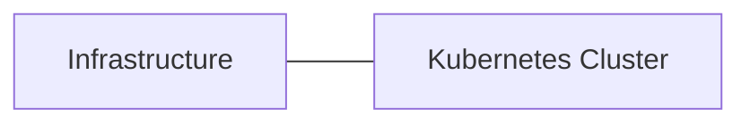

# Software Architecture Document

This document is generated from the Software Architecture Document (SAD) XML file.

## Table of Contents

* [Module](#module)
  * [Module Decomposition view packet 1.1.1: Application infrastructure](#module-decomposition-view-packet-111-application-infrastructure)
  * [Module Decomposition view packet 1.1.2: Kubernetes infrastructure](#module-decomposition-view-packet-112-kubernetes-infrastructure)
* [CnC](#cnc)
* [Allocation](#allocation)

## Module

### Module Decomposition view packet 1.1.1: Application infrastructure

#### 1.1.1: Primary presentation



* Infrastructure: Provide the infrastructure for the application
  * Kubernetes Cluster: Container orchestration platform.


#### 1.1.1: Context diagram

```mermaid
  graph TD;
```

| Entity | Type | Description | Reference |
| ------ | ---- | ----------- | --------- |
| Infrastructure | TheWork | Provide the infrastructure for the application |  |

#### 1.1.1: Related views

* Parent:
* Siblings:
* Children:
  * [Module Decomposition view packet 1.1.2: Kubernetes infrastructure](#module-decomposition-view-packet-112-kubernetes-infrastructure)

### Module Decomposition view packet 1.1.2: Kubernetes infrastructure

#### 1.1.2: Primary presentation

```mermaid
  graph LR;
```

* Kubernetes Cluster: Container orchestration platform.


#### 1.1.2: Context diagram

```mermaid
  graph TD;
```

| Entity | Type | Description | Reference |
| ------ | ---- | ----------- | --------- |
| Kubernetes Cluster | TheWork | Container orchestration platform. |  |

#### 1.1.2: Related views

* Parent:
  * [Module Decomposition view packet 1.1.1: Application infrastructure](#module-decomposition-view-packet-111-application-infrastructure)
* Siblings:
* Children:

## CnC

## Allocation

