# Software Architecture Document

This document is generated from the Software Architecture Document (SAD) XML file.

## Table of Contents

* [Module](#module)
  * [Module Decomposition view packet 1.1.1: Card game](#module-decomposition-view-packet-111-card-game)
  * [Module Decomposition view packet 1.1.2: Game Client](#module-decomposition-view-packet-112-game-client)
  * [Module Decomposition view packet 1.1.3: Game server](#module-decomposition-view-packet-113-game-server)
  * [Module Decomposition view packet 1.1.4: Edge connector](#module-decomposition-view-packet-114-edge-connector)
  * [Module Decomposition view packet 1.1.5: Message broker](#module-decomposition-view-packet-115-message-broker)
  * [Module Decomposition view packet 1.1.6: oAuth decomposition](#module-decomposition-view-packet-116-oauth-decomposition)
  * [Module Uses view packet 1.2.2: Edge connector](#module-uses-view-packet-122-edge-connector)
  * [Module Uses view packet 1.2.4: Session manager](#module-uses-view-packet-124-session-manager)
  * [Module UsedBy view packet 1.3.3: RabbitMQ](#module-usedby-view-packet-133-rabbitmq)
  * [Module Layered view packet 1.5.1: Cloud presence layers](#module-layered-view-packet-151-cloud-presence-layers)
* [CnC](#cnc)
  * [CnC ClientServer view packet 2.1.1: EdgeConnector](#cnc-clientserver-view-packet-211-edgeconnector)
* [Allocation](#allocation)
  * [Allocation Deployment view packet 3.1.1: Server deployment](#allocation-deployment-view-packet-311-server-deployment)
  * [Allocation Install view packet 3.2.1: Statistics server installation](#allocation-install-view-packet-321-statistics-server-installation)
  * [Allocation Assignment view packet 3.3.1: Frontender team](#allocation-assignment-view-packet-331-frontender-team)
  * [Allocation Assignment view packet 3.3.2: empty team, for error testing](#allocation-assignment-view-packet-332-empty-team-for-error-testing)

## Module

### Module Decomposition view packet 1.1.1: Card game

#### 1.1.1: Primary presentation

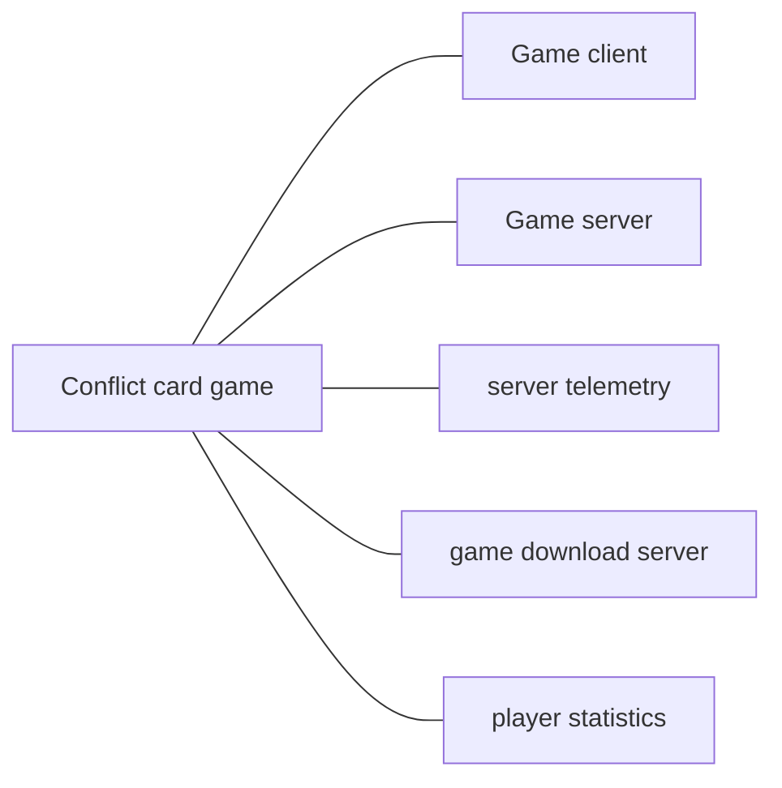

* Conflict card game: An online multiplayer tournament conflict card game.
  * Game client: Application running at the player end.
  * Game server: The server side solution.
  * server telemetry: Holds the the telemetry of all server side entities.
  * game download server: Hosts the download site for the game client application.
  * player statistics: API with access to all player statistics.


#### 1.1.1: Context diagram

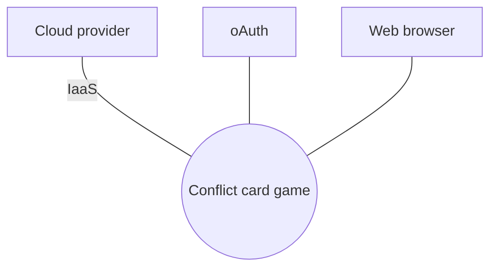

| Entity | Type | Description | Reference |
| ------ | ---- | ----------- | --------- |
| Cloud provider | Adjacent |  |  |
| Conflict card game | TheWork | An online multiplayer tournament conflict card game. |  |
| IaaS | Connector | Iaas operations |  |
| oAuth | Adjacent | authorization that enables a user to grant an application access to their data on
      another application without sharing their credentials |  |
| Web browser | Adjacent | Web browser application. |  |

#### 1.1.1: Related views

* Parent:
* Siblings:
* Children:
  * [Module Decomposition view packet 1.1.2: Game Client](#module-decomposition-view-packet-112-game-client)
  * [Module Decomposition view packet 1.1.3: Game server](#module-decomposition-view-packet-113-game-server)

### Module Decomposition view packet 1.1.2: Game Client

#### 1.1.2: Primary presentation

```mermaid
  graph LR;
```

* Game client: Application running at the player end.

#### 1.1.2: Related views

* Parent:
  * [Module Decomposition view packet 1.1.1: Card game](#module-decomposition-view-packet-111-card-game)
  * [Module Decomposition view packet 1.1.4: Edge connector](#module-decomposition-view-packet-114-edge-connector)
* Siblings:
* Children:

### Module Decomposition view packet 1.1.3: Game server

#### 1.1.3: Primary presentation

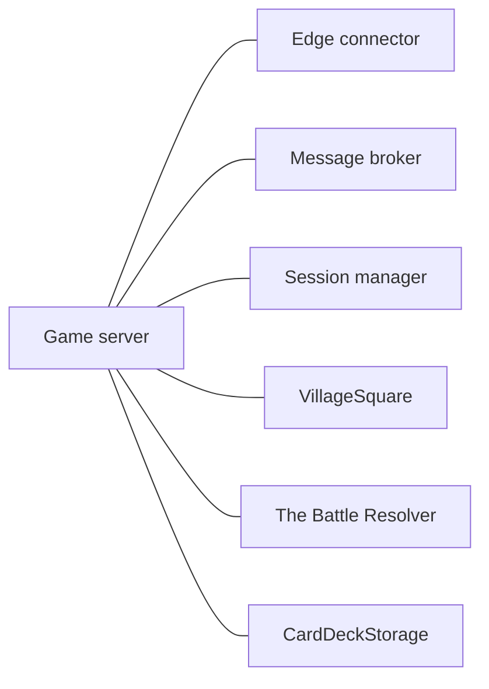

* Game server: The server side solution.
  * Edge connector: Receive client connections, validate the message and route the message.
  * Message broker: Pub-sub server, enable transferring messages among server services.
  * Session manager: TODO Handle setting up game sessions, and transition the session between the different
      stations until the game is done.
  * VillageSquare: Modify the deck for the next battle.
  * The Battle Resolver: Execute the battle
  * CardDeckStorage: Holds the current deck, plus any version of deck still being used in an ongoing
      session.

#### 1.1.3: Related views

* Parent:
  * [Module Decomposition view packet 1.1.1: Card game](#module-decomposition-view-packet-111-card-game)
* Siblings:
* Children:
  * [CnC ClientServer view packet 2.1.1: EdgeConnector](#cnc-clientserver-view-packet-211-edgeconnector)
  * [Module Uses view packet 1.2.2: Edge connector](#module-uses-view-packet-122-edge-connector)
  * [Module Decomposition view packet 1.1.4: Edge connector](#module-decomposition-view-packet-114-edge-connector)
  * [Module Uses view packet 1.2.4: Session manager](#module-uses-view-packet-124-session-manager)

### Module Decomposition view packet 1.1.4: Edge connector

#### 1.1.4: Purpose

Ensure the client is authticated and the payload is valid(not a security risk)

#### 1.1.4: Primary presentation

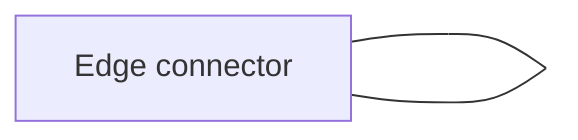

* Edge connector: Receive client connections, validate the message and route the message.
  * Edge connector: Receive client connections, validate the message and route the message.

#### 1.1.4: Related views

* Parent:
  * [Module Decomposition view packet 1.1.2: Game Client](#module-decomposition-view-packet-112-game-client)
  * [Module Decomposition view packet 1.1.3: Game server](#module-decomposition-view-packet-113-game-server)
* Siblings:
  * [CnC ClientServer view packet 2.1.1: EdgeConnector](#cnc-clientserver-view-packet-211-edgeconnector)
  * [Module Uses view packet 1.2.2: Edge connector](#module-uses-view-packet-122-edge-connector)
* Children:

### Module Decomposition view packet 1.1.5: Message broker

#### 1.1.5: Primary presentation

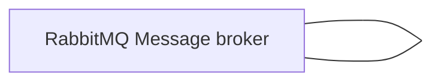

* RabbitMQ Message broker: Pub-sub server, enable transferring messages among server services.
  * RabbitMQ Message broker: Pub-sub server, enable transferring messages among server services.

#### 1.1.5: Related views

* Parent:
  * [Module Decomposition view packet 1.1.4: Edge connector](#module-decomposition-view-packet-114-edge-connector)
* Siblings:
  * [Module UsedBy view packet 1.3.3: RabbitMQ](#module-usedby-view-packet-133-rabbitmq)
* Children:

### Module Decomposition view packet 1.1.6: oAuth decomposition

#### 1.1.6: Primary presentation

```mermaid
  graph LR;
```

* oAuth: authorization that enables a user to grant an application access to their data on
      another application without sharing their credentials

#### 1.1.6: Related views

* Parent:
  * [Module Decomposition view packet 1.1.1: Card game](#module-decomposition-view-packet-111-card-game)
  * [Module Decomposition view packet 1.1.4: Edge connector](#module-decomposition-view-packet-114-edge-connector)
* Siblings:
* Children:

### Module Uses view packet 1.2.2: Edge connector

#### 1.2.2: Purpose

Ensure the client is authticated and the payload is valid(not a security risk)

#### 1.2.2: Primary presentation

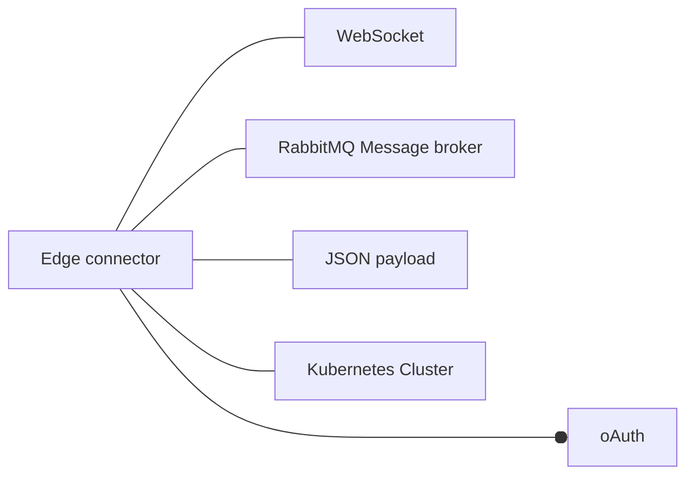

* Edge connector: Receive client connections, validate the message and route the message.
  * WebSocket: WebSocket library for the client application.
  * RabbitMQ Message broker: Pub-sub server, enable transferring messages among server services.
  * oAuth: authorization that enables a user to grant an application access to their data on
      another application without sharing their credentials
  * JSON payload: JSON message payloads.
  * Kubernetes Cluster: Container orchestration platform.

#### 1.2.2: Related views

* Parent:
  * [Module Uses view packet 1.2.2: Edge connector](#module-uses-view-packet-122-edge-connector)
* Siblings:
  * [CnC ClientServer view packet 2.1.1: EdgeConnector](#cnc-clientserver-view-packet-211-edgeconnector)
  * [Module Decomposition view packet 1.1.4: Edge connector](#module-decomposition-view-packet-114-edge-connector)
* Children:
  * [Module UsedBy view packet 1.3.3: RabbitMQ](#module-usedby-view-packet-133-rabbitmq)
  * [Module Decomposition view packet 1.1.5: Message broker](#module-decomposition-view-packet-115-message-broker)
  * [Module Decomposition view packet 1.1.6: oAuth decomposition](#module-decomposition-view-packet-116-oauth-decomposition)
  * [external: Module Decomposition view packet 1.1.2: Kubernetes infrastructure](http://localhost:8080/Architecture.md#module-decomposition-view-packet-112-kubernetes-infrastructure)

### Module Uses view packet 1.2.4: Session manager

#### 1.2.4: Primary presentation

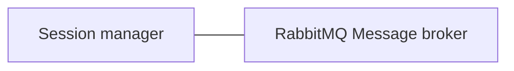

* Session manager: TODO Handle setting up game sessions, and transition the session between the different
      stations until the game is done.
  * RabbitMQ Message broker: Pub-sub server, enable transferring messages among server services.

#### 1.2.4: Related views

* Parent:
* Siblings:
* Children:
  * [Module UsedBy view packet 1.3.3: RabbitMQ](#module-usedby-view-packet-133-rabbitmq)
  * [Module Decomposition view packet 1.1.5: Message broker](#module-decomposition-view-packet-115-message-broker)

### Module UsedBy view packet 1.3.3: RabbitMQ

#### 1.3.3: Primary presentation

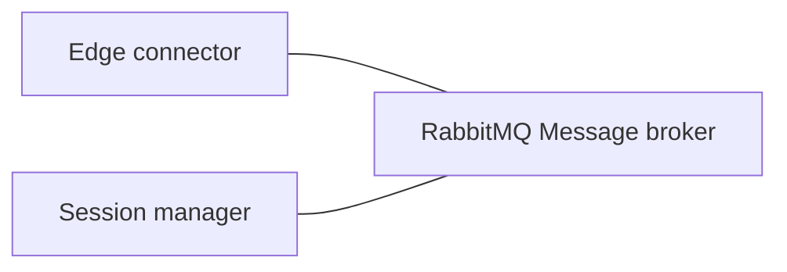

* RabbitMQ Message broker: Pub-sub server, enable transferring messages among server services.

#### 1.3.3: Related views

* Parent:
  * [Module UsedBy view packet 1.3.3: RabbitMQ](#module-usedby-view-packet-133-rabbitmq)
* Siblings:
  * [Module Decomposition view packet 1.1.5: Message broker](#module-decomposition-view-packet-115-message-broker)
* Children:

### Module Layered view packet 1.5.1: Cloud presence layers

#### 1.5.1: Primary presentation

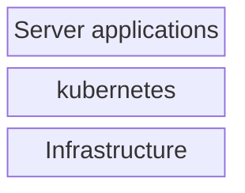

* Server applications: 
* kubernetes: 
* Infrastructure: 


#### 1.5.1: Related views

* Parent:
* Siblings:
* Children:

## CnC

### CnC ClientServer view packet 2.1.1: EdgeConnector

#### 2.1.1: Purpose

Ensure the client is authticated and the payload is valid(not a security risk)

#### 2.1.1: Primary presentation

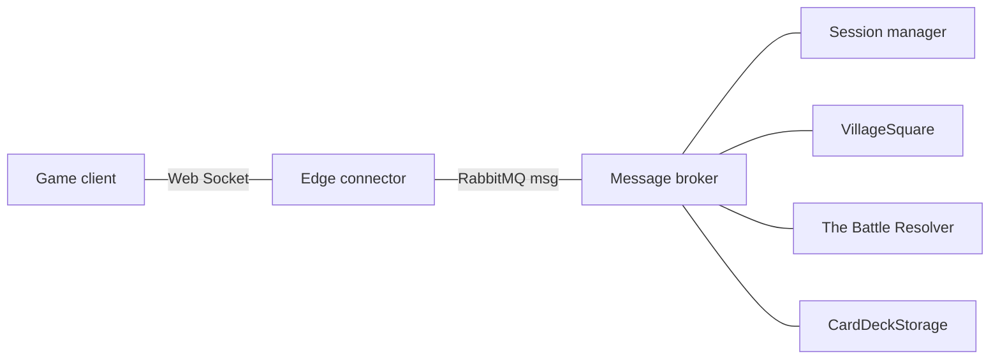


* Components:
  * The Battle Resolver: Execute the battle
  * CardDeckStorage: Holds the current deck, plus any version of deck still being used in an ongoing
      session.
  * Edge connector: Receive client connections, validate the message and route the message.
  * Game client: Application running at the player end.
  * Message broker: Pub-sub server, enable transferring messages among server services.
  * Session manager: TODO Handle setting up game sessions, and transition the session between the different
      stations until the game is done.
  * VillageSquare: Modify the deck for the next battle.


#### 2.1.1: Context diagram

```mermaid
  graph TD;
```

| Entity | Type | Description | Reference |
| ------ | ---- | ----------- | --------- |
| Edge connector | TheWork | Receive client connections, validate the message and route the message. |  |

#### 2.1.1: Element catalog - Element behavior

```mermaid
  sequenceDiagram
```

#### 2.1.1: Related views

* Parent:
  * [CnC ClientServer view packet 2.1.1: EdgeConnector](#cnc-clientserver-view-packet-211-edgeconnector)
* Siblings:
  * [Module Uses view packet 1.2.2: Edge connector](#module-uses-view-packet-122-edge-connector)
  * [Module Decomposition view packet 1.1.4: Edge connector](#module-decomposition-view-packet-114-edge-connector)
* Children:

## Allocation

### Allocation Deployment view packet 3.1.1: Server deployment

#### 3.1.1: Primary presentation

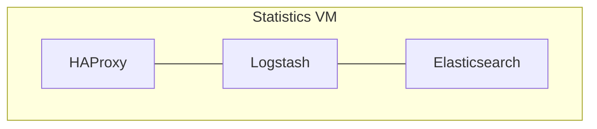

* Components:
  * Elasticsearch: Search and analytics engine for server logs.
  * HAProxy: Load balancer for distributing client requests among server instances.
  * Logstash: Log management and processing tool for server logs.
  * Statistics VM: VM hosting the statistics services.

#### 3.1.1: Related views

* Parent:
* Siblings:
* Children:

### Allocation Install view packet 3.2.1: Statistics server installation

#### 3.2.1: Primary presentation

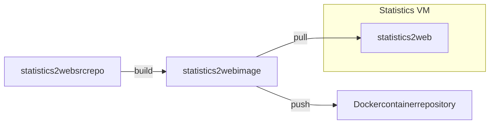

* Components:
  * Docker container repository: 
  * Statistics VM: VM hosting the statistics services.
  * statistics2web: Service for providing player statistics to the web application.
  * statistics2web image: 
  * statistics2web src repo: 

#### 3.2.1: Related views

* Parent:
* Siblings:
* Children:

### Allocation Assignment view packet 3.3.1: Frontender team

#### 3.3.1: Primary presentation

| Component Name | Summary | Reference |
|----------------|---------|-----------|

#### 3.3.1: Related views

* Parent:
* Siblings:
* Children:

### Allocation Assignment view packet 3.3.2: empty team, for error testing

#### 3.3.2: Primary presentation

| Component Name | Summary | Reference |
|----------------|---------|-----------|

#### 3.3.2: Related views

* Parent:
* Siblings:
* Children:

